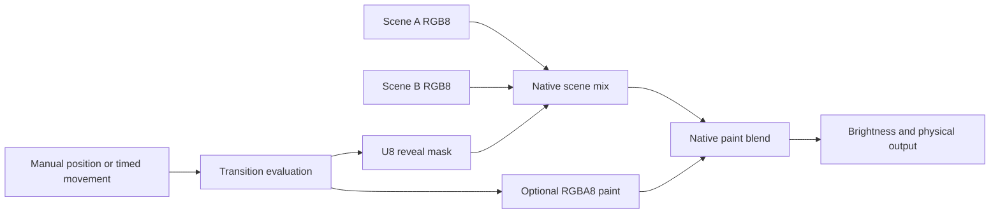

# LightVM A/B Scenes and Transition Programs

Status: Proposed

Date: 17 October 2026

## Purpose

LightVM must have two scene slots, A and B, for one logical output.
The operator can prepare B while A supplies the output.
A transition effect controls the appearance between A and B.
The operator can control the transition position manually or through a timed movement.

The transition effect must supply a reveal mask and optional color paint.
The effects include crossfades, wipes, dissolves, dips through black, and white flashes.
The two scenes continue by default, also after a movement reaches an endpoint.
The operator can move between the scenes again without a restart.

This proposal defines three resources:

- A scene supplies a completed color frame and keeps its animation state.
- A transition definition specifies the appearance at a given position.
- A movement changes that position over a specified duration.

The movement stops when it completes.
The controller keeps the target position.
Completion does not automatically pause or unload a scene.

## Implemented features

The [animation profile](../animation-profile.md) uses portable bytecode and initialization settings.
Each instance owns its state.
Its initialization settings cannot change during playback.
New packages use LBC1/4, execution ABI 4, and schema `lightvm.program/11`.
The compiler does not execute source code.

The [scene compositor](../composition.md) combines layers over opaque black.
Each layer runs independently.
New layers supply premultiplied RGBA8 contributions.
The compositor supplies RGB8 output with `over`, `add`, `screen`, and `multiply` layer modes.
Each layer keeps its own state, clock, and random sequence.

The editor can save scene recipes as presets.
Device preset storage has its own advertised capability.
A saved recipe does not keep a running instance's state.

The engine has scene composition.
It does not have the A/B mixer in this proposal.
The mixer must accept completed scenes from the first implementation.
A single animation can supply a scene with one layer.

This proposal extends the [control API](../control-api.md) and [controller model](../architecture.md).
The future [control model](feature-proposal-control-api.md) gives more context for jobs and resource ownership.
Its proposed general task interfaces are not necessary for this feature.

All new operations and profile names below specify proposed interfaces.
They do not specify implemented firmware capabilities.

## Terms

These technical nouns have one meaning in this proposal.

| Term | Meaning |
|---|---|
| Slot | The name A or B and its bound scene instance. |
| Scene | A sequence of animation layers that supplies one completed RGB8 frame. |
| Contribution | The last completed frame from an animation layer. |
| Position | The controller value `p`, from the A endpoint to the B endpoint. |
| Endpoint | Position 0 for A, or position 65535 for B. |
| Reveal mask | One U8 value per pixel that specifies the contribution from B. |
| Transition paint | An optional premultiplied RGBA8 image above the scene mix. |
| Transition definition | A transition program, its initialization settings, its seed, and its paint blend mode. |
| Movement | A timed job that changes the position from a start value to a target value. |
| Generation | An identifier for one version of a resource instance. |
| Binding revision | An identifier for the active scene bindings and transition definition. |
| Publication | The operation that makes a completed result available to the next stage. |
| Presentation | A completed transfer of an output frame through the native driver. |
| Preparation | Initialization and first-frame evaluation that make a scene or transition available for playback. |
| Movement completion | The movement state after presentation of its target frame. |
| Opaque pixel | A pixel with alpha 255. |
| Transparent pixel | A pixel with alpha 0. |

Technical verbs include compile, render, blend, publish, upload, and unload.
These verbs refer to their computer or graphics operations.
The verbs pause, resume, and restart refer to the specified playback operations.
API identifiers and product names keep their specified spelling.

## Existing practice

These sources give examples from other systems.
The LightVM decisions adapt these examples for an embedded pixel engine.

| Source | Documented behavior | LightVM decision |
|---|---|---|
| [grandMA3 executors](https://help.malighting.com/grandMA3/2.5/HTML/executor_assign.html) | Manual crossfaders control cues. An endpoint can advance the active cue. | The mixer keeps manual control. The operator selects sequential cue actions. |
| [Resolume composition](https://resolume.com/support/en/composition) | A/B buses combine their layers before the crossfader mixes the buses. | The mixer combines each scene before the A/B mix. Slot names do not change. |
| [Ableton Live crossfader](https://www.ableton.com/en/live-manual/12/mixing/) | The crossfader has A/B assignments, selectable response curves, and automation. | Position, mixer response, and timed movement have their own controls. |
| [QLab fades](https://qlab.app/docs/v5/video/fading-video/) | A fade has an option to stop its target after completion. | Movement completion does not control scene lifetime by default. |
| [OBS stinger transitions](https://obsproject.com/kb/track-matte-stinger-transitions) | A transition can combine a scene reveal mask with artwork above the scenes. | The transition effect supplies a reveal mask and optional transition paint. |

Picolights supplies directional wipes with duration and easing.
LightVM must use those shapes through its own implementations.
The [provenance requirements](feature-proposal-control-api.md#prior-art-and-provenance) also apply to transition code and easing functions.

## Scope

The first release must have:

- Two scene slots that run independently for one logical RGB8 output.
- Scene preparation without a change to the output source.
- An A/B position with manual control in the two directions.
- Timed movements between two specified positions.
- A reveal mask and optional transition paint.
- Crossfade, directional wipe, soft wipe, seeded dissolve, and white flash examples.
- Scene pause, resume, restart, and unload operations for each slot.
- Operator-selected completion policies for sequential playback.
- Aggregate memory admission and bounded execution.
- Native playback after a browser or transport disconnection.

The initial geometry is a one-dimensional pixel index.
RGBW mixing, mapped transitions, beat control, playlists, and persistent A/B shows are subsequent extensions.
Image distortion and arbitrary sampling of A/B frames are also subsequent extensions.
Two slots do not supply storage for a third active scene.

## Scene slots

Slot names A and B do not change.
A position change does not rename a slot, copy its state, or restart its scene.
Two instances of the same scene have their own state and clocks.

Mixer activation binds the active scene to A at position 0 without a restart.
A direct animation becomes a scene with one layer without reinitialization.
Activation must pass resource admission before it changes ownership.
An activation error keeps the previous playback path.

If no scene is active, the mixer starts with black output and empty slots.
It permits initial preparation in A at position 0.
Play or Cut starts presentation of that scene.

Each scene keeps its layer order, contributions, and initialization settings.
Animation settings cannot change in an instance.
A settings change starts preparation of a replacement instance.
This proposal does not introduce live animation settings.

Preparation initializes each layer and supplies a completed first scene frame.
After this work completes without an error, the scene is prepared.
Preparation must not exceed the resource limits.
Upload completion alone does not make a scene prepared.

The engine pauses a newly prepared hidden scene by default.
The operator can resume it for a live preview.
Before a movement uses a paused scene, the controller resumes that scene from its saved state.
A scene that runs continues without an interruption.
Restart has its own command.

At an endpoint, the editor identifies the selected slot as **Program**.
The other slot is **Preview**.
Between endpoints, the editor identifies the output as **A/B Mix**.
These labels identify output roles. Slot names do not change.

At an endpoint, the operator can prepare a replacement for the hidden slot.
The controller rejects replacement of a slot that contributes to the output.
It also rejects scene replacement during a movement or at an intermediate position.
This rule prevents an unexpected change to a contributing source.

At an intermediate position, the two slots stay occupied even when movement stops.
The operator must select an endpoint before preparation of a new scene.
The first release has no hidden third slot or automatic queue.

Layer membership, order, and program replacement follow the same slot restrictions.
The documented layer opacity and blend controls can operate between completed frame passes.
Management changes must keep the compositor's contribution ownership rules.

## Position and endpoint rules

The native controller stores position `p` as an integer from 0 through 65535.
The transition program receives the same position as a normalized value from 0 through 1.
The normalized value is the integer position divided by 65535.
The integer position is authoritative.

- Position 0 selects A.
- Position 65535 selects B.
- Intermediate positions select the appearance specified by the transition definition.

The position always has the same A/B orientation.
During movement to A, the value decreases.
Reveal mask value 255 always selects B, also during reverse movement.
The spatial direction of a wipe has its own setting.

At each endpoint, the native compositor bypasses the transition effect.
It selects the frame from the related scene without an A/B blend or transition paint.
These rules also apply to custom transition programs.

An endpoint does not reset the position or release the transition definition.
The controller keeps the settings and seed for subsequent movement in either direction.
The operator can replace the transition definition at an endpoint when no movement runs.

## Reveal mask and transition paint

The transition program supplies a reveal mask in the range 0 through 255.
The mask specifies the B contribution at each pixel.
For each RGB component, the native mixer uses widened integer arithmetic:

```text
base[i] = (A[i] * (255 - mask[i]) + B[i] * mask[i] + 127) // 255
```

Each mask evaluation starts with zero values.
An unwritten mask pixel selects A.
An invalid index or value faults the evaluation.

Transition paint uses the documented premultiplied RGBA8 drawing rules.
Its working frame starts transparent.
Transparent paint leaves the scene mix unchanged.
In `over` mode, opaque black paint sets the result to black.

The native compositor applies transition paint after the scene mix.
The default paint blend mode is `over`.
The first release also has `add`, `screen`, and `multiply` through the documented blend kernels.
One mode applies to the completed paint image.
The paint mode does not change the reveal mask.

For `over`, paint channel `c` includes paint alpha `a`:

```text
output.channel = c + (base.channel * (255 - a) + 127) // 255
```

The mixer uses the documented encoded RGB8 color values.
It does not apply a gamma or linear-light conversion.
A subsequent linear-light mode must have its own capability and color-space contract.

The default crossfade uses complementary weights.
A mix of the same frame with itself thus keeps that frame unchanged.
An audio equal-power curve can increase the result for two copies of the same bright source.
It is not the default pixel mixing rule.

Physical brightness, power limits, and wire order apply one time after the combined mix.
Transition paint stays subject to those native output limits.

## Transition program contract

The new transition profile uses the portable interpreter and documented drawing operations.
It adds a U8 reveal resource and a position context.
Its manifest specifies if transition paint is necessary.
An RGBA paint allocation is not necessary for a mask-only program.

The profile must have these operations:

| Interface | Contract |
|---|---|
| Initialization | The engine prepares initialization settings, bounded storage, and optional cached data. |
| Evaluation | The program supplies the mask and optional paint for one position. |
| Context | The context supplies the pixel count, position, and seed. These values do not change during the resume slices. |
| Mask access | The resource supplies indexed writes and range fills with bounds checks. The last write to an index wins. |
| Paint access | The resource supplies the documented drawing operations for a private RGBA destination. |
| Publication | After evaluation completes, the engine publishes the completed mask and paint together. |

The profile identifier, package version, entry points, and binding IDs are implementation decisions.
The compiler and runtime must do capability checks for the advertised profile and package.
Stored `animation/1` packages keep their documented contract.

The transition result must depend only on position, pixel geometry, initialization settings, and seed.
The same inputs must give the same mask and paint.
Previous position values and evaluation order must not change the result.

The profile does not supply elapsed time, frame delta, or input values that change.
A program cannot advance a random sequence on each evaluation to change its output.
It can use a deterministic hash or data prepared from the seed.
Private caches are permitted when they give the same result.

The controller can reuse a completed mask and paint while the position does not change.
The two scenes can continue without a new transition evaluation.
At an endpoint, the controller can bypass evaluation fully.

Transition programs have no physical output access.
They cannot change A/B frames, scene clocks, slot bindings, or scene lifetimes.
The first release also gives them no A/B frame read access.
The controller owns movement completion and resource release.

VM suspension between execution slices is not a fault.
The device must declare a maximum work limit for each transition evaluation.
The engine reports an error when an evaluation exceeds that total limit.
This new limit does not change the documented animation execution contract.

## Example effects

These examples are pseudocode. They are not implemented SDK interfaces.
The normalized position `p` has the range 0 through 1.
The native endpoint rules apply to each example.

```text
# Crossfade
evaluate(context, mask):
    mask.fill(round(255 * context.position))

# Hard forward wipe
evaluate(context, mask):
    for i in range(mask.count):
        threshold = (i + 0.5) / mask.count
        mask[i] = 255 if context.position >= threshold else 0

# Seeded dissolve
evaluate(context, mask):
    for i in range(mask.count):
        threshold = hash01(i, context.seed)
        mask[i] = 255 if context.position >= threshold else 0

# White flash
evaluate(context, mask, paint):
    p = context.position
    mask.fill(0 if p < 0.5 else 255)
    distance = max(0, abs(p - 0.5) - 0.01)
    alpha = clamp01(1 - distance / 0.09)
    paint.fill(white, alpha=alpha)
```

For a soft wipe, a smooth ramp replaces the hard threshold.
The boundary must travel beyond the two strip ends to include the full soft edge.
Center wipes use distance from the strip center.
A dissolve uses deterministic thresholds, so an unchanged position does not flicker.

The white flash has opaque paint at the switch from A to B.
At 40%, the output is A.
At 50%, the output is white.
At 60%, the output is B.
Movement to A follows the same appearance in reverse.

The native integer position cannot represent 50%.
Paint stays opaque from 49% through 51%.
That interval includes the two integer positions adjacent to the mask switch.

A flash position that does not change can keep white output for a specified duration.
This behavior follows directly from manual position control.
A momentary flash that returns to the same scene is a different timed overlay action.
An A/B scene change is not necessary.

Movement reversal changes the transition appearance, not scene time.
An earlier position gives the same mask and paint again.
The scenes continue to supply new frames.

## Timed movements

A movement owns its start position, target position, duration, and movement curve.
It also owns an identifier and a captured binding revision.
The native controller measures elapsed time with a monotonic clock.

```text
u = clamp(elapsed / duration, 0, 1)
p = round(start + (target - start) * curve(u))
```

The controller applies the curve one time to elapsed time.
The transition program receives the resulting position.
A movement curve must be monotonic and must keep the two endpoints.
Manual position control does not apply that curve.
Position rounding uses `floor(value + 0.5)` after the full movement calculation.

Duration specifies the time for the requested movement.
The controller uses the full two seconds for a movement from 35% to B with that duration.
It does not use a fraction of an assumed full-range duration.
A subsequent constant-speed mode must have its own option.

Mixer response specifies the appearance at a position.
The transition definition owns that response through its mask, paint, and settings.
The movement curve specifies the change of position over time.
Each control must have its own name in the API and editor.

A movement can target a position in the specified range.
On completion, the controller stops the movement and keeps that position.
The two scenes continue by default.
At an intermediate target, the mixer keeps the selected mask and paint.

A movement completes only after presentation of its target frame.
Completion also requires elapsed time equal to or greater than the requested duration.
A rounded target position before that time does not complete the movement.
An overdue movement uses elapsed time and can reach its target on the next completed evaluation.
The controller can omit intermediate positions.
Status distinguishes the requested position from the last presented position.

A new movement starts from the controller position.
It replaces the previous movement without a reset to an endpoint.
The controller first validates a replacement request.
It then cancels the previous movement and its completion policy as one operation.
An invalid replacement request does not change the previous movement.

## Operator controls

| Control | Required behavior |
|---|---|
| Position slider | The controller sets the position directly and cancels the active movement. |
| Hold | The controller cancels the movement and keeps the controller position. The two scenes continue. |
| Auto to A | The controller starts a movement from the controller position to 0. |
| Auto to B | The controller starts a movement from the controller position to 65535. |
| Reverse | The client requests a new movement to the opposite endpoint with a specified duration. |
| Cut to A or B | The controller selects the endpoint immediately, without transition paint. |
| Pause all | The controller pauses scene clocks and the movement clock. It keeps the output. |
| Resume all | The controller restores the previous playback states and excludes the paused time. |
| Stop | The controller cancels movement, holds scenes, and blanks output. It keeps the bindings and position. |
| Play | The controller resumes the mixer from its saved position and previous scene playback selections. |

The Reverse control sends an explicit target endpoint.
The firmware does not infer a target from a direction label.
Hold ends the movement; a subsequent Auto starts a new movement with the selected duration.
Pause all keeps the movement and its saved clock value.

Before a paused hidden scene first contributes, the controller resumes its saved playback selections.
This rule applies to manual control, timed movement, and Cut.
Cut also cancels the active movement and its pending completion policy.

Scene pause and mixer pause have their own controls.
A scene pause keeps that scene's state and contribution.
Resume does not accumulate animation time from the pause interval.
Whole-scene controls must keep layers that the operator deliberately paused in that state.

## Scene lifetime and completion policies

Movement completion, transition definition lifetime, and scene lifetime have their own controls.
After completion, the controller keeps the transition definition and its seed.
The default hidden-scene policy is `continue`.

| Policy | Result after endpoint presentation |
|---|---|
| `continue` | The hidden scene keeps its playback state and loaded resources. |
| `pause` | The hidden scene stays loaded with its state and contribution, but its clock stops. |
| `unload` | The engine releases the hidden scene instance and its animation state. |

An endpoint alone does not apply a new pause or unload policy.
A manual slider can reach either endpoint and return immediately.
The operator can apply a policy explicitly through a Take or Cut command.
Policies that affect a hidden scene are invalid for intermediate targets.

Take is a convenience operation for sequential playback.
It starts an endpoint movement and attaches an explicit hidden-scene policy.
The default stays `continue`.
For example, Take B with `pause` selects B and then pauses A.

The policy runs only after endpoint presentation.
Cancellation, replacement, Hold, Stop, or a fault cancels that pending policy.
Before release, the controller compares the captured scene generation with the bound scene generation.
It must not apply an old completion policy to a replacement scene.

Movement back to a paused scene resumes that scene from its saved state.
Before movement back to an unloaded scene, preparation must complete without an error.
The controller must not silently restart an unloaded scene or release a running scene to satisfy a memory request.

The engine can release completed movement storage without unloading the transition definition.
The operator can replace or release a custom transition at an idle endpoint.
After release, the mixer uses the native crossfade definition.

## Frame processing and ownership



One native owner applies management commands and advances the controller.
It applies commands between frame passes.
The next frame pass uses the new controller position.
Scene renderers publish completed contributions through the documented execution contract.
The mixer reads completed scene frames and a completed transition result.
It submits one combined RGB8 frame to the native output driver.

A composition pass pins each source frame that it reads.
The owner defers changes to those frames until the pass completes.
The driver keeps an immutable transfer frame until completion or cancellation.
The mixer output must not become a scene's simulation state.

Each transfer records its position, binding revision, and movement identifier.
Only a matching active movement can complete after that transfer.
An obsolete transfer must not apply a completion policy.

Scene rendering and transition evaluation use bounded resume slices.
Each transition evaluation keeps its captured position through each slice.
If the slider changes during evaluation, the engine can discard the obsolete result at a safe cancellation point.
It must not combine paint and a mask from different positions.

A slow source supplies its last completed scene frame.
A slow transition evaluation leaves the previous completed transition result available.
The engine must not supply partial frames through output or snapshots.
Scene layer faults follow the documented composition contract.

Snapshots identify the binding revision, frame identifier, and relevant position.
The API distinguishes working results, completed results, and the last presented output.
Snapshot reads do not advance playback.

## Memory and execution limits

Admission must include the two scenes, the transition instance, all frame buffers, and native driver storage.
It must also include temporary storage for preparation of a replacement.
Rendering must not allocate memory.

This reference layout keeps completed results in their own buffers.
`N` is the pixel count.
`L` is the total number of RGBA layers across A and B.

| Storage | Bytes |
|---|---:|
| Layer working and committed contributions | `8 * N * L` |
| Scene A RGB working and committed frames | `6 * N` |
| Scene B RGB working and committed frames | `6 * N` |
| Reveal working and committed masks | `2 * N` |
| Output RGB working, transfer, and last presented frames | `9 * N` |
| Optional paint working and committed frames | `8 * N` |

The mask-only total is `8 * N * L + 23 * N` bytes.
The total with transition paint is `8 * N * L + 31 * N` bytes.
With 200 pixels and two total layers, these totals are 7,800 and 9,400 bytes.
These figures exclude interpreter state, arrays, sprites, metadata, and driver conversion buffers.

This layout specifies the proposed mixer storage.
It does not specify two physical scene presenters.
The mixer owns one physical presenter.
Its source scenes must supply completed RGB frames without their own physical outputs.
The scene storage design must give each owner the necessary buffers.

An implementation can reuse storage only when it keeps the ownership and publication guarantees.
A native crossfade can use one mask value for all pixels.
Paint with one color and alpha can also use scalar storage.
These optimizations must keep the same output and snapshot results.
Discovery must report the actual limits and available optimizations.

Immutable bytecode can stay in shared flash storage.
Each instance keeps its own mutable state and contributions.
Admission uses the measured bytecode instance costs for each target.

Admission checks must count:

- Interpreter registers, call storage, and continuations.
- Initialization arrays, sprite storage, and effect caches.
- Scene frames, transition frames, and physical output frames.
- Native driver conversion buffers and platform state.
- Upload storage and temporary replacement instances.
- Movement records, event records, and management queues.

One aggregate execution budget includes all scene layers and mixer stages.
An instance must not receive its own full output budget.
Measurements must include preparation, rendering, scene composition, transition evaluation, and physical transfer.
The device must report missed frame deadlines and peak memory use.

Two simple scenes can fit when two larger scenes cannot fit.
An unsupported combination must fail before it changes the output.
The error must identify the resource requirement and available capacity.

## Preparation and management API

Upload, preparation, binding, and movement have their own operations.
Preparation must not route candidate output to the physical driver.
A preparation error must not change the output scene or its state.

Replacement must keep the previous hidden scene until candidate preparation completes.
If the preparation peak exceeds capacity, the request fails.
The operator can explicitly unload the hidden scene before a new attempt.
The engine must not unload the hidden scene automatically.

The native event loop must continue service between bounded preparation steps.
Each port must state if preparation can delay new output frames.
Two scene buffers alone do not prove uninterrupted animation during upload or initialization.

These operations specify behavior. Their transport names are implementation decisions:

| Operation | Meaning |
|---|---|
| `upload(kind, ...)` | The client stores a scene, animation, or transition artifact through the object protocol. |
| `prepare(slot, scene, settings)` | The engine prepares an idle hidden slot, or the initial empty A slot. |
| `select_transition(artifact, settings, seed, paint_blend)` | The engine prepares and selects a transition at an idle endpoint. |
| `release_transition()` | The engine releases the custom transition at an idle endpoint and selects the native crossfade. |
| `set_position(value)` | The controller cancels movement and sets a manual position. |
| `move_to(value, duration_ms, curve)` | The controller starts or replaces a movement. It keeps the two scenes after completion. |
| `take(slot, duration_ms, curve, hidden_policy)` | The controller moves to an endpoint and applies the explicit completion policy. |
| `hold()` | The controller cancels movement and keeps the controller position. |
| `cut(slot, hidden_policy)` | The controller selects a prepared endpoint and applies its explicit policy after presentation. |
| `scene_pause(slot)` / `scene_resume(slot)` | The controller changes scene playback without a restart. |
| `scene_restart(slot, settings)` | The engine prepares a new scene instance with the slot replacement rules. |
| `unload(slot)` | The engine releases an idle hidden scene. |
| `pause_all()` / `resume_all()` | The controller pauses or resumes scene clocks and the active movement clock. |
| `stop()` / `play()` | The controller blanks output and holds playback, or resumes the mixer from its saved state. |
| `snapshot(target)` | The client reads a completed scene, mask, paint, or output result with its identifiers. |
| `status()` | The client reads bindings, generations, positions, movement state, errors, and resource use. |

A movement must have a prepared scene in each slot and a selected transition definition.
Its duration must be positive and in the advertised range.
The controller accepts an intermediate manual position only when each slot has a prepared scene.
Cut uses only the selected prepared slot.
Missing or invalid inputs must not change active playback.

Mutations carry expected generations and a binding revision.
Movement commands also carry a retry token.
A repeated token returns the previous result without a new movement.
Commands for an obsolete movement identifier cannot affect its replacement.

The engine keeps only the latest pending slider value.
Command, snapshot, and event queues have declared limits.
Transport callbacks queue commands for the native owner.
They do not execute a guest or change frame storage directly.

Completion, cancellation, and failure cause movement events after the related native state change.
The event identifies the movement and binding revision.
Guest event callbacks must have their own advertised capability.

Discovery must identify the mixer version, transition profile, slot count, pixel format, paint modes, and resource limits.
It must also identify preparation guarantees and supported snapshot targets.
Before deployment, the editor must identify operations that the device cannot do.
The single-program commands keep their documented meaning unless the client explicitly enables the mixer.

## Completion and failure behavior

| Event | Required result |
|---|---|
| Movement completion | The controller keeps the target position and transition definition. The two scenes continue by default. |
| Endpoint Take completion | The controller applies the captured hidden-scene policy after presentation. |
| Manual endpoint selection | The compositor selects the scene frame without a blend or paint. It keeps the two scene instances and the transition definition. |
| Movement replacement or Hold | The controller cancels the old movement and its pending policy. It keeps the controller position. |
| Invalid preparation or movement request | The controller keeps active playback and reports the failed resource and reason. |
| Scene layer fault | The compositor keeps its last completed contribution and stops that layer, as the documented scene contract specifies. |
| Transition fault or work-limit error | The engine discards partial mask and paint. It cancels movement and its policy, and keeps the last presented output and position. |
| Native output failure | The controller retries output and reports the error. Completion and policy execution wait for presentation. |
| Browser or transport disconnection | Native playback continues. A manual position does not change. |
| Pause all | The controller keeps frames and playback selections. All paused clocks exclude the pause interval. |
| Stop | The controller blanks output and cancels movement policies. It keeps loaded scenes, the definition, and the position. |

A transition fault does not rewind scene state.
Healthy scenes can continue without physical presentation until recovery.
Recovery uses Cut to a prepared scene, transition replacement at an endpoint, or Stop.
The output failure path must stay usable without a new guest evaluation.

An electrical transfer cannot roll back pixels that already reached the device.
Presentation status records only completed transfers.
Completion policies must wait for that success.

## Editor and client behavior

The editor must show A, B, their playback states, and their completed previews.
It must also show the transition definition, seed, position, and mixer output.
Optional mask and paint previews help explain a custom transition.
Preview reads must not change device playback.

The position control must keep its A/B orientation after each movement.
The duration control applies to the next requested movement.
Movement curves and transition settings must have their own controls.
The editor must show the default completion policy as `continue`.

A/B project data must keep scene bindings, layer order, artifacts, initialization settings, and default movement options.
Each artifact declares its own version and capability requirements.
A saved scene preset does not save A/B bindings or movement state.
Persistence of an A/B show must have its own capability.

The desktop client must have the same preparation and movement operations.
The browser is not the playback clock.
Local preview must use the same position conversion, rounding, endpoint rules, and paint blend rules as firmware.
Preview comparison uses the same completed scene frames and transition inputs.

## Delivery sequence

1. The native core gives scene frames and physical presentation their own buffers and admits two scene slots.
2. The mixer adds A/B position, Cut, native crossfade, scene policies, and passive snapshots.
3. The controller adds timed movements, manual takeover, pause, cancellation, and completion events.
4. The transition profile adds reveal programs, optional paint, and atomic publication of the two results.
5. The example library adds wipes, seeded dissolve, and a white flash with opaque paint at its switch.
6. The editor and desktop client supply the controls and report combined resource use.
7. Host and hardware measurements establish supported scene sizes and output rates for each port.

Each delivery step keeps the documented single-program and scene APIs.
The first usable A/B mixer must accept layered scenes in its declared limits.

## Acceptance criteria

- B and a transition can prepare while A supplies the output.
- Mixer activation keeps the active scene's state. An empty mixer can prepare A before playback.
- A preparation error does not change the output scene or the previous hidden scene.
- A settings change uses replacement preparation. Settings do not change in other instances.
- The two scenes advance at an unchanged intermediate position and after endpoint completion.
- Two instances of the same scene keep their own animation state and random sequences.
- Position 0 selects A without a blend or paint. Position 65535 selects B with the same rules.
- Reverse movement keeps the same A/B orientation, seed, reveal mask, and paint rules.
- Repeated visits to a position reproduce the mask and paint without a scene rewind.
- A seeded dissolve does not flicker at an unchanged position.
- A white flash supplies white above two black scenes and has opaque paint at its scene switch.
- Native and local preview results agree at the integer positions adjacent to that switch.
- A movement from 35% to B uses its full specified duration.
- An early rounded target position does not cause early completion or scene release.
- Manual takeover and movement replacement start without an endpoint reset.
- Movement completion, manual endpoint selection, and Hold do not unload a scene by default.
- Operator-selected pause and unload policies run only after endpoint presentation.
- Cancellation and stale identifiers cannot release a replacement scene.
- A paused scene resumes its saved state. An unloaded scene must complete preparation first.
- The controller rejects scene replacement during movement and at an intermediate position.
- Partial source, mask, paint, and output frames do not appear as completed snapshots.
- A transition fault keeps the last presented output and leaves Cut and Stop available.
- Native output failure retries without false completion or hidden-scene release.
- Disconnection does not stop automatic movement or native scene playback.
- Pause all keeps individual layer selections and excludes paused time.
- Rendering performs no allocation, and repeated preparation does not leak resources.
- Admission includes layered scenes, optional paint, and replacement memory peaks.
- Host, Pico, and supported ESP32 measurements include completed frame and physical transfer costs.

## Writing reference

This proposal uses the descriptive writing rules of [ASD-STE100 Issue 9](https://www.asd-ste100.org/assets/files/ASD-STE100_ISSUE9.pdf).
The technical terms above supplement the general dictionary for this subject field.
The word `must` identifies a requirement for the proposed implementation.
