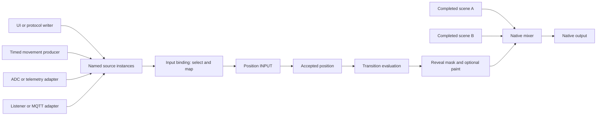
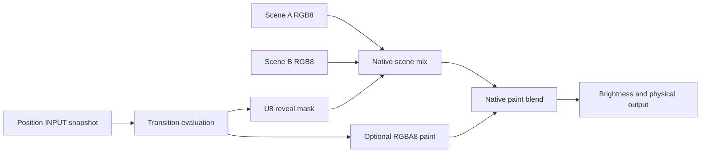

# LightVM A/B Scenes, INPUT, and Transition Programs

Status: Proposed

Date: 17 October 2026

Implementation baseline: commit `f5a860b`, application release `1.0.0`.

## Purpose

LightVM must have two scene slots, A and B, for one logical output.
The operator can prepare B while A supplies the output.
A transition effect controls the appearance between A and B.
An INPUT supplies the position that controls the transition effect.

A source supplies a value to an INPUT through an input binding.
The source can be a timed movement, a UI slider, a sensor, or a message adapter.
Each compatible source uses the same INPUT contract.
The transition effect does not need to know which source supplies the position.

These parts have different functions:

- A scene supplies a completed color frame and keeps its animation state.
- A source publishes samples of a typed value.
- An input binding selects a source and converts its samples for an INPUT.
- An INPUT supplies a stable value to its consumer.
- A transition definition specifies the appearance at a given position.
- A movement is a timed job that supplies position samples.
- The mixer combines the scene frames, reveal mask, and optional transition paint.

The transition effect supplies a reveal mask and optional transition paint.
Examples include crossfades, wipes, dissolves, dips through black, and white flashes.
The two scenes continue by default, also after a movement completes.
The operator can move between the scenes again without a restart.

## Implemented features

The [animation profile](../animation-profile.md) uses portable bytecode and initialization settings.
Each instance owns its state.
Its initialization settings cannot change during playback.
Packages declare a minimum [application release](../versioning.md), independently of compiler provenance.
The compiler does not execute source code.

The [scene compositor](../composition.md) combines layers over opaque black.
Each layer runs independently.
New layers supply premultiplied RGBA8 contributions.
The compositor supplies RGB8 output with `over`, `add`, `screen`, and `multiply` layer modes.
Each layer keeps its own state, clock, and random sequence.

The editor can save scene recipes as presets.
Device preset storage has its own advertised capability.
A saved recipe does not keep a running instance's state.

The baseline has one slot A for each configured pixel output.
The baseline does not have an A/B mixer, live INPUT, input bindings, or scalar producer programs.
The baseline has no ADC, sensor, or MQTT input drivers.
USB and HTTP commands use the same native management owner.

This proposal extends the [control API](../control-api.md) and [controller model](../architecture.md).
The future [control model](feature-proposal-control-api.md) supplies requirements for samples, events, jobs, and ownership.
The [device proposal](feature-proposal-device-support.md) supplies requirements for peripheral drivers.
A general task system is not necessary for the first native INPUT implementation.

Current animation callbacks receive pixel count, program time, and frame delta.
The current compiler and runtime reject additional runtime arguments and scalar-only outputs.
Guest access to INPUT needs a compiler and runtime extension.
The first native input bindings do not require that extension.

The current management operation `program_state` reports animation state and frozen settings.
The removed operations `program_parameters_get` and `program_parameters_set` do not supply live INPUT.
This proposal does not restore those operations or a retired runtime.

All new operations below are proposed interfaces.
They do not identify implemented firmware capabilities.

## Terms

These technical nouns have the meanings in the tables below.
The document uses one term for each concept.
API identifiers, document kinds, and product names keep their specified spelling.
The short form binding means input binding unless the text specifies a slot binding.

### System and image terms

| Term | Meaning |
|---|---|
| Controller | The physical LightVM device and its native management logic. |
| Engine | The native software that manages resources, executes programs, and schedules work. |
| Native software | Software that executes outside the guest interpreter. |
| Native owner | The one execution context that changes engine state and enters guest code. |
| Guest | A program that executes in the portable bytecode interpreter. |
| Callback | A guest entry point that the engine invokes for a specified operation. |
| Driver | Native software that operates physical hardware or a transport. |
| Resource | An engine object that has an identity, generation, owner, and bounded lifetime. |
| Instance | One prepared resource and its private mutable state. |
| Capability | An available function, with declared types, operations, and resource limits. |
| Artifact | A stored program or data document used to prepare a resource. |
| Bytecode | Typed instructions that the portable interpreter executes. |
| Manifest | Metadata in a program artifact that declares its release requirements, settings, and resource needs. |
| Transport | A communication path, such as USB or HTTP, that carries management requests or source data. |
| UI | The user interface through which an operator controls the system. |
| Setting | An initialization value that stays fixed for the lifetime of an instance. |
| Slot | The fixed name A or B and its bound scene instance. |
| Slot binding | The selection of a scene instance for a slot. |
| Layer | One animation instance and its position in a scene. |
| Scene | An ordered set of layers that supplies a completed RGB8 frame. |
| Frame | One complete image for a specified pixel count. |
| Frame pass | One calculation that publishes a complete frame. It can use several resume slices. |
| Working frame | An image under calculation that is not available as a completed result. |
| Committed frame | A completed image that an owner has published for readers. |
| Transfer frame | An immutable image that the native driver keeps until transfer completion or cancellation. |
| Presenter | The native component that submits transfer frames and records physical output completion. |
| Contribution | The last completed frame from a layer. |
| Mixer | The native component that combines completed A and B frames. |
| Position | The accepted controller value `p`, from 0 through 65535. |
| Requested position | A candidate position that has not yet passed controller validation. |
| Evaluated position | The position related to a completed reveal mask and transition paint. |
| Presented position | The position related to the last successfully presented output frame. |
| Endpoint | Position 0 for A, or position 65535 for B. |
| Hidden scene | The scene in the slot that contributes no image at the selected endpoint. |
| Idle endpoint | An endpoint with no movement and no active external input binding. |
| U8 | An unsigned integer from 0 through 255. |
| RGB8 | Three U8 channels that specify red, green, and blue. |
| RGBA8 | RGB8 plus a U8 alpha channel. |
| RGBW | Red, green, blue, and a separate white emitter channel. |
| Alpha | The coverage value of an RGBA8 pixel. |
| Opacity | A U8 layer control that scales layer color and alpha during composition. |
| Premultiplied RGBA8 | RGBA8 in which each color channel already includes the effect of alpha. |
| Opaque pixel | A pixel with alpha 255. |
| Transparent pixel | A pixel with alpha 0. |
| Weight | A numeric factor that specifies how much a scene channel contributes to a mix. |
| Reveal mask | One U8 value per pixel that specifies the weight of B. |
| Transition paint | An optional image in premultiplied RGBA8 above the scene mix. |
| Transition program | Guest code that calculates a reveal mask and optional transition paint for one position. |
| Transition definition | A transition program or native effect, its settings, its seed, and its paint blend mode. |
| Transition effect | The appearance that a transition definition produces at a specified position. |
| Seed | A fixed value that makes a random pattern repeatable. |
| Blend mode | The arithmetic rule that combines an image with the image below it. |
| Geometry | The pixel count and spatial coordinates available to an effect. |
| Crossfade | A scene mix with the same reveal value at every pixel. |
| Wipe | An effect in which a spatial boundary separates A and B. |
| Soft wipe | A wipe with a gradual change between A and B near the spatial boundary. |
| Dissolve | An effect that selects B through repeatable thresholds at different pixels. |
| White flash | An effect that covers the scene switch with opaque white transition paint. |

### INPUT terms

| Term | Meaning |
|---|---|
| INPUT | A typed logical port through which a consumer receives a value that can change. |
| Consumer | A native component or guest that reads an INPUT. |
| Producer | Native software or guest code that supplies values to a source. |
| Source | A named resource that publishes samples of one typed signal. |
| Signal | The value represented by a source as that value changes over time. |
| Sample | A source value with capture time, sequence, generation, and validity. |
| Input snapshot | The stable input values captured for one consumer evaluation. |
| Delivery boundary | A scheduler point at which the native owner can supply a new input value without changing an active evaluation. |
| Input binding | The resource that selects one source, converts its samples, and controls delivery to one INPUT. |
| Input drive | The selected source and binding that can change accepted position. |
| External binding | An input binding selected through the explicit Bind control. It excludes the internal manual and movement bindings. |
| Mapping | The conversion from a source range and unit to the range and unit of an INPUT. |
| Normalized value | A dimensionless fraction from 0 through 1. |
| Filter | A specified operation that reduces noise or limits sample changes. |
| Deadband | A range of changes that a configured filter ignores. |
| Endpoint snapping | A mapping rule that converts a configured endpoint interval to the exact endpoint. |
| Valid sample | A sample that passes the source type, range, and availability checks. |
| Fresh sample | A valid sample whose age does not exceed the configured maximum age. |
| Stale sample | A sample whose age exceeds that maximum age. |
| Adapter | Native software that converts transport data or peripheral data into typed samples. |
| ADC | An analog-to-digital converter that measures an electrical input. |
| Telemetry | Measurements of internal controller state, such as CPU temperature. |
| CPU | The central processor of the controller. |
| MQTT | A message protocol that an optional adapter can use to receive source values. |
| Manual takeover | An explicit control action that replaces the active input binding with a manual value. |

### Time, identity, and lifetime terms

| Term | Meaning |
|---|---|
| Monotonic clock | A native clock that moves forward independently of calendar time. |
| Program clock | An instance clock that excludes time while the instance is paused. |
| Movement | A timed job that publishes position samples from a start value to a target value. |
| Job | An action that continues over time and has an identity and a terminal state. |
| Movement curve | A function that converts normalized elapsed time to normalized movement progress. |
| Movement completion | A terminal job state reached after the duration expires and the engine presents a matching target frame. |
| Completion policy | An explicit instruction to continue, pause, or unload the hidden scene after endpoint presentation. |
| Event | An ordered record that an occurrence happened. A sample is current state, not an event. |
| Sequence | A number that increases for each accepted sample from one source generation. |
| Writer sequence | A number that increases for each write under one writer identity. |
| Generation | An identifier for one resource lifetime. A replacement receives a different generation. |
| Binding revision | An identifier for the bound scenes and selected transition definition. |
| Input generation | An identifier for one activation of input drive at a consumer. Sample updates do not change this identifier. |
| Writer identity | An identifier that authorizes one producer to update a writable source. |
| Retry token | An identifier that prevents a repeated request from starting the same action again. |
| Non-idempotent action | An action that can create additional work if the engine executes the same request again. |
| Terminal state | A job state of completed, canceled, or failed that accepts no further progress. |
| Admission | Checks and reservations that prove a resource fits the available limits before activation. |
| Preparation | Initialization and evaluation that supply the first completed result without physical presentation. |
| Evaluation | One bounded calculation using captured arguments and an input snapshot. |
| Resume slice | A bounded part of an evaluation that can continue in a later scheduler pass. |
| Publication | The operation that makes a completed result available to its consumer. |
| Presentation | A successfully completed transfer of an output frame through the native driver. |
| Hold | The control that cancels input drive and keeps the accepted position. |
| Pause | Suspension that keeps state and excludes the pause interval from the related program clocks. |
| Stop | The control that cancels input drive, holds scenes, and requests black physical output. |

### Technical verbs

These verbs describe computer or graphics operations in this document.
Other uses keep their approved general meanings.

| Verb | Technical meaning |
|---|---|
| Bind | Connect a resource to its consumer under a checked binding. |
| Blend | Combine image channels with a specified blend mode. |
| Clamp | Limit a number to a specified closed range. |
| Coalesce | Keep only the latest of several state samples pending for one source. |
| Compile | Convert checked source code into portable bytecode. |
| Capture | Read and keep a value for a sample or evaluation. |
| Compose | Combine ordered layer contributions into a completed scene frame. |
| Decode | Convert transport data into a specified data representation. |
| Deliver | Make a selected sample available to an INPUT at its delivery boundary. |
| Evaluate | Calculate one result from captured arguments. |
| Filter | Apply the declared operation that reduces noise or limits sample changes. |
| Map | Convert a value between declared ranges or units. |
| Pin | Keep a resource unchanged and available while an owner uses it. |
| Publish | Make one completed value or image available to its consumer. |
| Render | Calculate one animation contribution. |
| Resume | Continue suspended execution from the state kept at suspension. |
| Unload | Release an instance and its mutable state. |
| Upload | Transfer an artifact to the controller. |

## How the parts interact

The control path supplies position.
The image path supplies the pixels displayed at that position.
The two paths meet at transition evaluation and the mixer.



The source box represents separate source instances, not one shared writable value.
Each source has one producer authority.
An INPUT has one active input binding.
One source can supply several INPUTs through separate input bindings.

The mixer owns a position INPUT.
Its input binding selects a compatible source and produces a requested position.
The controller validates that request before it changes position.
Transition evaluation then captures the accepted position.
Scene clocks continue independently of the source cadence.

The transition program receives position, not a sensor handle or a transport message.
At an unchanged position, the engine can reuse the completed transition result.
The scenes can still publish new frames.
A source change does not restart either scene.

## Application releases and compatibility

The [application release contract](../versioning.md) governs this proposal.
Program artifacts use the unversioned document kind `lightvm.program`.
The field `compiler_version` records provenance.
The field `requires` declares the minimum application release within the same major release.

The compiler must raise `requires` when it emits an INPUT or transition feature introduced after the baseline.
The introducing release must be specified before that feature ships.
This proposal does not assign that release number.
An explicit requirement below the feature minimum must cause a compiler diagnostic.

Optional capabilities and limits describe the actual firmware build.
Application release compatibility alone does not prove that an ADC driver or MQTT adapter is available.
The engine must check required capabilities, configured resources, and aggregate admission.
The editor must show missing capabilities before deployment.

These additions must use the shared interpreter and application release contract.
They must not introduce independent INPUT, mixer, schema, drawing API, or interpreter release counters.
The current `animation` authoring name and existing animation behavior remain unchanged.
New entry points and binding IDs need definitions before implementation.
Those definitions do not create a second compatibility system.

Current management uses the fixed `LVM1` frame marker over USB and HTTP.
The new operations must use that management path.
The baseline has no adapter for retired packages or the former `WASM` frame marker.
The release guide specifies the [pre-baseline cutover](../versioning.md#pre-baseline-cutover).

## Existing practice

These references give examples from other systems.
The LightVM decisions adapt these examples for an embedded pixel engine.

| Reference | Documented behavior | LightVM decision |
|---|---|---|
| [grandMA3 executors](https://help.malighting.com/grandMA3/2.5/HTML/executor_assign.html) | Manual crossfaders control cues. An endpoint can advance the active cue. | The mixer keeps manual control. The operator selects sequential cue actions. |
| [Resolume composition](https://resolume.com/support/en/composition) | A/B buses combine their layers before the crossfader mixes the buses. | The mixer combines each scene before the A/B mix. Slot names do not change. |
| [Ableton Live crossfader](https://www.ableton.com/en/live-manual/12/mixing/) | The crossfader has A/B assignments, selectable response curves, and automation. | Position, mixer response, and timed movement have their own controls. |
| [QLab fades](https://qlab.app/docs/v5/video/fading-video/) | A fade has an option to stop its target after completion. | Movement completion does not control scene lifetime by default. |
| [OBS stinger transitions](https://obsproject.com/kb/track-matte-stinger-transitions) | A transition can combine a scene reveal mask with artwork above the scenes. | The transition effect supplies a reveal mask and optional transition paint. |

Picolights supplies directional wipes with duration and easing.
LightVM must use those shapes through its own implementations.
The [provenance requirements](feature-proposal-control-api.md#prior-art-and-provenance) also apply to transition code and easing functions.

## Scope

The first A/B and INPUT release must have:

- Two scene slots that run independently for one logical RGB8 output.
- Scene preparation without a change to the selected output scene.
- A position INPUT with one active input binding.
- A writable scalar source for manual control over USB and HTTP.
- A native movement source with duration and a movement curve.
- Source identity, sample validity, input ownership, and status.
- Explicit source selection, manual takeover, Hold, and pause behavior.
- Timed movements between two specified positions.
- A reveal mask and optional transition paint.
- Crossfade, directional wipe, soft wipe, seeded dissolve, and white flash examples.
- Scene pause, resume, restart, and unload operations for each slot.
- Operator-selected completion policies for sequential playback.
- Aggregate memory admission and bounded execution.
- Native playback after a browser or transport disconnection.

ADC, peripheral sensors, telemetry, port listeners, and MQTT are later source adapters.
Their adapters must use the same source, sample, and input binding contracts.
Support for one adapter must not require every other adapter.
Each adapter must declare its sampling cadence, units, validity, and resource costs.

Custom scalar producer programs and guest INPUT access are later compiler and runtime extensions.
They must use stable input snapshots and bounded execution in the shared interpreter.
A transition program and a scalar producer program have different functions.
A producer can depend on time; transition appearance must remain repeatable at a specified position.

The initial geometry is a one-dimensional pixel index.
RGBW mixing, mapped transitions, beat control, playlists, and persistent A/B shows are later extensions.
Image distortion and arbitrary sampling of A/B frames are also later extensions.
Two slots do not supply storage for a third active scene.

## Sources and samples

A source represents one typed signal.
Source metadata must identify its name, generation, type, unit, range, producer authority, and availability.
Native configuration owns physical pins, buses, drivers, and sampling intervals.
An input binding refers to a source identity, not a physical pin.

The initial source types are Boolean, integer, finite real number, and normalized fraction.
A normalized fraction uses an unsigned integer from 0 through 65535 on the management path.
Its numeric meaning is the integer divided by 65535.
Integer and real sources keep their declared units.
A source must not represent a temperature as a fraction without a declared mapping.

Each sample must identify its source generation, sequence, capture time, value, and validity.
An invalid sample has no usable numeric value.
Source replacement must invalidate the old generation.
A binding must not select a replacement automatically because the replacement has the same name.

Native capture time uses the monotonic clock.
A remote adapter must record local receipt time separately from any remote capture time.
An unsynchronized remote clock must not determine native sample age.
Cached or retained messages must not imply a fresh measurement without a declared freshness rule.

A measurement source must declare a maximum sample age before binding.
A binding can specify a shorter maximum age, but must not extend the source maximum.
A held manual value remains valid until an explicit control action replaces it.
It does not expire as a measurement does.
The native movement source remains valid while its movement job is active.

Each writable source must have one writer identity.
The engine must reject writes from an obsolete source generation or writer identity.
The engine must reject duplicate or decreasing writer sequences.
A writer change must invalidate the previous writer identity.
USB and HTTP must use the same checks.
After an accepted write, the native owner assigns the next source sequence.

The native owner publishes source updates at defined scheduling boundaries.
An interrupt, driver callback, or network callback must not enter guest code or change position directly.
Sample storage and pending updates must have fixed limits.
The engine can keep only the latest pending state sample for a source.
The engine must report coalesced and discarded sample counts.

Events have a different delivery contract.
A button press, movement completion, or explicit Take request is an occurrence.
An event must not disappear through sample replacement.
Event queues must preserve accepted order and report overflow.
The first native INPUT implementation does not require guest event handlers.

## INPUTs and input bindings

An INPUT describes a consumer requirement.
Its metadata must specify the accepted type, unit, range, delivery boundary, and behavior when no valid sample exists.
The position INPUT accepts a normalized fraction.
The controller stores its accepted value as position `p`.
The native mixer owns this INPUT; an animation setting does not own it.

An input binding selects exactly one source generation for one INPUT.
The binding owns its mapping, filter state, maximum sample age, and input generation.
Different bindings to one source keep separate filter state.
The engine must reserve these resources before activation.
The source remains independent of the consumers that read it.

The native source registry must be independent of the pixel output registry.
The current pixel driver table accepts pixel configuration and cannot directly describe an ADC or sensor driver.
Native configuration must validate shared pins and other hardware reservations across both registries.
Removing a consumer must not release a source still used by another consumer.
Explicit source removal requires source ownership and the expected source generation.
The owner must disable dependent bindings before it releases the source and pending references.

The engine must validate a candidate binding before it replaces the active binding.
Validation must check source availability, sample validity, types, units, mapping, ownership, and resource limits.
An external binding to position must also require two prepared scenes.
A failed Bind request must keep the previous binding and position.
The initial accepted sample must pass the same checks as later samples.

The first implementation permits one active binding per INPUT.
It does not combine competing writers by arrival time.
Source combination, feedback loops, and arbitrary routing graphs are later extensions.
Those extensions need their own ownership and execution rules within the application release contract.

### Mapping and filtering

A compatible source either matches the INPUT type and unit or has an explicit conversion.
The binding must reject an unsupported conversion.
A Boolean source can select A or B through an explicit Boolean-to-endpoint mapping.
Text, images, and message payloads cannot directly supply the position INPUT.
An adapter must first decode and validate a typed value.

A linear mapping uses configured source limits `low` and `high`.
The value of `high` must exceed `low`.
For a valid numeric sample `x` without a filter, the mapping is:

```text
q = clamp((x - low) / (high - low), 0, 1)
q = 1 - q                         # Only when inversion is selected.
p = floor(q * 65535 + 0.5)
```

The value `q` is the mapped normalized fraction.
The value `p` is the requested integer position.
Mapping arithmetic must not overflow.
A failed conversion must reject the sample.

Clamping after a valid sample conversion is part of the mapping.
It does not turn an invalid source sample into a valid value.
The binding must reject non-finite values and invalid limits.
The mapping must preserve the exact two endpoints.

Filtering is optional and must be explicit.
The default normalized binding has no smoothing, deadband, or endpoint snapping.
A configured filter operates after mapping and before final position rounding.
Endpoint snapping operates after the filter and before final rounding.
Discovery must describe the supported filter rules and their timing.

A filter must have bounded state and a declared latency.
Endpoint snapping intervals must not overlap.
The editor must show the configured conversion and its effect on the input range.
A noisy ADC must not require exact raw equality to reach an endpoint when endpoint snapping is configured.
Changing mapping or filter settings requires activation of a replacement binding.

A replacement filter starts from the accepted position at activation.
It must not inherit filter state from the previous binding.
Its clock starts at activation and excludes periods without a fresh valid sample.

The native movement binding uses an identity mapping with no filter.
The controller must apply the movement curve only once.
It must not smooth a movement target after the movement duration expires.

### Source examples

The names below illustrate resources and bindings.
They do not define source code syntax or management field names.

| Source | Published value | Binding to position |
|---|---|---|
| Native movement | Position from the movement calculation | The binding preserves the supplied position. |
| UI slider over USB or HTTP | A normalized fraction | The binding preserves the supplied position. |
| Potentiometer on an ADC pin | A measured integer in the declared ADC range | The binding maps calibrated limits and can filter noise. |
| CPU temperature telemetry | A finite real number in degrees Celsius | The binding maps a configured temperature interval to A through B. |
| Peripheral sensor | A typed measurement with declared units | The binding applies the selected range conversion. |
| Port listener or MQTT adapter | A validated typed value | The binding uses the same conversion and freshness rules as a local source. |

For example, a temperature binding can map 30 degrees Celsius to A and 60 degrees Celsius to B.
At 45 degrees Celsius, the requested position is 32768 after rounding.
An unavailable temperature must keep the accepted position; it must not select A as if the measurement were zero.
The transition effect uses the resulting position without temperature-specific code.

### Input ownership and takeover

Every position change must pass through the selected input binding and the native owner.
Each mixer has an internal manual source.
Its value changes only through an explicit position control action.
The internal manual binding selects that source.
The internal movement binding selects the active movement source.
An external binding selects a source through the Bind control.

A direct position command and a writable source update have different authority.
A direct position command requests manual takeover.
A writable source update changes that source only.
It cannot select a binding or cancel a movement.

An accepted manual position command performs manual takeover.
The controller cancels the active movement and its completion policy.
It disables any external binding, selects the internal manual binding, and sets position.
Auto selects a new internal movement binding.
Bind cancels the movement and selects the validated external binding.
Cut selects the internal manual binding at an endpoint.

Each binding selection or disable action must advance the input generation.
The engine must discard pending position requests from the previous input generation.
Normal samples must not change the input generation or binding revision.
Manual updates within the same selected manual binding also keep its input generation.

Manual updates must use the writer identity and sequence checks for the internal manual source.
Takeover by a different writer must advance the input generation and invalidate the previous writer identity.
The binding must reject new sample updates from an obsolete source generation or source sequence.
These checks prevent delayed samples from restoring control after takeover.

The source can continue sampling when its input binding is disabled.
Disabled bindings must not change accepted position.
The editor must identify the selected source and indicate whether delivery is active, paused, or disabled.
Selecting an endpoint does not grant a different source ownership.

### Missing, stale, and removed sources

The binding must reject invalid samples without changing accepted position.
When a sample becomes stale, the binding must keep accepted position and report stale status.
Invalid or stale samples must not advance filter state.
The scenes continue under their existing playback selections.
The engine must not start a movement or select an endpoint as an implicit fallback.

An active external binding can continue delivery after a fresh valid sample arrives.
The engine must not change ownership during that recovery.
If the source is removed or its generation changes, the engine must disable the external binding and keep position.
The controller selects the internal manual source at that position.
The operator must bind the new source explicitly.
An initial Bind request without a fresh valid sample must fail.

A remote source must declare its maximum sample age before binding.
A transport disconnection must not cancel a native movement or stop scene playback.
The last manual value stays selected after disconnection.
A remote source stops changing position when its last sample becomes stale.

### Hold, pause, and Stop

Hold cancels a movement and its completion policy.
It disables external delivery and selects the internal manual binding at the accepted position.
The two scenes continue.
Further samples cannot change position until the operator selects a source again.

Pause all keeps the selected binding, accepted position, and scene playback selections.
It suspends binding delivery, filter advancement, scene clocks, and the movement clock.
Native sampling and transport reception continue within their bounds.
The engine keeps the latest accepted source sample while paused.

Resume all restores the saved playback selections.
A paused movement excludes the pause interval from elapsed time.
An external binding uses its latest fresh valid sample at the next delivery boundary.
The default unfiltered binding can therefore change position immediately after Resume all.
A stateful filter resumes from the held value without elapsed-time debt from the pause.
An invalid or stale sample keeps position and the related status.

Stop cancels a movement and its completion policy, disables external delivery, and selects the internal manual binding at accepted position.
It holds scenes and requests black physical output.
Source updates cannot resume presentation.
Play restores scene playback selections at the held manual position.
Play does not restore an external binding or restart a canceled movement.

## Scene slots

Slot names A and B do not change.
A position change does not rename a slot, copy its state, or restart its scene.
Two instances of the same scene have their own state and clocks.

Mixer activation binds the active scene to A at position 0 without a restart.
A direct animation becomes a scene with one layer without reinitialization.
Activation must pass resource admission before it changes ownership.
An activation error keeps the previous playback path.

If no scene is active, the mixer starts with black output and empty slots.
It permits initial preparation in A at position 0.
Play or Cut starts presentation of that scene.

Each scene keeps its layer order, contributions, and initialization settings.
Animation settings cannot change in an instance.
A settings change starts preparation of a replacement instance.
This proposal does not introduce live animation settings.

Preparation initializes each layer and supplies a completed first scene frame.
After this work completes without an error, the scene is prepared.
Preparation must not exceed the resource limits.
Upload completion alone does not make a scene prepared.

The engine pauses a newly prepared hidden scene by default.
The operator can resume it for a live preview.
Before a movement uses a paused scene, the controller resumes that scene from its saved state.
A scene that runs continues without an interruption.
Restart has its own command.

At an endpoint, the editor identifies the selected slot as **Program**.
The other slot is **Preview**.
Between endpoints, the editor identifies the output as **A/B Mix**.
These labels identify output roles. Slot names do not change.

At an idle endpoint, the operator can prepare a replacement for the hidden slot.
The controller rejects replacement of a slot that contributes to the output.
It also rejects scene replacement during a movement, an active external binding, or an intermediate position.
This rule prevents an unexpected change to a contributing scene.

Hold disables external delivery before preparation or transition replacement.
A brief endpoint sample from a sensor does not unlock scene replacement.
Source sampling can continue during preparation without control of position.

At an intermediate position, the two slots stay occupied even when movement stops.
The operator must select an endpoint before preparation of a new scene.
The first release has no hidden third slot or automatic queue.

Layer membership, order, and program replacement follow the same slot restrictions.
The documented layer opacity and blend controls can operate between completed frame passes.
Management changes must keep the compositor's contribution ownership rules.

## Position and endpoint rules

The native controller stores position `p` as an integer from 0 through 65535.
The transition program receives the same position as a normalized value from 0 through 1.
The normalized value is the integer position divided by 65535.
The integer position controls position comparisons and endpoint checks.

- Position 0 selects A.
- Position 65535 selects B.
- Intermediate positions select the appearance specified by the transition definition.

The position always has the same A/B orientation.
During movement to A, the value decreases.
Reveal mask value 255 always selects B, also during reverse movement.
The spatial direction of a wipe has its own setting.

At each endpoint, the native compositor bypasses the transition effect.
It selects the frame from the related scene without an A/B blend or transition paint.
These rules also apply to custom transition programs.

An endpoint does not reset the position or release the transition definition.
The controller keeps the settings and seed for later movement in either direction.
The operator can replace the transition definition only at an idle endpoint.

## Reveal mask and transition paint

The transition program supplies a reveal mask in the range 0 through 255.
The mask specifies the weight of B at each pixel.
For each RGB component, the native mixer uses widened integer arithmetic:

```text
base[i] = (A[i] * (255 - mask[i]) + B[i] * mask[i] + 127) // 255
```

Each mask evaluation starts with zero values.
An unwritten mask pixel selects A.
An invalid index or value faults the evaluation.

Transition paint uses the documented drawing rules for premultiplied RGBA8.
Its working frame starts transparent.
Transparent paint leaves the scene mix unchanged.
In `over` mode, opaque black paint sets the result to black.

The native compositor applies transition paint after the scene mix.
The default paint blend mode is `over`.
The first release also has `add`, `screen`, and `multiply` through the documented blend kernels.
One mode applies to the completed paint image.
The paint mode does not change the reveal mask.

For `over`, paint channel `c` includes paint alpha `a`:

```text
output.channel = c + (base.channel * (255 - a) + 127) // 255
```

The mixer uses the documented encoded RGB8 color values.
It does not apply a gamma or linear-light conversion.
A later linear-light mode must have its own capability and color-space contract.

The default crossfade uses complementary weights.
A mix of the same frame with itself keeps that frame unchanged.
An audio equal-power curve can increase the result for two copies of the same bright source.
It is not the default pixel mixing rule.

Physical brightness, power limits, and wire order apply one time after the combined mix.
Transition paint stays subject to those native output limits.

## Transition program contract

Transition evaluation must use the shared portable interpreter and documented drawing operations.
The extension adds a U8 reveal resource and a position context.
Its manifest specifies if transition paint is necessary.
An RGBA paint allocation is not necessary for a mask-only program.

The extension must have these operations:

| Interface | Contract |
|---|---|
| Initialization | The engine prepares initialization settings, bounded storage, and optional cached data. |
| Evaluation | The program supplies the mask and optional paint for one position. |
| Context | The context supplies the pixel count, position, and seed. These values do not change during the resume slices. |
| Mask access | The resource supplies indexed writes and range fills with bounds checks. The last write to an index wins. |
| Paint access | The resource supplies the documented drawing operations for a private RGBA destination. |
| Publication | After evaluation completes, the engine publishes the completed mask and paint together. |

Entry points, manifest fields, resource permissions, and binding IDs need definitions before implementation.
They must follow the application release contract above.
The compiler and runtime must check the required application release and available transition capabilities.
Stored `animation` packages keep their documented contract.

The transition result must depend only on position, pixel geometry, initialization settings, and seed.
The same inputs must give the same mask and paint.
Previous position values and evaluation order must not change the result.

The transition context does not supply elapsed time, frame delta, or live source samples.
A program cannot advance a random sequence on each evaluation to change its output.
It can use a deterministic hash or data prepared from the seed.
Private caches are permitted when they give the same result.

The controller can reuse a completed mask and paint while the position does not change.
The two scenes can continue without a new transition evaluation.
At an endpoint, the controller can bypass evaluation fully.

Transition programs have no physical output access.
They cannot change A/B frames, scene clocks, slot bindings, or scene lifetimes.
The first release also gives them no A/B frame read access.
The controller owns movement completion and resource release.

VM suspension between execution slices is not a fault.
The device must declare a maximum work limit for each transition evaluation.
The engine reports an error when an evaluation exceeds that total limit.
This new limit does not change the documented animation execution contract.

## Example effects

These examples are pseudocode. They are not implemented SDK interfaces.
The normalized position `p` has the range 0 through 1.
The native endpoint rules apply to each example.

```text
# Crossfade
evaluate(context, mask):
    mask.fill(floor(255 * context.position + 0.5))

# Hard forward wipe
evaluate(context, mask):
    for i in range(mask.count):
        threshold = (i + 0.5) / mask.count
        mask[i] = 255 if context.position >= threshold else 0

# Seeded dissolve
evaluate(context, mask):
    for i in range(mask.count):
        threshold = hash01(i, context.seed)
        mask[i] = 255 if context.position >= threshold else 0

# White flash
evaluate(context, mask, paint):
    p = context.position
    mask.fill(0 if p < 0.5 else 255)
    distance = max(0, abs(p - 0.5) - 0.01)
    alpha = floor(255 * clamp01(1 - distance / 0.09) + 0.5)
    paint.fill(white, alpha=alpha)
```

For a soft wipe, a smooth ramp replaces the hard threshold.
The boundary must travel beyond the two strip ends to include the full soft edge.
Center wipes use distance from the strip center.
A dissolve uses deterministic thresholds, so an unchanged position does not flicker.

The white flash has opaque paint at the switch from A to B.
At 40%, the output is A.
At 50%, the output is white.
At 60%, the output is B.
Movement to A follows the same appearance in reverse.

The native integer position cannot represent 50%.
Paint stays opaque from 49% through 51%.
That interval includes the two integer positions adjacent to the mask switch.

A flash position that does not change can keep white output for a specified duration.
This behavior follows directly from manual position control.
A momentary flash that returns to the same scene is a different timed overlay action.
An A/B scene change is not necessary.

Movement reversal changes the transition appearance, not scene time.
An earlier position gives the same mask and paint again.
The scenes continue to supply new frames.

## Timed movements

A movement owns its start position, target position, duration, and movement curve.
It also owns an identifier, input generation, and captured binding revision.
The native movement producer publishes position through the internal movement binding.
The native controller measures elapsed time with a monotonic clock.
The movement clock excludes the Pause all interval.
In the calculation below, `u` is normalized elapsed time.

```text
u = clamp(elapsed / duration, 0, 1)
p = round(start + (target - start) * curve(u))
```

The controller applies the curve one time to elapsed time.
The transition program receives the resulting position.
A movement curve must be monotonic and must keep the two endpoints.
Monotonic means that progress cannot decrease as elapsed time increases.
Manual position control does not apply that curve.
Position rounding uses `floor(value + 0.5)` after the full movement calculation.

Duration specifies the time for the requested movement.
The controller uses the full two seconds for a movement from 35% to B with that duration.
It does not use a fraction of an assumed full-range duration.
A later constant-speed mode must have its own option.

Mixer response specifies the appearance at a position.
The transition definition owns that response through its mask, paint, and settings.
The movement curve specifies the change of position over time.
Each control must have its own name in the API and editor.

A movement can target a position in the specified range.
On completion, the controller selects the internal manual source at the target position.
It advances the input generation and releases the completed movement record when no transfer references that record.
The two scenes continue by default.
At an intermediate target, the mixer keeps the selected mask and paint.

A movement completes only after presentation of its target frame.
Completion also requires elapsed time equal to or greater than the requested duration.
A rounded target position before that time does not complete the movement.
An overdue movement uses elapsed time and can reach its target on the next completed evaluation.
The controller can omit intermediate positions.
Status distinguishes the requested position from the last presented position.

A new movement starts from the controller position.
It replaces the previous movement without a reset to an endpoint.
The controller first validates a replacement request.
It then cancels the previous movement and its completion policy as one operation.
An invalid replacement request does not change the previous movement.

A general source does not need to move in one direction or finish at an endpoint.
A repeating signal can move position in both directions indefinitely.
Such a source is not a movement job and does not generate movement completion.
Custom timed producers must declare whether they implement a finite movement or a continuing signal.
Their compiler and runtime extension must preserve that distinction.

## Operator controls

| Control | Required behavior |
|---|---|
| Position slider | The controller performs manual takeover and sets position. |
| Bind | The controller selects a validated external binding and cancels the previous input drive. |
| Hold | The controller selects the manual source at accepted position. The two scenes continue. |
| Auto to A | The controller replaces input drive with a movement from position to 0. |
| Auto to B | The controller replaces input drive with a movement from position to 65535. |
| Reverse | The client requests a new movement to the opposite endpoint with a specified duration. |
| Cut to A or B | The controller selects the manual source at the endpoint, without transition paint. |
| Pause all | The controller suspends input delivery and scene playback. It keeps the selected binding and output. |
| Resume all | The controller restores input delivery and the saved scene playback selections. |
| Stop | The controller disables input drive, holds scenes, and requests black output. It keeps position and slot bindings. |
| Play | The controller resumes scene playback at the held manual position. |

The Reverse control sends an explicit target endpoint.
The firmware does not infer a target from a direction label.
Hold ends the movement; a later Auto starts a new movement with the selected duration.
Pause all keeps the movement and its saved clock value.

Before a paused hidden scene first contributes, the controller resumes its saved playback selections.
This rule applies to input delivery, manual control, timed movement, and Cut.
Cut also cancels the active movement and its pending completion policy.

Scene pause and mixer pause have their own controls.
A scene pause keeps that scene's state and contribution.
Resume does not accumulate animation time from the pause interval.
Whole-scene controls must keep layers that the operator deliberately paused in that state.

## Scene lifetime and completion policies

Movement completion, transition definition lifetime, and scene lifetime have their own controls.
After completion, the controller keeps the transition definition and its seed.
The default hidden-scene policy is `continue`.

| Policy | Result after endpoint presentation |
|---|---|
| `continue` | The hidden scene keeps its playback state and loaded resources. |
| `pause` | The hidden scene stays loaded with its state and contribution, but its clock stops. |
| `unload` | The engine releases the hidden scene instance and its animation state. |

An endpoint alone does not apply a new pause or unload policy.
A manual slider can reach either endpoint and return immediately.
An ADC sample or message can also select an endpoint without a completion policy.
The operator can apply a policy explicitly through a Take or Cut command.
Policies that affect a hidden scene are invalid for intermediate targets.

Take is a convenience operation for sequential playback.
It starts an endpoint movement and attaches an explicit hidden-scene policy.
The default stays `continue`.
For example, Take B with `pause` selects B and then pauses A.

The policy runs only after endpoint presentation.
Cancellation, input takeover, replacement, Hold, Stop, or a transition fault cancels that pending policy.
Before release, the controller compares the captured scene generation with the bound scene generation.
It must not apply an old completion policy to a replacement scene.
The completed transfer must also match the captured binding revision, input generation, and movement identifier when applicable.
The controller checks those identities and applies the policy before it advances input generation for movement completion.

Take and Cut select the internal input drive before they can apply a completion policy.
An external binding cannot remain active after either command.
This rule prevents a new sensor sample from selecting a scene that the completion policy just unloaded.

Movement back to a paused scene resumes that scene from its saved state.
Before movement back to an unloaded scene, preparation must complete without an error.
The controller must not silently restart an unloaded scene or release a running scene to satisfy a memory request.

The engine can release completed movement storage without unloading the transition definition.
The operator can replace or release a custom transition at an idle endpoint.
After release, the mixer uses the native crossfade definition.

## Frame processing and ownership



One native owner applies management commands, publishes source samples, and advances the controller.
It applies binding changes and position requests between frame passes.
The next transition evaluation captures the new controller position and input generation.
Scene renderers publish completed contributions through the documented execution contract.
The mixer reads completed scene frames and a completed transition result.
It submits one combined RGB8 frame to the native output driver.

A mixer frame pass pins each scene frame that it reads.
The owner defers changes to those frames until the pass completes.
The driver keeps an immutable transfer frame until completion or cancellation.
The mixer output must not become a scene's simulation state.

Each transfer records position, binding revision, input generation, and any movement identifier.
Source generation and sample sequence identify the sample that supplied position.
Only a matching active movement can complete after that transfer.
An obsolete transfer must not apply a completion policy.

Scene rendering and transition evaluation use bounded resume slices.
Each transition evaluation keeps its captured position through each slice.
The owner keeps later source samples pending until a permitted delivery boundary.
Frequent samples must not restart every resume slice or prevent a completed transition result.
Binding replacement can discard an obsolete result at a safe cancellation point.
It must not combine paint and a mask from different positions.

A cached transition result can be reused when its position and transition definition match the required result.
Each new transfer must capture the current input generation and any active movement identifier.
The transfer must not reuse an old movement identity from the cached result.
An unchanged image does not remove the duration and presentation requirements for movement completion.

A slow scene supplies its last completed scene frame.
A slow transition evaluation leaves the previous completed transition result available.
The engine must not supply partial frames through output or snapshots.
Scene layer faults follow the documented composition contract.

Snapshots identify binding revision, input generation, frame identifier, and relevant position.
Status must distinguish requested, accepted, evaluated, and presented positions.
The presented position must describe the transition result actually used, including when the engine reuses an older result.
The API distinguishes working results, completed results, and the last presented output.
Snapshot reads do not advance playback.

Input sampling, binding delivery, scene rendering, and physical output can have different cadences.
The scheduler must bound work in each stage.
An input flood must not prevent native servicing, scene frames, or management commands.
The first implementation must specify these bounds before it advertises the INPUT capability.

## Memory and execution limits

Admission must include the two scenes, transition instance, input resources, all frame buffers, and native driver storage.
It must also include temporary storage for preparation of a replacement.
Rendering must not allocate memory.

This reference layout keeps completed results in their own buffers.
`N` is the pixel count.
`L` is the total number of RGBA layers across A and B.

| Storage | Bytes |
|---|---:|
| Layer working and committed contributions | `8 * N * L` |
| Scene A RGB working and committed frames | `6 * N` |
| Scene B RGB working and committed frames | `6 * N` |
| Reveal working and committed masks | `2 * N` |
| Output RGB working, transfer, and last presented frames | `9 * N` |
| Optional paint working and committed frames | `8 * N` |

The mask-only total is `8 * N * L + 23 * N` bytes.
The total with transition paint is `8 * N * L + 31 * N` bytes.
With 200 pixels and two total layers, these totals are 7,800 and 9,400 bytes.
These figures exclude interpreter state, arrays, sprites, metadata, input resources, and driver conversion buffers.

This layout specifies the proposed mixer storage.
It does not specify two physical scene presenters.
The mixer owns one physical presenter.
Its bound scenes must supply completed RGB frames without their own physical outputs.
The scene storage design must give each owner the necessary buffers.

The current scene scheduler presents directly to a physical output.
Separating scene frame publication from physical presentation is required implementation work.

An implementation can reuse storage only when it keeps the ownership and publication guarantees.
A native crossfade can use one mask value for all pixels.
Paint with one color and alpha can also use scalar storage.
These optimizations must keep the same output and snapshot results.
Discovery must report the actual limits and available optimizations.

Immutable bytecode can stay in shared flash storage.
Each instance keeps its own mutable state and contributions.
Admission uses the measured bytecode instance costs for each target.

Admission checks must count:

- Interpreter registers, call storage, and continuations.
- Initialization arrays, sprite storage, and effect caches.
- Scene frames, transition frames, and physical output frames.
- Native driver conversion buffers and platform state.
- Upload storage and temporary replacement instances.
- Movement records, event records, and management queues.
- Source metadata, sample storage, writer identities, and adapter state.
- Input bindings, filter state, snapshots, and pending source updates.
- Peripheral sampling buffers and optional network subscriptions.

Shared sample storage must be counted once for each source.
Each binding needs its own conversion and filter storage.
Scalar input storage must not require a pixel frame allocation.
Source, binding, and queue capacities must have explicit limits.

One aggregate execution budget includes all scene layers and mixer stages.
An instance must not receive its own full output budget.
Measurements must include input servicing, preparation, rendering, scene composition, transition evaluation, and physical transfer.
The device must report missed frame deadlines and peak memory use.

Two simple scenes can fit when two larger scenes cannot fit.
An unsupported combination must fail before it changes the output.
The error must identify the resource requirement and available capacity.

## Preparation and management API

Upload, source management, input binding, scene preparation, and movement have separate operations.
Preparation must not route candidate output to the physical driver.
A preparation error must not change the output scene or its state.

Replacement must keep the previous hidden scene until candidate preparation completes.
If the preparation peak exceeds capacity, the request fails.
The operator can explicitly unload the hidden scene before a new attempt.
The engine must not unload the hidden scene automatically.

The native event loop must continue service between bounded preparation steps.
Each port must state if preparation can delay new output frames.
Two scene buffers alone do not prove uninterrupted animation during upload or initialization.

These operations specify behavior. Their transport names are implementation decisions:

| Operation | Meaning |
|---|---|
| `upload(kind, ...)` | The client stores a scene, animation, or transition artifact through the object protocol. |
| `source_list()` / `source_get(source)` | The client reads source metadata, generation, availability, and the latest sample. |
| `create_writable_source(type, unit, range, initial)` | The engine reserves a source and returns its identity, generation, and writer identity. |
| `source_write(source, value)` | The authorized producer updates a source under its generation and sequence checks. |
| `remove_writable_source(source)` | The engine disables dependent bindings and releases an owned writable source. Internal mixer sources are excluded. |
| `bind_input(input, source, mapping, filter, max_age)` | The engine validates and selects an external input binding. |
| `unbind_input(input)` | For position, the engine performs Hold and disables external delivery. |
| `prepare(slot, scene, settings)` | The engine prepares an idle hidden slot, or the initial empty A slot. |
| `select_transition(artifact, settings, seed, paint_blend)` | The engine prepares and selects a transition at an idle endpoint. |
| `release_transition()` | The engine releases the custom transition at an idle endpoint and selects the native crossfade. |
| `set_position(value)` | The controller performs manual takeover and sets position. |
| `move_to(value, duration_ms, curve)` | The controller starts or replaces a movement. It keeps the two scenes after completion. |
| `take(slot, duration_ms, curve, hidden_policy)` | The controller moves to an endpoint and applies the explicit completion policy. |
| `hold()` | The controller disables input drive and keeps position through the internal manual binding. |
| `cut(slot, hidden_policy)` | The controller selects a prepared endpoint and applies its explicit policy after presentation. |
| `scene_pause(slot)` / `scene_resume(slot)` | The controller changes scene playback without a restart. |
| `scene_restart(slot, settings)` | The engine prepares a new scene instance with the slot replacement rules. |
| `unload(slot)` | The engine releases an idle hidden scene. |
| `pause_all()` / `resume_all()` | The controller suspends or restores input delivery and scene playback selections. |
| `stop()` / `play()` | The controller requests black output, or resumes scene playback at the held manual position. |
| `snapshot(target)` | The client reads a completed scene, mask, paint, or output result with its identifiers. |
| `status()` | The client reads source selection, sample status, bindings, generations, positions, movement state, errors, and resource use. |

A movement must have a prepared scene in each slot and a selected transition definition.
Its duration must be positive and in the advertised range.
The controller accepts an intermediate position only when each slot has a prepared scene.
Cut uses only the selected prepared slot.
Missing scene resources or invalid control requests must not change active playback.
Fresh samples still require position validation before acceptance.

Source inspection and sampling must remain available without a running animation.

Initial source creation and binding preparation can allocate their reserved storage.
Sampling, sample publication, filtering, and input delivery must not allocate during execution.

Sample writes carry source generation, writer identity, and writer sequence.
Input binding changes carry the expected input generation and consumer generation.
Mixer mutations also carry the expected binding revision and relevant scene generations.
Movement and other non-idempotent commands must carry a retry token.
A repeated token returns the previous result without repeating the action.
Commands for an obsolete movement identifier cannot affect its replacement.

Source management must work without selection of a pixel output or slot.
Input binding operations must identify their consumer INPUT explicitly.

The engine keeps only the latest pending state sample for each source.
Command, snapshot, and event queues have declared limits.
Transport callbacks queue commands for the native owner.
They do not execute a guest or change frame storage directly.

Completion, cancellation, and failure cause movement events after the related native state change.
The event identifies the movement, binding revision, and input generation that owned the movement.
Guest event callbacks must have their own advertised capability.

Discovery must report the application release and the capabilities actually available in the firmware build.
The descriptor must include these capability details:

- A/B availability, slot count, pixel format, and supported paint modes.
- INPUT availability, source types, input types, units, and supported conversions.
- Configured source identities, generations, and current availability.
- Filter rules, sample freshness rules, and delivery guarantees.
- Movement curves, duration limits, and transition work limits.
- Source, binding, sample, event, and queue capacities.
- Aggregate frame, interpreter, adapter, and temporary preparation limits.
- Preparation guarantees and supported snapshot targets.

Metadata field names need definitions before implementation.
There must be no independently negotiated mixer version or INPUT API version.
Before deployment, the editor must identify operations that the device cannot do.
The single-program commands keep their documented meaning unless the client explicitly enables the mixer.

## Completion and failure behavior

| Event | Required result |
|---|---|
| Movement completion | The controller keeps the target position and transition definition. The two scenes continue by default. |
| Endpoint Take completion | The controller applies the captured hidden-scene policy after presentation. |
| Manual endpoint selection | The compositor selects the scene frame without a blend or paint. It keeps the two scene instances and the transition definition. |
| Movement replacement | The controller cancels the old movement and its policy. The new movement starts at accepted position. |
| Hold or manual takeover | The controller disables the previous input drive and cancels its completion policy. |
| Invalid or stale source sample | The binding keeps accepted position and reports validity or stale status. |
| Fresh source recovery | The selected external binding resumes delivery. Ownership does not change. |
| Source removal or replacement | The engine disables the binding and keeps position. An explicit Bind request is necessary. |
| Invalid preparation or movement request | The controller keeps active playback and reports the failed resource and reason. |
| Scene layer fault | The compositor keeps its last completed contribution and stops that layer, as the documented scene contract specifies. |
| Transition fault or work-limit error | The engine discards incomplete results and disables input drive. It keeps the last presented output and position. |
| Native output failure | The controller retries output and reports the error. Completion and policy execution wait for presentation. |
| Browser or transport disconnection | Native playback continues. Remote measurement delivery stops when its sample becomes stale. |
| Pause all | The controller suspends input delivery and playback. Native sampling continues. |
| Stop | The controller requests black output and selects manual input drive. It keeps loaded scenes, the definition, and position. |

A transition fault does not rewind scene state.
It cancels the movement and its completion policy and selects the internal manual source at the last presented position.
Healthy scenes can continue without physical presentation until recovery.
Recovery uses Cut to a prepared scene, transition replacement at an endpoint, or Stop.
The output failure path must stay usable without a new guest evaluation.

An electrical transfer cannot roll back pixels that already reached the device.
Presentation status records only completed transfers.
Completion policies must wait for that success.

## Editor and client behavior

The editor must show A, B, their playback states, and their completed previews.
It must also show the transition definition, seed, position, and mixer output.
Optional mask and paint previews help explain a custom transition.
Preview reads must not change device playback.

INPUT controls must show the selected source, its type, its unit, and its latest sample.
The editor must distinguish source validity, sample age, and binding delivery state.
Mapping, filtering, endpoint snapping, and maximum age must have explicit controls.
The editor must identify manual takeover before a position action replaces an external binding.
Hold and source selection must remain available without a guest evaluation.

The position control must keep its A/B orientation after each movement.
The duration control applies to the next requested movement.
Movement curves and transition settings must have their own controls.
The editor must show the default completion policy as `continue`.

A/B project data must keep slot bindings, layer order, artifacts, initialization settings, and default movement options.
It must also keep source references and input binding settings.
Each program artifact declares its minimum application release and required capabilities.
Deployment must resolve source identities and validate fresh samples before input drive starts.
Saved source references must not restore obsolete source generations or writer identities.

A saved scene preset does not save A/B bindings or movement state.
Persistence of an A/B show must have its own capability.

The desktop client must have the same preparation and movement operations.
The browser is not the playback clock.
Local preview must use the same position conversion, rounding, endpoint rules, and paint blend rules as firmware.
Preview comparison uses the same completed scene frames and transition inputs.
Simulated inputs must be identified as simulations.
A simulated ADC or temperature value does not prove that the corresponding hardware driver is available.

## Delivery sequence

1. The native core separates scene frames from physical presentation and admits two scene slots.
2. The native INPUT core adds sources, samples, input bindings, generations, and bounded delivery.
3. The mixer adds its position INPUT, manual source, Cut, native crossfade, scene policies, and passive snapshots.
4. The movement producer adds timed position, takeover, Hold, pause, cancellation, and presentation-based completion.
5. The shared interpreter extension adds transition evaluation, optional paint, and joint publication of mask and paint.
6. The example library adds wipes, seeded dissolve, and a white flash with opaque paint at its switch.
7. The editor and desktop client add source controls and report combined resource use.
8. Host and hardware measurements establish supported input cadences, scene sizes, and output rates for each port.
9. Optional ADC, sensor, telemetry, listener, and MQTT adapters use the same source contract.
10. Guest INPUT access and custom scalar producers extend the shared compiler and interpreter after their execution rules are specified.

Each delivery step keeps the documented single-program and scene APIs.
The first usable A/B mixer must accept layered scenes in its declared limits.
The first native INPUT implementation must not depend on the later adapters or general guest task support.

## Acceptance criteria

- All first-release operations use the application release contract and the existing management frame encoding.
- Programs that use a new emitted feature declare at least that feature's minimum application release.
- No independent INPUT, mixer, profile, schema, or drawing API release counter is introduced.
- Manual values and native movement values reach the same position INPUT through checked bindings.
- Equivalent source samples produce the same position, reveal mask, and paint under equivalent binding settings.
- A writable source update cannot select a binding, cancel a movement, or execute a completion policy.
- USB and HTTP apply the same source type, generation, writer identity, and sequence checks.
- Source updates from an obsolete writer or source generation cannot change position.
- An obsolete input generation cannot regain ownership through a delayed sample or position request.
- Source metadata and the latest sample remain available without a running animation.
- Each source has bounded sample storage; each binding has separately reserved filter state.
- A failed Bind request keeps the previous source selection, position, and playback state.
- A source with mismatched units requires an explicit mapping or fails binding validation.
- Invalid, unavailable, or stale measurements keep accepted position and never become an implicit zero.
- Fresh samples resume delivery only for the selected active binding.
- Source replacement disables delivery and requires an explicit Bind request for the new generation.
- Configured endpoint snapping reaches exact A and B despite ADC noise.
- A mapped temperature sample drives an unchanged transition definition through the resulting position.
- A future listener or MQTT adapter uses the same binding and freshness checks as a local source.
- Hold prevents later samples from changing position until a new source selection.
- Pause all stops input delivery and filter advancement while native sampling continues.
- Resume all uses the latest fresh sample and excludes paused time from movement and filter advancement.
- Stop keeps output black despite source updates; Play restores the held manual position.
- Frequent samples cannot prevent transition completion or starve scene rendering and native services.
- Transition evaluation uses one captured position and input generation through all resume slices.
- Source samples and position changes do not mutate frozen animation settings or restart scenes.
- B and a transition can prepare while A supplies the output.
- Mixer activation keeps the active scene's state. An empty mixer can prepare A before playback.
- A preparation error does not change the output scene or the previous hidden scene.
- A settings change uses replacement preparation. Settings do not change in other instances.
- The two scenes advance at an unchanged intermediate position and after endpoint completion.
- Two instances of the same scene keep their own animation state and random sequences.
- Position 0 selects A without a blend or paint. Position 65535 selects B with the same rules.
- Reverse movement keeps the same A/B orientation, seed, reveal mask, and paint rules.
- Repeated visits to a position reproduce the mask and paint without a scene rewind.
- A seeded dissolve does not flicker at an unchanged position.
- A white flash supplies white above two black scenes and has opaque paint at its scene switch.
- Native and local preview results agree at the integer positions adjacent to that switch.
- A movement from 35% to B uses its full specified duration.
- An early rounded target position does not cause early completion or scene release.
- Manual takeover and movement replacement start without an endpoint reset.
- Movement completion, manual endpoint selection, and Hold do not unload a scene by default.
- An endpoint selected by a sensor or message does not apply a completion policy.
- Operator-selected pause and unload policies run only after endpoint presentation.
- Cancellation and stale identifiers cannot release a replacement scene.
- A paused scene resumes its saved state. An unloaded scene must complete preparation first.
- The controller rejects scene replacement during movement, active external delivery, or an intermediate position.
- Hold at an endpoint permits hidden-scene preparation while the source continues sampling without position ownership.
- Partial scene, mask, paint, and output frames do not appear as completed snapshots.
- A transition fault keeps the last presented output and leaves Cut and Stop available.
- A transition fault disables external delivery and cancels the movement and its pending completion policy.
- Native output failure retries without false completion or hidden-scene release.
- Disconnection does not stop automatic movement or native scene playback.
- Pause all keeps individual layer selections and excludes paused time.
- Rendering performs no allocation, and repeated preparation does not leak resources.
- Admission includes layered scenes, optional paint, source adapters, bindings, queues, and replacement memory peaks.
- Host, Pico, and supported ESP32 measurements include input servicing, completed frames, and physical transfer costs.

## Writing reference

This proposal uses the descriptive writing rules of [ASD-STE100 Issue 9](https://www.asd-ste100.org/assets/files/ASD-STE100_ISSUE9.pdf).
The technical nouns and technical verbs above supplement the general dictionary for this subject field.
Descriptive sentences have a maximum of 25 words.
Each paragraph has one topic and a maximum of six sentences.
The word `must` identifies a requirement for the proposed implementation.
