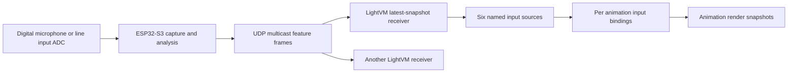

# ESP32-S3 audio analyser and multicast inputs

Status: historical experiment implemented on 26 October 2026, superseded by
[preset-driven subscriptions](feature-proposal-audio-subscriptions.md).

See the [current implementation guide](../audio-subscriptions.md). The first slice
uses 23 fixed `audio.*` names: six scalar features, a deduplicated onset
counter and sixteen spectrum values. Configurable prefixes, ESP32 reception, per-animation event queues and
pause/resume trigger expiry below are future work. The counter is not a complete
event-binding API. A temporary sender-side unicast experiment uses the same Pico
UDP receiver and input bindings.

Date: 19 October 2026. Timing revised: 26 October 2026.

Build a standalone ESP32-S3 audio analyser that publishes six audio features over
UDP multicast. LightVM controllers subscribe to the stream and expose its values
through the existing live-input registry. Each animation chooses its own mapping
from sound to movement, colour, brightness or transition progress.

Receivers apply the newest measurement at the next engine service point, with
**zero deliberate playback delay**. Keep one pending metric snapshot, coalescing
bursts before rendering. The earlier 100 ms jitter-buffer proposal is superseded.
It was never implemented in the native device code.

The kaj-fi Sense now analyses at 46.875 Hz and publishes every fifth hop:
**9.375 snapshots/s** (106.67 ms apart). Network-only tests on the installation AP
found approximately 204.8 ms multicast delivery batches. Lowering the publication
rate reduces traffic, but does not remove that network delay. Scheduling another
100 ms of receiver playback would add latency without recovering the missed live
response. Reconsider scheduled playback only for a measured synchronization need.

The existing [browser audio demo](../audio-source.md) and
[live-input core](../inputs.md) provide the feature semantics and consumer model.
The separate kaj-fi firmware implements capture, analysis and multicast sending;
this document proposes the native LightVM subscription and publication path.

## Architecture



The analyser runs independently of a browser and of the light controllers. It
transmits derived features; raw audio stays on the analyser. Controllers can join
an existing stream without the analyser maintaining a subscriber list. Each
receiver initially selects one configured sensor, consuming six of the current
32 controller-wide source slots (the current implementation also uses sixteen
slots for spectrum and one for the onset counter). One subscription can feed many animation
instances and transition progress.

## Hardware and capture

Use an ESP32-S3 with native C/C++, ESP-IDF audio capture and ESP-DSP processing.
The S3 supplies Wi-Fi, floating-point support and DMA-backed audio input. Its
dual-core processor and 512 KB internal SRAM make this a practical workload;
measure the complete capture, analysis and networking budget on the chosen board.
See [Espressif's device specifications](https://www.espressif.com/en/products/socs/esp32-s3)
and [I2S driver](https://docs.espressif.com/projects/esp-idf/en/v5.5.3/esp32s3/api-reference/peripherals/i2s.html).

| Input | Proposed hardware | Considerations |
| --- | --- | --- |
| Integrated microphone | XIAO ESP32S3 Sense with its digital PDM microphone | Convenient first prototype; configure hardware PDM conversion and validate the chosen capture rate. |
| External microphone | ESP32-S3 development board and an I2S MEMS microphone breakout | Allows microphone placement; requires power, ground, bit clock, word-select and data, plus channel selection where applicable. |
| Direct music feed | Mixer/player line output into an I2S audio ADC module | More consistent music measurement without room noise; select input conditioning, supplies and clocking appropriate to the ADC. |

Seeed documents the [Sense microphone](https://wiki.seeedstudio.com/xiao_esp32s3_sense_mic/).
An external example is the [SPH0645 breakout](https://www.adafruit.com/product/3421),
whose quoted response begins around 50 Hz. Deep-bass performance requires checking
the microphone and enclosure response. A [PCM1808-based ADC](https://www.ti.com/product/PCM1808)
is one candidate for line input; its analog supply and input requirements must be
handled by the selected module. Feed it a correctly conditioned line signal.

Capture the waveform rather than a threshold output from a basic sound sensor.
Use fixed gain initially so automatic gain control does not flatten musical
dynamics. A mono microphone is sufficient. For stereo line input, initially mix
the digitized channels to mono with headroom; phase cancellation is a known
limitation of that simple downmix.

Proposed analysis parameters:

| Parameter | Initial value |
| --- | --- |
| Capture rate | 48,000 samples/s |
| Analysis window | 2,048 mono samples, about 42.67 ms |
| Hop size | 1,024 samples, about 21.33 ms |
| Feature publication | Latest snapshot every five hops, nominally 9.375 frames/s |
| Buffer allocation | Fixed DMA, window, FFT and network buffers at startup |

The 48 kHz rate preserves the current upper analysis bound of 12 kHz. Validate
that rate on the actual microphone and driver; the Sense tutorial's 16 kHz example
does not establish 48 kHz operation. A lower-rate experiment must explicitly
reduce the treble bound and document its changed response.

DMA captures continuously. An analysis task removes DC, applies a window,
calculates the spectrum and features, and hands the newest completed frame to
networking. Keep FFT work out of interrupt callbacks. Bound processing to the hop
budget; if analysis overruns, discard obsolete work and report the discontinuity
rather than sending a delayed backlog. After Wi-Fi reconnects, resume with current
features instead of replaying frames generated while disconnected.

## Feature contract

Publish the following binary32 floats, each finite and in the inclusive range
0..1. These are visual control values, not calibrated acoustic measurements.

| Feature | Meaning |
| --- | --- |
| `level` | Normalized RMS amplitude of the audio window |
| `bass` | Normalized energy in 40 Hz <= frequency < 250 Hz |
| `mid` | Normalized energy in 250 Hz <= frequency < 2,000 Hz |
| `treble` | Normalized energy in 2,000 Hz <= frequency < 12,000 Hz |
| `centroid` | Amplitude-weighted spectral centroid, mapped onto a logarithmic 0..1 scale |
| `onset` | Decaying energy-rise pulse with warmup and a refractory interval |

Follow [the current extractor](../../web/src/audio-features.ts): sum linear power
within each band before converting to its normalized level, gate silence, and
use elapsed-time attack/release smoothing. Start with its 30 ms attack, 220 ms
release and -50 dB floor, with configurable sensitivity. Port its centroid and
onset semantics, including the distinction between a transient and a predicted
musical beat. Match FFT/window scaling using shared synthetic signal fixtures;
matching FFT size alone does not reproduce Web Audio's numerical response.

Continue sending complete frames during silence. Silence is valid zero-valued
state; a missing stream is a separate condition. `onset` remains scalar state,
with no guarantee that every pulse triggers an action after packet loss or a
slow render. kaj-fi also sends identified onset occurrences, retained independently
of scalar downsampling and repeated in up to three packets within 350 ms. Event
bindings must deduplicate these occurrences; neither UDP delivery nor musical
beat detection is guaranteed. BPM/beat-phase tracking remains a later extension.

## Multicast transport and frame format

Use IPv4 UDP multicast on the local installation network, with TTL 1. A proposed
configurable group is `239.255.42.99`, within the
[IPv4 Local Scope](https://www.rfc-editor.org/rfc/rfc2365.html#section-6.2),
and an example configurable UDP port is `49152`. Keep feature transport separate
from mDNS discovery and available without enabling HTTP or MQTT.

Receivers explicitly join the configured group on the active network interface
and rejoin after reconnecting. Select the sensor by its stable configured ID;
do not follow whichever sender happened to transmit last. This follows LightVM's
trusted-LAN model: sensor identity and session fields prevent accidental mixing
and stale playback, but do not authenticate packets. Multicast delivery depends
on the access point and network configuration; validate it on the installation's
actual Wi-Fi. See [wireless multicast considerations](https://www.rfc-editor.org/rfc/rfc9119.html).

Use the current [kaj-fi LVAF v4 contract](../../../kaj-fi/docs/protocol.md), updating
sender and receiver together. The earlier fixed 72-byte v1 draft is superseded.
Each datagram contains an 84-byte header, six scalar values, 0–64 eight-byte
spectrum records and 0–4 twenty-four-byte event records. With the default 16 bands
and no events, it is 212 bytes: about 1,988 payload bytes/s at 9.375 Hz, excluding
UDP/IP and Wi-Fi overhead. Maximum datagram size is 692 bytes.

Decode fields explicitly in network byte order; never cast a C structure onto a
packet. Validate length, version, flags, sensor/session identity, timestamps,
finite bounded values, band layout and event ordering/expiry before staging any
part of the packet. Sequence counts scheduled publications, not analysis hops.
The transmitted 1,024-sample hop describes analysis resolution; adjacent published
snapshots normally span five hops.

Audio timestamps identify the end of the analysed window, and event timestamps
the detection window. `send_time_us` uses the same sender monotonic clock. Events
must be at most 350 ms old at send time. This is a sender retention ceiling,
not a receiver delay or proof of network freshness. Receivers select a stable
sensor and deduplicate occurrences by sensor, session and event ID.

## Immediate receiver timing

There is no timestamp-scheduled playback cursor, startup clock-acquisition wait,
or frame-depth jitter buffer in the first receiver. Clock synchronization is
unnecessary for applying the newest state immediately. One-way timestamps cannot
separate clock offset from transport delay, so diagnostics must not claim a
measured absolute packet age or exact alignment between controllers.

At each bounded engine service point before an input snapshot:

1. Inspect the bounded ingress batch, validate packets and apply sensor/session
   rules. Keep the highest advancing sequence as the pending metric snapshot.
2. Inspect distinct events from every accepted packet before discarding its older
   metrics. Coalescing scalar state must not erase an onset between publications.
3. Publish the newest six-value vector atomically, then release the pending slot.
   Do not replay the older scalar frames in the burst on later render ticks.
4. Hold the last published vector until another arrives or its source timeout
   applies. Do not extrapolate energy or invent onset events. Source attack/release
   envelopes already provide smoothing; add no receiver interpolation initially.

A single pending metric slot bounds application backlog; this does not require a
single-datagram socket buffer. The network path still needs bounded ingress space
to inspect the events in a received burst. Bound packet work per service call and
report ingress overflow. Avoid a FIFO of scalar updates that would turn a burst
into several frames of added latency.

For example, two measurements with sender audio times 1,000 ms and 1,107 ms may
arrive together after an AP release. At the next service point use the 1,107 ms
snapshot, while preserving a distinct onset carried only in the older packet.
If the engine renders at 50 Hz, its next opportunity is nominally within 20 ms;
that render wait is separate from network, DSP and physical LED output delays.

Lower packet rate trades temporal detail for less traffic. Events detected just
after a scheduled publication wait up to roughly one publication interval for
their first packet; their capture timestamps still have 21.33 ms resolution.
An AP batch can contain roughly two new measurements at this rate. The receiver
cannot undo the AP's delay; its job is to avoid adding a second playback queue.

## Stream lifecycle and freshness

Latch one active session for the configured sensor. A different session cannot
replace it while that session remains live. After the one-second stream timeout,
adopt a valid advancing new session and clear pending metrics/event state. Keep a
bounded retired-session history to reject delayed traffic from recently retired
streams. Sensor/session IDs prevent accidental mixing, not deliberate replay.

On receiver restart or network reconnect, clear pending data and accept the first
valid selected-sensor snapshot without a 250 ms clock-acquisition phase. On source
loss, retain the last valid publication until the consumer's configured timeout
causes its existing default or hold policy to apply. The default binding timeout
remains 1,000 ms; missing data is distinct from valid zero-valued silence.

Record freshness from the original local receipt of each accepted advancing
frame. Engine ticks, duplicate packets, rejected frames and local publication
must not extend it. Expose receipt age and the delay from ingress to publication
separately. This makes additional receiver backlog visible without pretending
to measure unsynchronized one-way network latency.

Events need their own bounded history, expiry and per-animation consumption.
Sender TTL alone cannot detect a packet delayed in transit. Define and test the
receiver's lateness policy before enabling event bindings, using sender timestamp
progress and local receipt/queue age, and document the remaining one-way timing
uncertainty. Duplicates must not refresh an occurrence's lifetime. Paused
animations discard pending triggers; resuming must not replay old flashes.

## Integration with LightVM

Implement a platform-independent decoder and latest-snapshot staging path,
exercised on the host. Native network ports supply group membership, bounded ingress, receipt
timestamps and reconnect notifications. ESP32 and Pico receive paths must stage
data for the engine owner; network callbacks must not mutate the registry or run
guest code. Bound packets processed per service call so traffic cannot starve
rendering or management. Enable the adapter independently of the current HTTP
discovery socket and its compile-time guards.

The adapter owns six float sources, for example:

```text
audio.room1.level
audio.room1.bass
audio.room1.mid
audio.room1.treble
audio.room1.centroid
audio.room1.onset
```

Resolve these names from a configured prefix and validate the resulting names
against the existing 32-character limit. Claim the group once when the adapter
is enabled. Add a bounded typed native publication entry point that preserves
atomic validation, publisher ownership and the original receipt timestamp. The
existing JSON API need not become the internal network decoder.

Sender identity, session and 64-bit sequence are transport metadata. Each
controller uses its own registry generation and advancing uint32 publication
sequence, renewing the local claim before exhaustion. These identities must not
be copied from one controller to another. A management claim that revokes adapter
ownership stops its publications and reports the conflict; do not automatically
fight the new owner by reclaiming on every packet.

An Eye binding can use the existing mapping format, for example:

```json
{
  "position": {
    "source": "audio.room1.centroid",
    "map": {"input_min": 0, "input_max": 1, "output_min": 0.05, "output_max": 0.95}
  },
  "width": {
    "source": "audio.room1.bass",
    "map": {"input_min": 0, "input_max": 1, "output_min": 0.04, "output_max": 0.4}
  },
  "hue": {
    "source": "audio.room1.treble",
    "map": {"input_min": 0, "input_max": 1, "output_min": 0, "output_max": 0.85}
  },
  "brightness": {"source": "audio.room1.level", "timeout_ms": 1000, "fallback": "default"}
}
```

Persist subscription configuration and input recipes, not pending samples, event
histories, sequence state or local publisher tokens. Configuration includes the
enabled adapter, multicast address/port, sensor ID and source prefix. Use zero
deliberate playback delay for the first implementation; any later buffering must
be an explicit, measured choice across the installation. Reject a configuration that exceeds
source, socket or memory limits before replacing the active subscription.

## Resource and diagnostic requirements

Reserve and report DMA buffers, analysis history, FFT tables/workspace, task
stacks, networking and receiver queue memory. Keep steady capture, decoding and
publication free of application heap allocation. General SDK networking may have
its own bounded allocations. Hardware measurements must include Wi-Fi load and
normal LightVM rendering; FFT kernel benchmarks alone do not establish the full
system budget.

The analyser reports capture overruns, analysis duration, dropped work, send
failures and its current session. Each receiver reports subscription state,
sensor/session, latest received and published sequence, pending/ingress occupancy,
coalesced/duplicate/reordered/invalid/overflow counts, receipt age and local
ingress-to-publication delay. Do not present these as measured absolute network
latency or guaranteed inter-controller skew.

## Delivery and validation

1. Implement host-side v4 codec and receiver staging with deterministic fixtures.
   Reuse the kaj-fi packet contract and synthetic signal fixtures.
2. Integrate the native receiver with the registry and existing Eye bindings.
   Verify atomic snapshots, receipt-based expiry and ownership handling.
3. Measure the analyser and receiver together under normal LightVM rendering.
   Confirm the newest packet in an AP batch reaches the next engine snapshot
   without an intentional 100 ms hold or a FIFO backlog.
4. Implement identified event bindings separately, including expiry, independent
   consumption and pause/resume behavior. Scalar onset is not a reliable trigger.

Acceptance checks must cover:

- Exact packet encoding, malformed fields, nonfinite values, wrong sensor identity,
  unsupported versions and within-session layout changes.
- Source publication at 9.375 Hz while analysis and detection remain at 46.875 Hz;
  short onsets at every position between publications survive downsampling.
- Burst arrival, loss, duplicates, reordering and engine stalls. Metrics never
  move backwards or drain an old backlog; useful distinct events survive coalescing.
- No arrival-to-publication timer beyond the next bounded engine service point.
  No clock-acquisition delay on subscription startup.
- Sender/receiver restart, reconnect, retired sessions and source timeout.
- Ingress limits, flooding, source-slot exhaustion, ownership replacement and
  local publication sequence renewal.
- Synthetic fixtures for RMS, band separation, centroid, envelopes, warmup and
  event expiry/repetition; measured DSP headroom on the actual Sense.
- Physical LED response with a shared GPIO or photodiode observation, separating
  network batching from rendering and output transmission delays.

The first receiver makes no exact simultaneity guarantee. A future synchronized
playback mode would need an explicit clock model, delay budget and measurements;
reducing the number of frames in a jitter queue alone does not define its delay.

This remains experimental. Update analyser and receivers together when the
protocol changes and reprovision test devices when necessary. Do not add
compatibility paths for superseded experiments.
