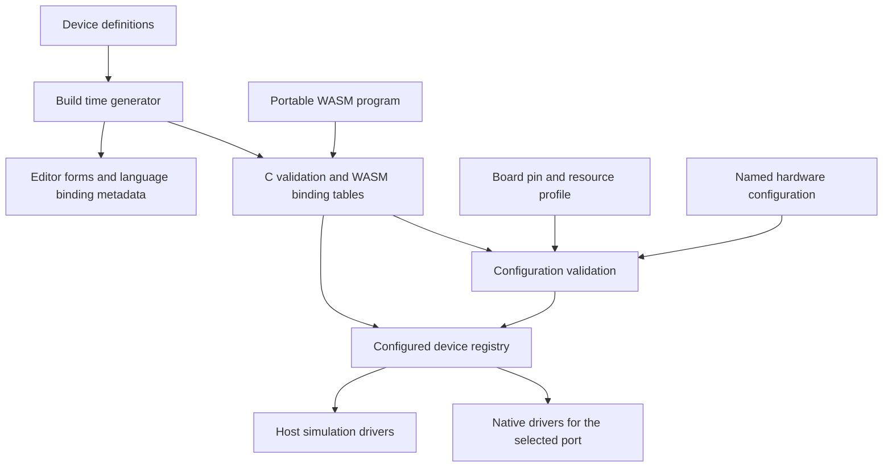

# LightVM Beginner Device Support Feature Proposal

Status: Proposed

Date: 12 October 2026

LightVM should support a small set of inputs and outputs that make programming
and logic tangible: press a button, compare a sensor value, change a light, play
a note or move a servo. Devices share the independently designed
[control API and execution model](feature-proposal-control-api.md): named
resources, typed properties and samples, actions/jobs, events and resumable
tasks. Addressable RGB lighting is one capability within that model. This complements the
[web editor](feature-proposal-web-editor.md) and
[controller model](../architecture.md). Optional
[animation composition](feature-proposal-animation-composition.md) gives several
lighting programs owned contributions to one scene under the same model.

Use a bounded device registry, named device instances and versioned, typed WASM
imports. Define each device type's configuration and API in one declarative
definition, then generate the shared validation and binding metadata from it.
Native drivers implement the hardware behaviour. This gives new devices a clear
extension path while keeping the Pico firmware small.

All general device interfaces and examples below are proposed. The implemented
baseline remains configured WS2812B RGB output and legacy animation API v1.
Pixelblaze source compatibility belongs in a frontend or adapter; it does not
define the device or execution contracts.

## Implemented foundation

Runtime JSON configuration, explicit RAM apply/save, the `ws2812b` registration,
instance-owned A buffers and named persistent WASM procedures are implemented on
host, Pico and both ESP32 ports. See [configuration](../configuration.md).
There is no compiled default strip; empty configuration is valid. The broader
generator, generic device-handle imports and non-pixel drivers below remain proposed.

## Starter devices and learning goals

Build the first increment around digital input and output. Complete the starter
release with analogue input, PWM, tone and positional servo support. Buttons,
switches, potentiometers and light sensors can be editor presets over these
basic types, rather than separate drivers for every component.

| Device type | Examples and lessons | Required configuration | Defaults and optional configuration |
|---|---|---|---|
| WS2812B pixels | Existing strips and rings; colour, loops and position | Output pin and pixel count | GRB order, output brightness limit, primary animation output |
| Pixel buffer | Indexed RGB frames mapped to addressable output | Size and output binding | Format, topology and successful-step publication |
| Digital input | Button, toggle switch or digital sensor; conditions and state changes | Input pin | Pull, active level and debounce interval; a button preset supplies suitable defaults |
| Digital output | LED or active buzzer; booleans and timed sequences | Output pin | Active level and logical safe value, initially off |
| Analogue input | Potentiometer or LDR divider; thresholds and mapping | ADC-capable pin | Sampling interval, smoothing and configured input endpoints |
| Analogue output | DAC level or voltage; distinct from PWM | A supported DAC channel or external driver | Declared units, calibration and safe level; optional after the starter release |
| PWM output | LED dimming; proportional values | Output pin | Frequency and safe duty cycle, initially zero |
| Tone output | Passive piezo; notes and timing | Output pin | Supported frequency range and maximum note duration; silence on stop |
| Positional servo | Pointer or simple mechanism; angles and state machines | Output pin and a selected servo calibration preset or explicit pulse limits | Period, permitted angle range and release on stop |

These are software capabilities, not promises that every connected component can
be driven directly from a GPIO. Wiring templates should specify the resistor,
driver, power supply and common ground required by the selected component.
Distinguish active buzzers from passive piezos, positional servos from continuous
rotation servos, and true analogue output from PWM in the editor. Pixel buffers
are logical resources; WS2812B and RGBW output are physical capabilities.
Explicit RGBW control is optional with its own driver and buffer budget.
Proper alpha transparency and scene composition remain a separate design and
implementation increment. A/B changes mix completed source frames; per-layer
alpha is a distinct concern. Scenes and layers are logical runtime resources,
not additional physical strips or pin allocations. Their future capability and
memory limits will be discovered separately from the WS2812B driver.

After the starter release, add one named I2C temperature/humidity driver and a
small monochrome display. These exercise bus sharing, measurement units and
buffer operations. Rotary encoders and distance sensors can follow. General
motor control, arbitrary bus transactions, cameras, radar and picolights' wider
automation catalogue are outside this initial feature.

Useful starter projects are a button-controlled light, a knob-controlled dimmer,
a light threshold alarm, a timed traffic light, a reaction game and a servo
pointer. Each should run in preview and on configured hardware without changing
its program's pin assumptions.

## Current platform and required changes

The shared engine already delegates clock, allocation and RGB transmission to
native ports. GPIO, PIO and SDK dependencies stay outside `src/`. Preserve that
boundary and the single owner of engine execution.

| Current code | Consequence for this feature |
|---|---|
| `PIXEL_CAPACITY` limits runtime pixel configuration; no output is valid | General execution with an empty configuration is available |
| `PixelBuffer` owns dynamically configured RGB and native driver state | Additional target types can build on explicit ownership |
| `VmInstance` links legacy `led` imports to its assigned target | Add generated generic device bindings alongside these imports |
| `prepare_animation` requires `render(index)` | Preserve it through a legacy adapter; add event dispatch and bounded task steps for general programs |
| `app_tick` only services active playback | Native input sampling and timed output expiry need service while guest execution is idle |
| Pixel driver open/close/show operations report failure | Extend registered driver contracts to non-pixel capabilities |
| STATUS describes one pin, brightness and pixel count | Structured discovery must report types, instances, state and resource limits |
| Board pin tables/budgets are separate from saved peripheral JSON | Extend resource planning to the proposed device types |

Picolights provides a useful precedent: its
[`device_factory`](../../../picolights/picolights/devices/config.py) registers named
types, `DeviceList` instantiates configured devices, and
[`PropertyManager`](../../../picolights/picolights/devices/controller.py) exposes
properties. Its animation helpers and transitions also establish buffer,
publication and completion concepts. The [control proposal](feature-proposal-control-api.md#prior-art-and-provenance)
records the Git lineage and upstream reuse constraints. LightVM should use explicit field types,
operation signatures and validation instead of dynamic Python imports and
untyped property messages. Devices need no MQTT connection to work.

## Device definitions and native drivers

Keep three concepts distinct:

- A **type** defines configuration, capabilities and operations, such as
  `digital-input`.
- An **instance** is configured hardware, such as `button` on Pico GP14.
- A **capability** is a portable contract, such as reading a logical input.
  Several device types can implement the same capability.

Firmware advertises both the types compiled into its build and the instances
actually configured. Compiling in a sensor driver does not establish that a
sensor is connected. Initial discovery relies on configuration; automatic
component identification is not required.



A device definition should contain its stable type ID and version, required
fields, defaults, ranges, units, editor labels, capability versions, properties,
actions, job outcomes and event schemas. Record import signatures, permitted
execution contexts, sample validity/age, error semantics, ownership, output
publication and pause/stop behaviour. Event definitions include capture time,
filtering, delivery/coalescing policy and bounds. Resource planning includes
driver state, buffers, queues, subscriptions, timers, jobs and continuation
storage. Cross-field and hardware constraints remain explicit validation hooks.

For example, a shortened definition could be:

```yaml
type: digital-output
version: 1
config:
  pin: {kind: pin, required: true, capabilities: [gpio.output]}
  active_low: {kind: boolean, default: false}
  safe_value: {kind: boolean, default: false}
capabilities: [digital-output/1]
imports:
  - module: lightvm.digital_output.v1
    name: write
    params:
      - {name: device, type: i32, kind: device_handle}
      - {name: value, type: i32, minimum: 0, maximum: 1}
    result: {type: i32, convention: status}
    contexts: [task_step]
```

The generator should emit compact C descriptors, field validation, import
registration, SDK declarations and editor metadata. Firmware should not need a
general JSON Schema interpreter. The editor can use richer generated schemas;
the firmware validates the same rules using bounded structures. Match schema
IDs, versions and content hashes when loading an editor's cached definitions.

Each native driver implements configuration validation/resource planning,
initialization, native servicing, input snapshots/event capture, staged output
commit, job expiry, safe state and teardown. The registry connects a type to the
selected port's driver
implementation. Hardware-specific code can be shared within a port, for example
PWM allocation used by dimming, tone and servo drivers.

Adding a device should require its definition, shared operation handlers where
needed, native and simulation drivers, and one build registration entry. It
should not require device-specific branches in the scheduler, command handler
or loader. Definitions cannot generate sensor protocols or useful simulations
automatically; those remain driver work. New drivers arrive through firmware
builds and firmware updates; uploading a guest program does not install drivers.

## Hardware configuration and resource validation

Board definitions describe pin identities and aliases, available functions,
reserved pins, peripheral resources and memory capacity.
[Build profiles](feature-proposal-build-profiles.md) select drivers and budgets
for each board instance's firmware. Hardware configuration selects named
peripheral instances using those included drivers. Programs select logical names
and required capabilities. Keep these layers separate so the same compiled
program can run on different boards with compatible firmware profiles.

An illustrative Pico configuration is:

```json
{
  "schema": "lightvm.hardware/1",
  "devices": [
    {"id": "lights", "type": "ws2812b", "config": {"pin": "GP16", "count": 100, "primary": true, "brightness_limit": 32}},
    {"id": "button", "type": "digital-input", "config": {"pin": "GP14", "pull": "up", "active_low": true, "debounce_ms": 20}},
    {"id": "dial", "type": "analog-input", "config": {"pin": "GP26"}},
    {"id": "indicator", "type": "digital-output", "config": {"pin": "GP15"}}
  ]
}
```

An ESP32 configuration would use that board's advertised pin aliases while
retaining `lights`, `button`, `dial` and `indicator`. The program manifest declares
the logical devices and capabilities it needs. Activation checks those bindings
and the actual WASM imports; a manifest alone does not prove compatibility.

Reject duplicate IDs, unknown types/fields, missing required values, unsuitable
or reserved pins, conflicting pin aliases, unavailable capabilities, incompatible
PWM periods, exhausted peripheral resources and excessive buffers. Report the
field path and conflicting instance, for example
`devices[2].config.pin: GP16 is already used by lights`.

Resource planning must include resources shared across different device types.
The RP2040's paired PWM outputs share a slice counter; the S3 associates PWM
channels with timers and has frequency/resolution constraints. A dimmer, tone
output and servo therefore need a common allocator rather than independent pin
checks. [Pico PWM documentation](https://www.raspberrypi.com/documentation/pico-sdk/hardware.html#hardware_pwm),
[S3 LEDC documentation](https://docs.espressif.com/projects/esp-idf/en/v5.5/esp32s3/api-reference/peripherals/ledc.html).

For analogue input, normalize a configured signal range to 0..65535. This does
not imply 16-bit measurement accuracy or calibrated voltage. Calibrated units
must be a separate advertised operation. ESP32 ADC drivers can report sampling
failures, and the S3's ADC2 shares use with Wi-Fi, so expose validity and age
instead of silently treating a failed sample as zero.
[S3 ADC documentation](https://docs.espressif.com/projects/esp-idf/en/v5.5/esp32s3/api-reference/peripherals/adc_oneshot.html),
[C6 ADC documentation](https://docs.espressif.com/projects/esp-idf/en/v5.5/esp32c6/api-reference/peripherals/adc_oneshot.html).

The first implementation should use fixed upper bounds for instance count,
aggregate pixel bytes, driver state, input events, tasks, subscriptions,
timers, jobs, continuation storage and native driver buffers.
Allocate or reserve device storage when applying configuration, never during a
guest callback. Account for it separately from the existing wasm3 heap budget.
Reserve scene/layer storage during scene preparation, including colour/alpha,
staging/readback and completed composites; include every participating program
in aggregate admission. Hardware configuration alone does not allocate an
unbounded number of virtual buffers or establish that layered A/B playback fits.
The initial pixel driver may advertise a maximum of one strip while the registry
and new imports still use instance handles. Additional strips then need no ABI
redesign.

Validate a complete configuration without changing hardware. Apply only while
guest execution is stopped, with an expected configuration revision to reject
stale editor writes. A successful apply invalidates old handles and requires
program rebinding. Validation failure leaves the current configuration intact.
Driver initialization can still fail during apply; leave outputs safe and report
the resulting active configuration. Advertise restoration guarantees explicitly
if a port can restore its previous drivers after that failure.

The implementation starts with an empty configuration or the explicitly saved
configuration. Management separates RAM apply from persistent saving; temporary
edits do not write flash. Program replacement retains hardware configuration.
Named stored WASM and startup references are available through the same management
layer on host, Pico and ESP32.

## Portable WASM device API

Use typed, versioned imports for guest calls, with schema-driven discovery and
management outside the guest. A generic string-based property interface would
make units, signatures and compiler checks harder to maintain.

The [common control model](feature-proposal-control-api.md) defines the semantics;
the table below sketches capability groups, not a frozen binary ABI. Resolve
logical names during initialization and cache opaque handles. Check generation,
capability, ownership, arguments and execution context on every operation.
Names and structured data use validated guest pointers/lengths; generated
bindings hide those details. New calls return status separately from data,
including reads, so negative measurements cannot become error codes.
Successful status is zero; defined negative status codes identify failures.

| Proposed capability group | Operations | Meaning |
|---|---|---|
| Device registry | Resolve, inspect capabilities | Find a configured resource and validate its binding |
| Runtime | Subscribe, schedule, emit, wait, cancel | Select triggers and manage bounded tasks, timers and jobs |
| Digital input | Read snapshot, subscribe to transitions | Logical state plus ordered debounced events; edge flags are conveniences |
| Digital output | Write, pulse | Stage a logical value or start a bounded native pulse job |
| Analogue input | Read sample, observe change/threshold | Value, timestamp, validity and optional calibrated units |
| Analogue output | Write level/voltage | True DAC capability, separately advertised from PWM |
| PWM output | Set duty, enable/disable, inspect achieved timing | Normalized duty with fixed or explicitly variable period |
| Tone output | Play, stop, inspect/cancel job | Native frequency generation, duration and terminal outcome |
| Positional servo | Set calibrated target, release | Angle in declared units; command state is distinct from feedback |
| Addressable pixels | Inspect, get, set, fill, successful-step publication | Indexed RGB access and colour conversion; every frame starts black |
| Animation composition | Future scene/layer operations | Proper alpha and blending require a separate design before implementation |
| RGBW output | Write explicit emitter channels | Optional independent white-channel control |

Use booleans for logical state and a common normalized encoding for fractions.
The proposed scalar level/duty range is 0..65535; physical units such as hertz,
microseconds and millidegrees are explicit metadata. Signed measurements and
commands remain valid data. The control ABI must fix encodings and structured
sample/event layouts before implementation. Pixel format and colour conversion
are separately versioned decisions, rather than inherited from
legacy `led.rgb`/`led.hsv` integer ranges.

Errors include `invalid_handle`, `wrong_capability`, `not_owner`, `out_of_range`,
`sample_unavailable`, `invalid_context` and resource exhaustion. Beginner bindings
turn unexpected errors into useful diagnostics; advanced bindings may inspect
them. Job failure and native commit failure are subsequent outcomes, distinct
from accepting a staged request.

Reads use a stable snapshot for one guest step. Output publication occurs after
a successful step or explicit batch, including before a task suspends. Scalar
outputs keep committed values until changed or stopped. RGB frames begin black
and redraw from independent animation state. The last assignment by one writer
wins within its batch. The future alpha compositor will own the combined scene
and one completed lighting publication; layer, alpha and background readback
semantics must be designed separately. A/B mixes completed source frames when
both capabilities and their combined budgets are supported.
Actuator ownership governs competing non-pixel writers. Property assignment must
not implicitly restart a job; explicit actions have documented replacement/retry
behaviour.

Keep `led.pixel_count`, `led.rgb`, `led.hsv`, `render` and `beforeRender` unchanged
for animation API v1. Its imports target the configured primary strip. Reject a
legacy animation when that output is unavailable. The old rainbow should retain
its current colours, callback order and lack of guest linear memory.

Device capability/import versions, buffer formats and the general execution
contract are separate from animation API, management API, configuration schema
and framing versions.
Additive discovery fields need no ABI break. Changed units or semantics require
a new capability/import version. A device links only the APIs implemented by
its firmware; missing required APIs or configured instances produce explicit
compatibility errors before execution.

## Execution and output lifecycle

The proposed `control-v1` execution contract dispatches lifecycle, input,
message, timer, frame and completion work as bounded guest steps. The exact
export/context layout remains to be fixed. It does not require a renderer or
impose the legacy `tick`/`beforeRender`/`render` shape on every device program.
Periodic update functions are frontend conveniences over scheduled tasks.

Each step captures a stable input snapshot and clock context, executes runnable
guest work, and publishes its successful output batch. A language frontend may
lower waits to resumable state machines in guest memory. Waiting yields this
task, allowing other tasks and native servicing to continue. Define queue,
restart, ignore-while-active and bounded-multiple-instance retrigger policies.

Input sampling, guest control/frame cadence and native waveform generation have
independent schedules. Native servicing continues when the guest is stopped or
paused. Ordered event records preserve presses/releases and repeated transitions;
snapshot `rose`/`fell` summaries are not the canonical event representation.
Declare debounce, coalescing, overflow and startup/pause delivery policies.
High-speed counting/capture needs its own native capability rather than relying
on a human-input event queue.

Use native monotonic capture/dispatch timestamps and pausable program time as
specified in the control proposal. The legacy millisecond carry and 1000 ms gap
cap remain confined to animation API v1. General deadlines retain actual elapsed
time; missed periodic intervals cannot create an unbounded catch-up queue.
Guest execution has no timed watchdog; scheduling uses bounded work slices.

Tone/pulse expiry uses native time and does not need another guest callback.
Servo pulses and tone waveforms come from native peripherals. Bus-based sensors
use bounded native servicing and cached examples/animations/jobs instead of blocking a guest
import on a conversion or absent peripheral.

Initialization may resolve bindings and prepare state while validating a
candidate, but cannot change physical output. After successful activation,
the start trigger can stage output through an ordinary task step. Reserve
resources and validate required bindings before that trigger runs.

| Event | Required behaviour |
|---|---|
| Successful step or suspension | Publish its output batch before waiting; there is no promise of electrically simultaneous updates across devices |
| Guest trap or timeout | Discard unpublished writes from the failing step and stop playback; previously committed steps remain; pixels retain their last submitted frame, digital/PWM outputs use safe values, tone is silenced and servos release pulses |
| Native output failure | Stop playback, report the failing instance and attempt the configured safe states; earlier native writes may already have happened |
| Stop, unload or hardware reconfiguration | Cancel owned tasks, jobs, timers and subscriptions; clear pixel output, set digital/PWM safe values, silence tone and release servo pulses; reconfiguration invalidates handles |
| Pause | Freeze program time and pausable tasks/jobs; retain pixels and ordinary scalar outputs; silence tone and release servos; native servicing/deadlines continue and resume uses a fresh snapshot |
| Browser or USB disconnect | Continue autonomous playback, consistent with the web editor proposal |

Servo release means no control pulses; it cannot guarantee a mechanism's physical
position. Keep firmware brightness limits on pixel instances separate from shared
controller brightness/power. Matter and other adapters use that controller state
for lighting. Lighting power-off should not implicitly rewrite every unrelated
device; a general stop action applies the lifecycle rules above.

One native engine owner controls the registry, interpreter and commits. Native
interrupts and network callbacks can publish samples or enqueue commands, but
cannot call WASM. Several guest tasks can be active and step through that owner.
Scene layers and A/B sources may run together within the advertised aggregate
limits, with pixel ownership/composition defined by their respective proposals.
They do not acquire competing actuator ownership merely by joining a scene.
Blending light frames does not define how two programs should control one servo.

## Web editor and board integration

Extend the editor's structured descriptor with supported device types and schema
references, configured instances/capabilities, configuration revision, pin choices,
resource limits and simulation availability. Keep controller identity separate
from peripheral instance IDs such as `button`.
Discover virtual scene/layer identity, contribution/readback modes and layer,
resident-instance and buffer limits through the runtime descriptor. These are
distinct from configured physical peripheral identities.

Add logical operations alongside the editor's existing proposed API:

| Operation | Proposed HTTP mapping | USB equivalent |
|---|---|---|
| List supported types and definitions | `GET /api/v1/device-types` | Bounded descriptor/schema query |
| Read hardware configuration and instances | `GET /api/v1/hardware` | Hardware query |
| Validate a candidate configuration | `POST /api/v1/hardware/config/validate` | Side-effect-free validation command |
| Apply configuration while stopped | `PUT /api/v1/hardware/config` | Apply with expected revision |
| Read peripheral state, validity and age | `GET /api/v1/devices/{id}/state` | Instance state query |

Use the same logical handlers, structured errors and access policy over both
transports. Large metadata needs bounded pagination or fragmentation because
current USB frames carry at most 512 payload bytes. Hardware forms should show
only choices valid for the connected board. Keep physical configuration distinct
from live program parameters such as speed or colour.

Generate language declarations, typed reporters/actions and Scratch-like trigger
blocks from the shared definitions. Distinguish a held-state reporter from a
pressed-event trigger. Semantic helpers such as `dial.level` and `servo.target`
make the low-level imports approachable. A supported Python frontend could expose
this illustrative program, assuming a configured PWM device named `dimmer` as
well as the button, dial and indicator; decorators and waits are proposed
lowering features:

```python
button = devices.input("button")
dial = devices.analog("dial")
indicator = devices.output("indicator")
dimmer = devices.pwm("dimmer")

@on(button.pressed, policy="queue")
def flash(event):
    indicator.write(True)
    wait_ms(1000)  # Publish, then suspend only this task.
    indicator.write(False)

@every_ms(20)
def sample_dial(context):
    level = dial.sample()  # Includes timestamp and validity.
    if level.valid:
        # Control an independent output while the flash task may be waiting.
        dimmer.duty(level.normalized)
```

Every frontend targets the same device, trigger and task semantics, with its own
numeric/unit conversion rules. Device definitions do not add arbitrary Python support or
Pixelblaze syntax automatically; capability availability and frontend support
both need checking. Simulation drivers should offer interactive buttons, analogue
sliders, addressable RGB output, note/job events and commanded servo position. Replaying
timestamped inputs should reproduce task steps and published batches. Mark
missing simulations explicitly. Preview does not validate wiring, measured
servo arrival, electrical behaviour or board timing.

Pico, XIAO ESP32-S3 and XIAO ESP32-C6 use the same shared definitions and imports.
Their ports supply different GPIO/ADC/PWM implementations and resource planners.
A port may initially support only a subset and advertise it accurately. Validate
each board's exposed pins, not just the underlying chip's peripheral catalogue.
Measure sampling latency, PWM/tone/servo behaviour and pixel throughput with
networking and Matter active on the ESP32 ports.

## Delivery sequence and acceptance

| Increment | Deliverable | Acceptance criteria |
|---|---|---|
| 1 | Definition format, generator, bounded registry, digital input/output, lifecycle/timer events and bounded handlers | Existing rainbow remains compatible; a button/LED program runs with zero pixels; repeated edges retain order; invalid handles/configuration are diagnosed; adding the second type needs no scheduler/loader switch |
| 2 | Shared hardware discovery/configuration, USB support and editor integration | Required fields generate forms and bindings; bad pins/resource conflicts fail before apply; stale revisions are rejected; simulated and physical button/LED projects agree |
| 3 | Resumable waits, RGB frame programs, analogue/PWM/tone/servo capabilities and native jobs | Red/wait/black publishes before suspension while other work runs; sample validity/age, retrigger/cancellation, ownership, timer conflicts and native expiry are verified |
| 4 | ESP32 native implementations | Identical compatible WASM works on Pico, S3 and C6 with board configuration changes only; resource use and interaction timing are measured under native service load |
| 5 | One I2C sensor and optional display | Shared bus ownership, address conflicts, bounded servicing, disconnected hardware and missing preview support behave predictably |

The registry and descriptor shape should be agreed before the web editor freezes
its capability model. The first registry implementation can proceed on host and
Pico while ESP32 porting continues. HTTP, BLE and Matter do not need to block basic devices over USB. Runtime hardware
forms should consume the implemented configuration and persistence operations.

Acceptance tests should cover missing fields/devices/imports, signature mismatch,
stale handles, instance/buffer exhaustion, initialization failure, duplicate pin
aliases and PWM conflicts across types. Exercise stable input snapshots, debounce,
event overflow/order, retrigger policies, task suspension/cancellation, signed
results, RGB frame reset/readback, bounded deadlines, failed steps/frames, partial native
commits, note expiry, pause/stop/unload and browser disconnect. Compare logical outputs and
scripted input sequences in the host before hardware checks on each board.
Composition-capable profiles must also verify independent layer ownership,
the separately designed alpha semantics, readback, single lighting
publication and rejection of excessive scene/A/B combinations. General device
support remains usable on profiles that omit animation composition.

Use an additional simulated device as an extension exercise: add its definition,
handler/driver and registration entry, generate its schema and language bindings,
and run it without changing generic engine or management dispatch. This is the
practical test of extensibility.

## Implementation decisions

The first prototype should settle the definition/generator format, handle and
error encoding, the common step/context and event/task contract, resource
allocator hooks and the smallest practical Pico storage bounds. It should establish which editor forms
and language bindings can be generated directly and which operations need
handwritten lowering.

Select concrete wiring/calibration presets for the starter examples before
claiming hardware support. Keep runtime configuration persistence and restoration
guarantees explicit per port. The resulting feature remains a compact teaching
device API with a repeatable driver extension path.
