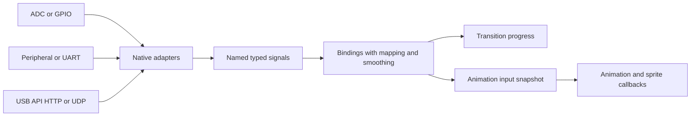

# External inputs for transitions and animations

Status: Scalar core implemented; remaining adapters and conditioning are proposed.
The [live input guide](../inputs.md) is authoritative for the implemented syntax,
drivers, snapshots, management, recipes and editor controls. Research sketches
below include future behaviour and should not be treated as the current API.

Date: 17 October 2026

Implemented slice, 18 October 2026: the controller workspace's
[Mixer tab](../web-editor.md#mixer) supplies a virtual slider
through the existing external transition source API and supports switching to
native timed transitions. General signal registries, hardware adapters and live
animation-variable bindings below were proposed at that point.

Implemented scalar core, 18 October 2026: static Input declarations, typed render
snapshots inherited by sprites, constant/timed/source bindings, generation-checked
atomic publication, persisted invocation recipes, native progress bindings and
editor controls. Rainbow exposes phase and scale; the new Eye exposes position,
width, colour and local intensity. Sweep retains its existing history and settings.
The separate native TCA9555 adapter supplies debounced tap, multi-press and hold events for
MQTT HA event entities, paired with APA102 RGB indicators; see [keypad setup](../mqtt.md#keypad-and-rgb-indicators).
Other hardware adapters, conditioning, guest events and streams remain proposed.

Implemented light controls, 20 October 2026: each output owns latched power,
master brightness and full RGB colour. Typed output-relative control bindings
and author defaults connect them to animation inputs; master dimming runs once
after composition/A/B. HA exposes one JSON light with preset effects. The browser
publishes generic music features, and presets choose numeric response ranges or
RGB palettes. See [light controls](../inputs.md#output-light-controls) and
[music sources](../audio-source.md) for the current contract and clean-install notes.

## Recommendation

Add a shared input system in which native adapters publish named, typed signals.
Bindings map those signals to transition progress and to inputs declared by an
animation. The animation uses its inputs to calculate colour, sprite length,
brightness, movement or other behaviour. One source can feed several bindings.

Keep hardware and transport selection in controller configuration. A reusable
animation should ask for a value such as `level` or `hue`, independently of
whether it comes from a potentiometer, a peripheral, USB management, a UART or a
network message. Keep initialization settings frozen: changing a live input must
preserve the running animation's clock, sprites, arrays and random sequence.

This develops the [future control and input model](feature-proposal-control-api.md)
into a lighting-focused feature. It does not require the proposed general task,
job or actuator systems.

## Baseline before the scalar implementation

This table records the starting point for the proposal. See the current
[input guide](../inputs.md) for implemented capabilities.

| Area | Current behaviour | Addition needed |
| --- | --- | --- |
| Transition progress | Manual, timed and named external source drivers share one percentage. Source updates include an assignment token. | Native source adapters and reusable bindings. |
| External management | USB serial and optional HTTP carry the same commands. A computer can already bridge sensor or network data into transition updates. | Publish general input values through these transports. |
| Animation settings | `setting(...)` is validated during initialization and remains frozen. Changing settings explicitly prepares a new instance. | Separate live input declarations and stable values for each render. |
| Drawing and sprites | `ColorTransform` supports tint, hue, brightness and alpha; `Transform.scale` changes visible size. Sprite callbacks can replace these every render. | Allow callbacks to read the containing animation's input snapshot. |
| Peripheral and stream access | Guest imports and operations are restricted; GPIO, ADC, UART and sockets are not guest APIs. Native networking already uses UDP for discovery. | Optional native input drivers and bounded message decoders. |

The transition's current external source is a name and an update contract. Typing
`sensor` into the browser does not open a sensor or start a subscription. A
producer still has to supply percentages. The existing management adapter can
demonstrate external transition control before a general input system exists.

Implementation references: [transition drivers](../../src/transition.c),
[transition management](../../src/app.c), [animation invocation](../../src/animation.c),
[compiler runtime bindings](../../lightvm/portable.py),
[sprite callback compilation](../../lightvm/sprite_compiler.py), and
[drawing contracts](../pixelarray-sprites.md).

## Source and binding model



There are three distinct identities:

| Identity | Example | Responsibility |
| --- | --- | --- |
| Physical adapter | ADC on GP26, a UART decoder, or a UDP listener | Own pins, buses, buffers, sampling and decoding. |
| Source signal | `knob.level`, `distance.metres`, `remote.energy` | Publish a typed value with freshness and validity. |
| Consumer input | `level` on a particular running animation | Declare the value the program understands and its default and bounds. |

A binding joins a source to a consumer. For example, `knob.level` in 0..1 could
drive output `lights` transition progress in 0..100, layer `eye` input `length`
in 1..30 pixels, and that layer's `brightness` in 0.1..1.0. Each binding has its
own mapping. Source fan-out does not duplicate physical sampling.

Source names are controller-wide. Animation input names are local to a program
instance; targeting must include the output, A/B slot and layer, or the direct
instance. Bindings to a transition program's own inputs identify that program
separately from the native progress target.

Each target has one active binding or controller driver. Replacing its binding
invalidates the old binding generation. Multiple writers must not race through
an implicit last-writer rule. An adapter owns publication of each source signal;
an explicit publisher replacement invalidates its old updates as well.

## Values events and streams

These need different delivery rules even when they share an adapter:

| Kind | Examples | Delivery |
| --- | --- | --- |
| Continuous state | Knob position, sensor distance, current brightness | Retain the newest valid value. Intermediate values can coalesce. |
| Occurrence | Button press, beat, encoder step, received command | Preserve bounded ordered events or explicitly counted occurrences. |
| Sample stream | Audio, rapid motion samples, a framed telemetry stream | Decode and process at the source cadence; publish derived control values or explicitly buffered samples. |

Start with continuous scalar state: binary32 float, signed 32-bit integer,
boolean and packed RGB8 match existing VM types. A vector peripheral can publish
several named channels in one atomic batch. Avoid arbitrary objects or strings
in render callbacks.

A button's current boolean state cannot preserve a short press between frames.
An event extension needs fixed queues per subscriber, capture timestamps,
overflow counters and an explicit pause policy. A counter can preserve the number
of identical occurrences but cannot preserve ordered payloads. Observers must not
consume animation events. Event actions such as starting a timed transition
belong in this extension; directly following a knob belongs in the scalar system.

For audio-reactive lighting, publish an envelope, peak or frequency-band values.
Raw audio acquisition and analysis need separate sampling, DMA and processing
budgets; the animation frame rate must not become the sampling clock.

## Sampling and lifecycle contract

Adapters publish into a bounded registry serviced independently of rendering.
The engine owner captures all inputs for an animation once when its render
starts. Those values remain fixed across instruction yields, pixel loops and
every sprite callback in that invocation. Updates arriving during execution
become eligible for the next invocation.

Validate and commit a producer's multi-channel update as one batch. This prevents
a snapshot from seeing a new red channel with an old green channel. Independent
producers remain independent; this does not imply globally simultaneous samples.
Compositions and layers currently run independently and can contribute frames of
different ages. Per-invocation snapshots preserve that contract without promising
synchronized A/B rendering.

Each source record needs a type, value, validity, publisher generation, sequence
and local monotonic receipt or capture time. Preserve optional sender timestamps
separately: an unsynchronized remote clock cannot establish local freshness.
An unchanged value with a fresh sequence can refresh freshness; rejected or
duplicate packets cannot. Report source age and consumer fallback state.

Recommended defaults are:

- An unbound animation input supplies its declared default. An unknown input
  name or incompatible binding is a configuration error.
- A temporarily unavailable source preserves its last accepted value until its
  configured timeout. After timeout, an animation input uses its declared
  default; an explicit hold policy can retain the last value instead.
- Transition bindings hold progress on source loss, matching the current
  external-source behaviour. A different fallback is an explicit binding choice.
- Invalid samples do not become zero or refresh the freshness deadline. Valid
  samples resume normal operation when the source recovers.
- Pause retains the animation contribution and clock while native acquisition
  continues. Resume samples current inputs. STOP keeps output stopped; incoming
  values do not implicitly resume it. Existing timed progress remains independent
  of composition pause.
- Unloading or replacing a consumer releases its bindings. Persisted recipes can
  bind a replacement only after validating its declarations. Source drivers can
  remain active for other consumers.

For deterministic admission, `@init` continues to depend only on settings and
geometry. Live reads are render operations. An animation candidate's initial
render uses one captured set of validated inputs, or defaults where no usable
source exists. This set remains fixed throughout preparation, including yields.
Input values cannot determine array sizes, sprite capacity or other allocations.

Transition evaluation needs particular care. Prepare its baseline using declared
input defaults and zero progress, so it cannot depend on live values present at
selection time. Its initialized VM state is restored before each evaluation.
Capture live inputs alongside progress and composition fronts, and keep that snapshot
outside the restored baseline. Progress seeking remains deterministic for the
same composition frames, input snapshot, settings and seed. Exact
0% and 100% continue to bypass the transition callback and show A or B.

## Mapping and signal conditioning

Keep physical calibration at the adapter and consumer-specific transforms at the
binding. A distance sensor can publish metres while different consumers choose
their own useful ranges. Preserve units and declared ranges in discovery and
editor metadata.

A useful first mapping is:

```text
u = clamp((sample - input_min) / (input_max - input_min), 0, 1)
value = output_min + u * (output_max - output_min)
```

Require `input_max > input_min`. Descending output endpoints provide inversion.
Clamping, integer rounding and colour conversion must be explicit and checked;
reject nonfinite numbers and incompatible types. The mapping's output must fit
the consumer's declared domain. A unit interval can map to hue degrees, pixel
length, normalized brightness or a transition percentage.

Provide optional deadband for noisy continuous controls, hysteresis for
thresholds, and debounce for digital inputs. A low-pass filter can use
`alpha = dt / (tau + dt)` and `filtered += alpha * (value - filtered)`.
Advance filters on a bounded native control cadence using monotonic elapsed time,
so smoothing behaves consistently when frame rates change or a composition pauses.
Initialize the filter from the first valid sample; define reconnection behaviour
explicitly. Angle and hue smoothing needs wrap-aware handling at the seam.

As an initial measurement target, sample ordinary knobs at 50..200 Hz and deliver
controls at up to the current nominal 60 Hz presentation cadence. These are
starting points for hardware measurement, not timing guarantees. Bound source
work and coalesce values so bursts cannot starve frame rendering or management.

## Animation and sprite API sketch

One possible source form is a static `Input` declaration, analogous to existing
static sprite definitions. It would be compiler metadata, not a dynamically
allocated Python object. The name, default, type and bounds become part of the
program manifest. The following syntax is proposed and does not compile today:

```python
from lightvm import (
    profile, init, render, Input, Sprite, SpriteBatch,
    Transform, ColorTransform, hsv,
)

profile("animation")

LEVEL = Input("level", default=0.5, minimum=0.0, maximum=1.0)
HUE = Input("hue", default=0.0, minimum=0.0, maximum=360.0)
BRIGHTNESS = Input("brightness", default=1.0, minimum=0.0, maximum=1.0)


def eye_init(s, runtime, max_width):
    s.max_width = max_width


def eye_render(s, runtime, pixels):
    level = runtime.input(LEVEL)
    hue = runtime.input(HUE)
    brightness = runtime.input(BRIGHTNESS)
    width = 1.0 + level * (s.max_width - 1.0)
    pixels.fill(hsv(hue / 360.0, 1.0, 1.0))
    s.transform = Transform(translate=(width - 1.0) / 2.0, scale=width)
    s.color = ColorTransform(brightness=brightness)


Eye = Sprite(width=1, init=eye_init, render=eye_render)


@init
def setup(ctx, runtime):
    ctx.eyes = SpriteBatch(Eye, capacity=1)
    ctx.eyes.spawn(max_width=float(runtime.pixel_count))


@render
def draw(ctx, runtime, pixels):
    ctx.eyes.render(runtime, pixels, sampling="nearest")
```

Here the same running sprite changes colour, length and brightness without
respawning. Its local canvas stays one pixel wide; its visible geometry scales.
For artwork, scaling stretches the whole shape. A reveal or crop instead draws
only part of a preallocated maximum-width canvas. Changing logical appearance
does not resize a Sprite definition or its storage. A zero visible length should
skip drawing or use zero alpha because `Transform.scale=0` currently faults.

All sprites in an invocation read the same containing program inputs, even
though their runtime clocks and local pixel counts differ. Passing a value to
`spawn(...)` captures its birth value; reading in the sprite render callback lets
existing sprites respond continuously. Per-sprite external addressing can be
considered separately if applications need it.

Tint supplies an explicit colour, hue rotates existing artwork, and brightness
scales light output while alpha changes how lower layers show through. Preserve
that distinction. The configured physical brightness limit still applies to the
final composed output. Existing layer opacity is already writable through
management and can demonstrate whole-layer fading today.

The `Input` spelling and `runtime.input(...)` access should be settled with the
first compiler prototype. Their required semantics are static declarations,
typed reads, no dynamic lookup per pixel, and no writes to frozen settings.

## Adapters and transport choices

| Input path | Proposed integration | Main constraint |
| --- | --- | --- |
| Potentiometer or analogue sensor | Native ADC adapter with periodic sampling, endpoint calibration and filtering. | Advertise ADC-capable pins and reserve them against LED outputs and other peripherals. |
| GPIO button or encoder | Publish stable level; capture edges or counted steps for the event extension. | Debounce and capture must work between animation frames. |
| I2C or SPI peripheral | A specific native sensor driver publishes named measurements. | Bus ownership, addresses, transaction deadlines and reconnect behaviour belong to the driver. |
| UART peripheral | Bounded decoder with explicit baud/framing settings and message limits. | UART bytes need message framing and recovery after partial or malformed messages. |
| Computer or browser serial bridge | Read an external controller and publish controls through the existing LightVM management connection. | The bridge must stay running; it is distinct from a standalone controller driver. |
| HTTP API | Add general input publication to the existing serialized command API. | Good first integration path; measure overhead before selecting it for rapid updates. |
| UDP datagrams | Optional listener decodes bounded control batches and publishes signals. | Loss, duplication, reordering, source identity and source timeout must be handled. |
| OSC | Optional adapter for an established typed control-message format. | Support a declared bounded subset; scheduled bundles require additional clock and queue semantics. |

### Analogue hardware

RP2040 provides a multiplexed 12-bit ADC, FIFO and DMA support. LightVM's Pico pin
table exposes GP26, GP27 and GP28, which are natural initial external ADC choices.
Use low-rate sampling for controls; DMA is an optional later path for genuine
sample streams. The SDK specifies the ADC hardware and mux behaviour in its
[ADC reference](https://www.raspberrypi.com/documentation/pico-sdk/hardware.html#hardware_adc).

Use ESP-IDF's oneshot ADC driver for slow controls, with per-target capabilities.
On ESP32-C3, ADC2 oneshot is unsupported because results are unstable. On ESP32-S3,
ADC2 shares hardware with Wi-Fi. Prefer validated ADC1 pins for these boards;
do not infer ADC support from the current list of output-capable GPIO aliases.
See the pinned SDK's [C3 driver](https://docs.espressif.com/projects/esp-idf/en/v5.5.3/esp32c3/api-reference/peripherals/adc_oneshot.html)
and [S3 driver](https://docs.espressif.com/projects/esp-idf/en/v5.5.3/esp32s3/api-reference/peripherals/adc_oneshot.html).
Use supported calibration for voltage measurements, or explicitly calibrated
endpoints for a normalized knob; raw counts do not imply accurate volts. See
[ESP-IDF calibration](https://docs.espressif.com/projects/esp-idf/en/v5.5.3/esp32c3/api-reference/peripherals/adc_calibration.html).

### Serial and browser integration

Keep existing USB management framing. An input update is another command on that
connection; interleaving unframed sensor text would corrupt the management
decoder. A separate UART can have its own bounded line or binary decoder. Reads
may split a message or combine several, so the decoder must retain partial data
and resynchronize after an oversized or invalid frame.

A browser bridge can use Web Serial to read another serial controller, then forward
decoded controls over LightVM USB or HTTP. Web Serial exposes byte streams and
requires port selection; see [Chrome's serial API guide](https://developer.chrome.com/docs/capabilities/serial).
The existing LightVM serial picker filters supported controllers, so an external
controller needs its own picker and decoder. A USB peripheral plugged directly into
the controller would require a separate USB-host capability and driver; current
USB management does not establish that support.

An ordinary browser page cannot open a raw UDP socket. Keep browser preview on
USB/HTTP, or use a desktop bridge for UDP. Chrome's Direct Sockets API is an
Isolated Web App capability, which would change editor distribution; see
[Direct Sockets](https://developer.chrome.com/docs/iwa/direct-sockets).

### Datagram messages and OSC

The first native datagram format should carry a bounded batch of signal IDs and
typed values, a publisher generation, a sequence number and the controller's
boot identity. Establish publication ownership over management and use numeric
IDs after resolving names. Reject the entire malformed batch before publishing
any values. Define sequence exhaustion and require a fresh publisher generation
before reuse; generation checks alone do not prevent older packets from the
same publisher replacing newer values.

Continuously repeat current state rather than retransmitting a backlog of obsolete
control positions. Retain only the newest accepted batch. UDP itself provides
neither delivery nor protection from duplicates and reordering; see
[RFC 8085](https://www.rfc-editor.org/rfc/rfc8085.html#section-3.3).
Reliable trigger delivery needs a separate acknowledged and deduplicated contract.

OSC offers address paths, typed values and bundles suitable for control messages.
It is a useful interoperability adapter after the scalar core exists. An initial
subset could accept literal configured addresses and immediate numeric messages,
with explicit packet and element limits. Reject unsupported bundles or types
clearly. Future-timed bundles require scheduling and clock synchronization that
the scalar core does not provide. Standard OSC messages also do not supply the
publisher-generation and sequence contract above; preserve that distinction or
add an explicitly documented extension. See the
[OSC specification](https://opensoundcontrol.stanford.edu/spec-1_0.html).

UDP input should be independent of enabling HTTP. Existing embedded discovery
offers port-specific UDP examples, but is currently associated with HTTP service;
it is not an input subscription service. Use the native API appropriate to each
port, with fixed ingress buffers and bounded processing. On Pico, respect lwIP's
callback execution rules; raw callbacks must not block. See the
[lwIP raw API](https://www.nongnu.org/lwip/2_0_x/raw_api.html).

Publisher tokens prevent accidental stale updates; they are not authentication.
Apply the existing trusted-LAN deployment model explicitly to any optional UDP
listener, and keep it disabled unless configured.

## Integration with the existing runtime

| Area | Proposed change |
| --- | --- |
| Native core | Add an input registry and binding evaluator, with board-defined limits and one engine owner. Poll adapters during normal service and checkpoints. |
| Platform ports | Add optional ADC/GPIO/UART and datagram hooks. Interrupts or other tasks stage bounded data; the engine commits publications and never runs guest callbacks from ingress. |
| Configuration | Separate source definitions from consumer bindings. Validate pin aliases by physical GPIO, buses, units, types and combined resources before swapping candidates. |
| Compiler and verifier | Compile static input declarations into checked metadata and constant numeric read sites. Validate every site and input type independently of editor metadata. |
| VM invocation | Reserve per-instance snapshot storage during admission and freeze it for the invocation. Preserve existing count/time/delta and count/progress callback signatures. |
| Sprites | Inherit the containing input snapshot alongside existing runtime values; retain local clocks and geometry. |
| Transition owner | Evaluate progress bindings through the existing single-driver ownership model. Capture any transition-program inputs at evaluation start, outside the restored baseline. |
| Management and editor | Discover sources and declared inputs, publish values, configure bindings, show effective values and age, and provide synthetic sliders for preview. |
| Storage and release | Persist definitions and bindings, never transient values or tokens. Use the application release feature floor and existing document kinds. |

The current verifier accepts exactly three animation runtime arguments or two
transition arguments. It rejects additional `R_INPUT` registers. A checked native
read from an admitted snapshot is a promising way to preserve those signatures;
simply appending arbitrary runtime arguments is not an existing extension point.
The prototype must settle how the declaration metadata is encoded and verified
within the existing package contract, without repurposing reserved header words
or adding a separate input API version.

All registry slots, bindings, snapshots, decoder buffers and event queues require
explicit limits and aggregate memory accounting, including replacement peaks.
Rendering and publication must not allocate. Input servicing during flash work
follows existing platform restrictions; the feature must not promise uninterrupted
sampling through operations that disable interrupts or flash access.

Persistent binding recipes should reference logical sources and input names.
Instantiation resolves fresh generations; stale packets must not bind themselves
to a replacement. Save source configuration separately from a reusable animation
recipe. Boot may start the configured single animation with bindings; restoring
an entire live A/B session remains a separate startup feature.

## Suggested delivery

1. **Scalar core and management adapter.** Add static declarations, typed
   snapshots, binding validation and synthetic browser controls. Prove that one
   source drives both transition progress and a running sprite's length or
   brightness without restarting it. A desktop bridge can supply real serial or
   network data through management at this stage.
2. **Standalone inputs.** Add ADC and GPIO levels with board capabilities and pin
   conflict validation. Add a bounded UART decoder and native UDP control batches
   as separate optional adapters using the same registry.
3. **Specific integrations.** Add one concrete I2C or SPI sensor driver and an OSC
   adapter when required by an actual project. Keep their protocol and hardware
   details out of animation source.
4. **Events and richer streams.** Add ordered button/beat/message delivery and
   trigger actions with explicit overflow, pause and retry semantics. Add
   high-rate sample processing only with separate resource budgets.

The first useful demonstration should have two independently animated A/B compositions,
one potentiometer or synthetic source driving their transition, and three named
inputs controlling an existing sprite's colour, visible length and brightness.
The same animation should run unchanged when those controls are supplied by a
serial bridge or UDP adapter.

## Acceptance criteria

- Source updates change running controls without changing program generation,
  resetting its clock, respawning sprites or changing frozen settings.
- All reads in an invocation agree, including after yields and inside sprites.
  Atomic input batches cannot produce mixed-channel snapshots.
- A single source can feed multiple targets, and replacing one binding does not
  interrupt other consumers.
- Backward transition movement, manual overrides and Hold preserve existing
  source-ownership and exact endpoint behaviour.
- Source loss, invalid data, reconnect and pause follow explicit policies;
  missing data is distinguishable from a valid zero.
- Reordered, duplicate, obsolete-generation and previous-boot datagrams cannot
  replace current values. Floods remain bounded and management stays responsive.
- Sampling and filtering are independent of animation cadence. Pin and peripheral
  conflicts fail before activation; rejected candidates preserve playback.
- All input state and ingress buffers are admitted within board budgets, and
  steady rendering/publication allocate no heap memory.
- Host replay can supply recorded snapshots for deterministic animation checks.
  Cross-builds and physical ADC/transport timing checks cover each supported port
  before advertising its corresponding capability.
