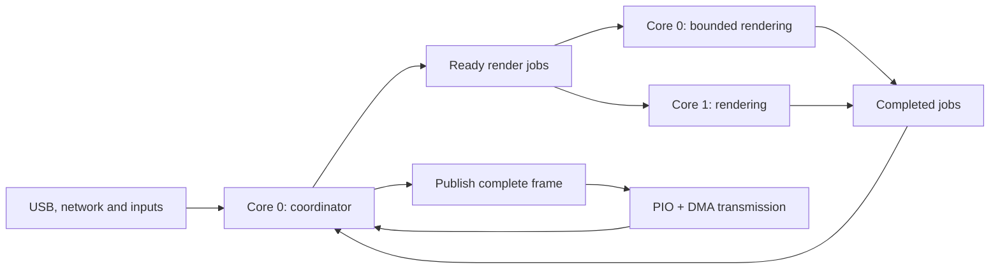

# Pico multicore rendering implementation plan

Status: Implemented with the refinements below. Research completed on 20 October
2026 against source revision `a0cc547` and the locally pinned Pico SDK 2.3.1.
This document preserves the original design exploration and proposed acceptance
matrix. The [validation report](../multicore-validation.md) identifies completed
checks, measured results and remaining physical/endurance coverage.

The [implementation guide](../multicore-rendering.md) records the current contract.
Implementation refined the proposed asynchronous graph into bounded execution
epochs: core 0 captures a pair of jobs, both cores execute, and core 0 joins before
publication or command processing. These joins provide the object-lifetime fence;
no command needs to wait for a background job left running across application
callbacks. This retains existing cooperative management checkpoints and avoids
duplicating the command state machine. Resource defaults, stack reservations,
kernel eligibility and validation status in the guide supersede initial candidates
below. The findings table describes the pre-change revision.

## Decision

Use a shared render scheduler with two execution workers. Core 0 owns the
application, communication, storage and hardware, and also executes bounded
render jobs. Core 1 executes render jobs exclusively. Keep PIO and DMA responsible
for LED transmission.

First parallelize independent animation instances, including layers, A/B
compositions and different outputs. Then use the same executor to divide
expensive, demonstrably independent pixel operations into ranges. This second
part is required to benefit a single expensive animation; dividing layers alone
cannot shorten its longest sequential render.

Implement this with the Pico SDK, without introducing an RTOS. Use one portable
scheduler with a serial executor for single-core platforms and a concurrent host
executor for testing. These execute the same jobs and dependency rules. After
validation, two workers become the normal configuration for supported Pico
boards; a one-worker diagnostic setting supports controlled comparisons.

The aim is higher sustained rendering throughput, consistent presentation and
responsive controls. Idle time is appropriate when frames are complete, the
configured refresh rate is satisfied, or output transmission is the bottleneck.

## Findings in the current implementation

| Area | Current behavior | Consequence |
| --- | --- | --- |
| Main loop | `platforms/pico/main.c` polls networking, calls `app_tick`, polls MQTT and reads USB, all on core 0. USB can wait 1 ms each iteration. | Communication and rendering compete on one CPU. |
| Memory layout | `platforms/pico/CMakeLists.txt` reserves a 16 KiB core-0 stack and no core-1 stack region. | Launching a second core requires an explicit linker and RAM-budget change. |
| Scheduler | `app_tick`, `composition_tick` and `transition_tick` call each other and run VMs cooperatively. Budgets count bytecode dispatches rather than elapsed time. | Existing functions cannot simply run concurrently. One native dispatch can cost much more than one arithmetic instruction. |
| Runtime services | `src/runtime.c` has global service, owner and recursion state. Checkpoints can run other VMs and poll networking. | A worker must never enter this application service path. |
| Animation | `animation.c` captures inputs, executes a resumable VM and copies its working frame into a committed contribution. | Separate coordinator work, exclusive VM execution and contribution publication. |
| Composition | `composition.c` blends 32 pixels at a time in layer order and defers autonomous layer writers during composition. | Layers can execute independently; a composite needs pinned, complete contributions. |
| Transition | `transition.c` pins A/B fronts, captures progress, restores custom-program state and executes bounded phases. | A/B work can run concurrently; transition evaluation still depends on captured A/B frames. |
| Pixel maps | `portable_map.c` verifies pure straight-line loops and executes at most 32 pixels per chunk. Scratch and register results currently belong to one invocation. | Strong initial candidate for parallel work within one animation, after extracting a separate range kernel. |
| Other native drawing | `portable_draw.c` combines VM state access with pixel kernels and sprite state operations. | Extract pure kernels; do not concurrently invoke the existing function on one `Portable`. |
| RNG | PCG state belongs to each VM, but `random_default` also increments a function-static 64-bit sequence. | Remove this shared mutation before allowing concurrent VMs. |
| Allocation | `vm_allocator.c` maintains unsynchronized global usage and peak counters. Normal rendering already avoids allocation. | Keep allocation, admission and destruction on core 0. |
| Output | PIO/DMA transmission is asynchronous. The simple VM nevertheless returns early while its previous output is pending. Composition has more overlap. | Decouple render-buffer ownership from physical output ownership to overlap the next render with transmission. |
| Cadence | `FRAME_INTERVAL_US` defaults to 16,667 microseconds. Composition and transition add scheduling decisions of their own. | Faster compute does not automatically raise displayed FPS beyond about 60; avoid unnecessary waits between pipeline stages. |
| Pico 2 maths | The Arm build enables FP/DSP instructions and uses `-ffp-contract=off` for the engine. The port explicitly selects compiler double routines. | Single-precision hardware is already enabled; benchmark SDK double acceleration separately. |

Relevant source files:
[main loop](../../platforms/pico/main.c),
[runtime](../../src/runtime.c),
[animation](../../src/animation.c),
[composition](../../src/composition.c),
[transition](../../src/transition.c),
[VM](../../src/vm.c),
[pixel maps](../../src/portable_map.c),
[native drawing](../../src/portable_draw.c),
[pixel output](../../src/pixels.c),
[Pico storage](../../platforms/pico/platform.c).

Existing local performance logs include scenes where one Stars layer costs far
more than the other layers and the transition combined. Their revisions and
workloads differ, so they are useful benchmark candidates, not a current baseline.
An illustrative 14 ms layer plus 3 ms of other layers takes at least 14 ms even
after perfect distribution across two cores: the layer-only speedup is at most
17/14, about 1.21. Accelerating the expensive layer's native operations matters.

## Options considered

| Option | Benefit | Limitation | Decision |
| --- | --- | --- | --- |
| Core 0 for communication, core 1 for all rendering | Clear ownership and less interference from I/O. | Most idle communication capacity cannot help a heavy animation. | Useful comparison build, insufficient as the final design. |
| Give core 1 LED transmission | Simple conceptual split. | PIO/DMA already perform transmission; little CPU work moves. | Reject as the main optimization. |
| Assign whole outputs or A/B sides permanently to cores | Coarse work has low dispatch overhead. | One output or an uneven A/B workload leaves capacity unused. | Use independent instances as jobs without permanent partitioning. |
| Parallel animation instances | Exploits existing independent VM state and works with arbitrary programs. | One dominant instance remains sequential. | First rendering milestone. |
| Parallel pixel ranges inside native operations | Helps single-layer maps, large sprites, composition and transitions. | Needs proven independence, precise fault behavior and an overhead threshold. | Second rendering milestone using the same executor. |
| Put VM work on one core and composition/packing on the other | Can overlap pipeline stages. | A fixed split performs poorly when their costs differ. | Express stages as jobs and schedule according to readiness. |
| Execute arbitrary bytecode instructions or successive frames concurrently | Appears to expose more parallelism. | Context, RNG, feedback and sprite updates carry dependencies. | Reject; preserve sequential state evolution per instance. |
| FreeRTOS SMP or unrestricted work stealing | General task scheduling. | Does not solve state ownership; adds stacks, synchronization and networking integration work. | Defer unless a later subsystem independently needs it. |
| GPU-style work on PIO/DMA | Useful for deterministic I/O and some copies. | These are not general animation processors. Extra copy DMA also competes with LED/radio traffic. | Continue I/O offload; benchmark copy offload only if profiling warrants it. |
| Native compilation or JIT | Could improve interpreter-heavy workloads. | Separate compiler, executable-memory and portability project. | Defer; profile dispatch cost after this plan. |
| Clock changes or overclocking | Can shorten CPU work. | Does not address dependencies or LED wire time; requires separate board validation. | Record actual clocks, retain supported stock operation for acceptance. |

The SDK's polling Wi-Fi integration has no multicore/thread safety. Keeping all
CYW43 and lwIP calls on core 0 allows that integration to remain appropriate.
Switching to its background variant would still require application-level
ownership and would not automatically make rendering parallel.
[SDK networking documentation](https://www.raspberrypi.com/documentation/pico-sdk/networking.html#pico_cyw43_arch)

## Execution and ownership

The diagram describes logical scheduling; core 0 alone manages dependencies.
Core 1 receives a bounded job descriptor and returns a completion. It does not
call `app_tick`, network services, transport callbacks, allocation, flash writes
or hardware reconfiguration.

### Job contract and dispatch

Introduce `render_scheduler.[ch]` and `render_executor.h`, with platform executors
in `platforms/pico/` and `platforms/host/`. A descriptor identifies the job kind,
instance/output generation, frame sequence, exclusive state or immutable source
views, destination range and work budget. Results contain completion/fault state
and timing. Pointers remain pinned until completion is collected.

Start with one outstanding core-1 assignment and small SDK job/completion queues,
allocated once during initialization. Core 0 selects another ready job for itself
after servicing I/O. A reserved completion slot prevents a worker from becoming
stuck behind a full completion queue. Keep the ready list bounded by admitted
instances and active stages; generate pixel ranges on demand instead of creating
an unbounded graph of pixel jobs.

SDK queues supply synchronization. Hold locks only to transfer descriptors.
Never hold a lock while rendering, polling hardware or waiting for another core.
Do not use `volatile` as a publication mechanism, or assume 64-bit counters are
atomic. Do not use the hardware inter-core FIFO for application jobs: SDK core
launch and flash lockout use that resource.
[Pinned SDK multicore interface](https://github.com/raspberrypi/pico-sdk/blob/2.3.1/src/rp2_common/pico_multicore/include/pico/multicore.h),
[queue implementation](https://github.com/raspberrypi/pico-sdk/blob/2.3.1/src/common/pico_util/queue.c).

Prioritize work approaching an output deadline, with round-robin fairness across
outputs. Dispatch a costly eligible job to core 1 early so that core 0 can service
I/O and execute other work concurrently. Use measured moving-average costs to
avoid splitting tiny kernels. Do not force an exact 50/50 division when core 0
also has communication work.

Bound CPU slices by both instruction/native-operation counts and time checked at
safe boundaries. Start calibration around 250–500 microseconds of core-0 render
work per service opportunity; this is a tuning target, not a claimed worst-case
latency. Measure the longest native chunk on RP2040. Polling a clock for every
pixel would itself add overhead.

### VM and frame ownership

Use explicit states such as `READY`, `RUNNING`, `WAITING_FOR_RANGES`, `COMPLETE`
and `FAULTED`. Exactly one worker owns a VM's mutable execution state. A suspended
invocation can resume only after the previous slice has returned ownership.
Prefer the same worker for locality, without making permanent affinity part of
the program contract.

Core 0 captures time, delta, inputs and relevant light controls before starting
an invocation. Workers use the capture throughout that invocation. Supply a
coordinator-owned snapshot timestamp rather than independently sampling shared
sources on each core. Live changes become eligible for the next capture.

Core 0 publishes a contribution only after successful completion. Pin committed
contributions for composition and A/B fronts for transition jobs. Rendering may
write a separate working buffer, but cannot overwrite a pinned contribution.
Reuse the existing working/front buffers where their lifetimes permit it.
No default third copy of every layer is needed.

Preserve ordered blending within each output pixel. Different pixel ranges may
run concurrently, with each range walking layers in the original order. Capture
the selected layer frame versions at composition start. A/B frames and transition
progress remain fixed for one transition evaluation. Unrelated outputs have
independent deadlines; a slow output must not impose a global frame barrier.

Normal playback can compose the latest complete contributions, retaining the
current independent-layer model. An explicit manual `FRAME` operation advances
the requested instances by the supplied delta and waits for the required jobs,
then composes and returns that complete result. Test both contracts rather than
silently replacing playback with a global lockstep simulation.

### Commands and lifecycle

Refactor management into preparation, a targeted execution fence, commit and
retirement. Prepare and admit candidate resources on core 0. Before replacing or
freeing live objects, stop new assignments for the affected objects and collect
all jobs that can reference them. A generation check detects stale results, but
does not make freeing live pointers safe.

Command handling must remain resumable while waiting: poll I/O, collect
completions and service unrelated outputs. A callback must not recursively run a
second mutation while a command awaits its fence. Preserve session/request IDs,
ordering and disconnect cancellation across deferred completion.

Pause and ordinary edits should finish an already-started stateful invocation,
as `animation_quiesce` currently requires. A nonterminating program needs an
explicit invocation budget and fault policy; slice quotas alone do not guarantee
completion. Add that budget for initialization and rendering, with diagnostics,
and never resume partially mutated state after a forced fault. Reset/destruction
can discard the retired instance once its running slices have stopped.

Expose completed statistics and committed snapshots to status requests. If an
operation requires live mutable guest state, fence that instance first. Copy
64-bit metrics through the completion/snapshot protocol.

Replace `random_default`'s shared sequence with a seed assigned at instance
creation and an instance-local reseed counter. Explicit seeds must produce the
same sequence in one-worker and two-worker execution. Default seeding remains
independent between instances without depending on worker interleaving.

Make runtime execution context explicit. Core-0 checkpoints may service the
coordinator; worker checkpoints only yield/check budgets. Keep heap accounting
and resource admission on core 0. Audit SDK per-core initialization, floating
point state and C-library state when bringing up core 1 through the standard
SDK launch API.

## Parallel work within an animation

| Work | How to divide it | Required constraint |
| --- | --- | --- |
| Verified `PIXEL_MAP` | Decode/capture once, execute independent index ranges, join and commit registers once. | Private scratch, stable inputs, disjoint writes, scalar-equivalent final locals/index and fault behavior. |
| Fill, gradient, colorwheel and palette kernels | Split the destination span. | Capture parameters and read-only palette; preserve per-pixel arithmetic. |
| Sprite sampling and transforms | Split destination pixels of an eligible draw call. | Immutable source/style and no source/destination overlap or shared mutation. |
| Layer composition | Split output pixels; each range blends every layer in order. | Pinned source contributions. |
| Native A/B transition kernels | Split output pixels. | Pinned fronts and captured progress/seed. |
| Custom transition programs | Run the VM as an exclusive job; split only eligible native operations inside it. | Baseline restore completes first; arbitrary guest state remains ordered. |
| Brightness and wire-format packing | Divide a sufficiently large frame into ranges before DMA submission. | Immutable brightness/order, disjoint output storage and exact rounding. |

Extract kernels that accept immutable parameters and a range. Existing helpers
mutate `Portable` registers, its bytecode cache, `bulk`, `native_pending`, fault
flags and counters; sharing that object between two range jobs is unsafe.

For pixel maps, prepare a reusable operation description and captured scalar
values. Each worker has private evaluation scratch. The coordinator merges the
result from the last logical iteration, sets the final index, and resumes the VM
only after all ranges finish. Count logical operations separately from worker
jobs so diagnostics do not depend on how a map was partitioned.

Start parallel map support with the transient frame working output. Writes to
persistent PixelArrays require separately verified fault semantics or admitted
staging storage: a later range must not leave observable changes after an earlier
logical iteration faults. Keep such operations serialized until that requirement
is met. Faulting parallel work never publishes a partial frame.

The owner yields at a parallel operation. Core 0 schedules its ranges on the two
workers and joins them; neither worker synchronously waits for child jobs. This
avoids nested worker-pool deadlocks.

Keep sprite/context updates and RNG consumption sequential. Parallelizing
overlapping sprites as separate jobs would change blending and introduce races.
Large destination spans within an individual pure draw call are safe candidates;
many tiny sprite draws may benefit more from faster native kernels than from
cross-core dispatch. A deferred drawing command list is a later option only if
measurements justify its memory cost and its read-after-write semantics are clear.

Use a calibrated minimum cost for splitting, not “always split at 32 pixels”.
Benchmark ranges of 32, 64, 128 and 256 pixels with cheap and expensive operations.
Small work executes directly through the same kernel. Preserve f32 operation
order and `-ffp-contract=off`; do not enable global fast-math.

## Frame pipeline and achievable FPS

Allow frame N to transmit while workers prepare frame N+1. A simple VM currently
waits for its previous transfer before rendering; remove that coupling by tracking
render and transfer ownership separately. Keep one ready frame per output and
backpressure rather than allowing a queue of stale animation frames.

Separate pure packing from DMA submission. The first implementation can retain
one wire buffer and pack after the preceding DMA releases it, while rendering
overlaps transmission. A second wire buffer costs about 4 KiB per 1024-pixel
WS2812 output, so add it only where measured packing cost merits the memory.
Always retain the last complete output for snapshots and error recovery.

Poll completions promptly and schedule composition/transition work immediately
when its dependencies are ready. Enforce presentation cadence once per physical
output rather than adding a full refresh interval between each pipeline stage.
Replace the unconditional 1 ms USB wait with nonblocking ingress while work is
ready, then sleep only until the earliest service/output/job deadline.

Default to the highest useful sustainable refresh rate: present as soon as a
new complete frame and the physical output are ready. Offer an optional refresh
cap for applications that need one. Report the cap, completed render FPS and
completed physical-output FPS separately. Simulation uses elapsed time, not an
assumed frame rate. Apply backpressure when output is busy rather than
accumulating stale frames or rendering frames solely to discard them.

At this driver's 800 kbit/s WS2812 rate, RGB data takes 30 microseconds per pixel.
Using its conservative 330-microsecond drain/reset allowance gives these
approximate optimistic ceilings before extra polling and packing delays:

| Pixels on one data line | Data plus allowance | Approximate ceiling |
| --- | --- | --- |
| 200 | 6.33 ms | 158 FPS |
| 500 | 15.33 ms | 65 FPS |
| 1000 | 30.33 ms | 33 FPS |
| 1024 | 31.05 ms | 32 FPS |

These are calculated from the current [driver](../../platforms/pico/pixels.c),
not hardware measurements. The allowance starts when drain is observed, so
polling latency can lower actual throughput. Two 500-pixel outputs can transmit
in parallel, unlike one 1000-pixel chain, if the wiring, memory and rendering
budget support it. APA102 has a configurable clock; measure it separately.
Changing wiring is an installation choice, not a firmware optimization alone.

For a well-overlapped pipeline, the steady-state frame interval is bounded by
the largest of render/compose/pack throughput, physical wire time and requested
interval, plus scheduling/dependency effects. An upper bound on compute speedup
is `1 / ((1 - p) + p / 2)` for parallelizable fraction `p`, before communication,
imbalance and shared-memory contention. “Twice the cores” is not a universal
2x-FPS promise.

## Flash and platform integration

Current storage and boot-journal writes disable interrupts on only one core.
Before enabling concurrent jobs, replace both paths with a shared
`flash_safe_execute` wrapper and initialize core-1 flash safety before any storage
operation can race its execution. Stop new assignments, collect active jobs,
then perform the SDK lockout with SRAM-resident arguments and a RAM-safe callback.
Never hold scheduler locks across the operation. Handle entry/exit failure and
do not blindly retry a write whose execution outcome is uncertain.
[SDK flash safety documentation](https://www.raspberrypi.com/documentation/pico-sdk/high_level.html#pico_flash),
[pinned implementation](https://github.com/raspberrypi/pico-sdk/blob/2.3.1/src/rp2_common/pico_flash/flash.c).

Flash writes still interrupt rendering. Continuing during erase would require
all reachable worker code, constants, bytecode and assets to reside in SRAM, with
safe interrupt and DMA dependencies. That is not the initial design. Report
storage pauses separately and resume animation clocks deliberately.

Pin program extents throughout jobs and restrict storage mutation to core 0.
Audit the complete worker read path through `vm_read` and `store_read`, including
the host storage backend; `const` on one parameter alone is not a concurrency
guarantee. Never relocate, unpin or destroy a backing store while it is borrowed.

Use the SDK's regular core-launch wrapper so per-core initialization and stack
guards run. Reserve and account for a second stack explicitly; ensure heap and
both stack regions cannot overlap. Both cores must stop at acknowledged safe
points before shutdown or hardware reconfiguration.

PIO/DMA ownership, channel allocation, completion polling and keypad/I2C access
remain on core 0. A timed-out worker must not be reset while leaving borrowed
objects or locks live. Detect loss of progress, report the fault and use a
controlled whole-device recovery when safe continuation cannot be established.

## Memory and board-specific performance

Existing build reports show why this needs separate board budgets:

| Saved profile | Space after current reservations |
| --- | --- |
| Pico W, HTTP/WebSocket/MQTT, boot sequence off | 2,380 bytes |
| Pico 2 W, corresponding profile | 260,344 bytes |

These are saved build reservation reports under `build/pico2-w-support/`, not
runtime free-heap measurements or a fresh build of this proposal. Rebuild the
exact current feature matrix before deciding capacities. The existing gate
already reserves 16 KiB of operating headroom; do not spend that reserve merely
to make the new build pass.

Start with a 4 KiB core-1 stack budget on Pico W and 8 KiB on Pico 2 W, subject to
compiler stack-usage reports, guards and measured high-water marks. The current
map evaluator alone needs approximately 1 KiB of scratch. Budget queue storage,
descriptors, per-worker scratch, TLS, instrumentation and any frame staging
exactly once.

For Pico W, first reclaim storage whose lifetimes are mutually exclusive:
`network_port.c` currently retains both HTTP ingress and WebSocket state in each
client. Audit handshake completion, queued requests, errors and disconnects
before overlaying those buffers. Streaming large HTTP responses is another
potential saving. Preserve advertised capacities where possible; if a profile
needs a different limit, make that explicit and test admission. Do not silently
disable a transport or skip the RAM gate.

Give Pico 2 W a larger admitted VM budget instead of retaining Pico W's 64 KiB
network ceiling indefinitely. Evaluate 192 KiB for networking and 256 KiB for
USB-only as starting candidates, then select values from measured peak use and
worst-case reservations. More resident layers improve capacity, not necessarily
FPS. Keep module size and pixel ceilings independent from that choice.

Additional optimizations belong behind separate measurements:

- **Math:** RP2350 has single-precision FP hardware; it is already enabled by the
  current Arm flags. Benchmark the pinned SDK `pico`/`pico_dcp` double routines
  against the explicitly selected compiler implementation. Check rounding,
  edge cases, long-running animation time, sprite wrapping and transition
  seeking before adopting them. Retain double precision where correctness needs
  it rather than converting every calculation to float.
  [RP2350 hardware](https://www.raspberrypi.com/products/rp2350/),
  [SDK double implementation](https://github.com/raspberrypi/pico-sdk/blob/2.3.1/src/rp2_common/pico_double/include/pico/double.h).
- **Code/data locality:** both cores and DMA share memory-system resources.
  Profile XIP contention, then consider small hot kernels in SRAM and bounded,
  shared immutable bytecode caching on Pico 2 W. Do not copy every module to RAM
  or duplicate code per VM. Cache admission and eviction belong to core 0.
- **Packing and copies:** measure working-to-committed copies, RGB conversion,
  brightness, wire packing and snapshot copies independently. Fuse passes only
  while preserving current rounding and frame lifetimes. Existing integer blend
  kernels are already optimized; avoid replacing them speculatively.
- **PIO capacity:** the current output drivers use PIO0/PIO1. RP2350 also has
  PIO2, used preferentially by the radio SDK. Consider its remaining resources
  only when more independent outputs are required, with explicit arbitration
  and RAM accounting. It does not accelerate an existing single data line.
- **Clock and hardware helpers:** report `clk_sys` in benchmarks. SDK defaults
  normally differ between RP2040 and RP2350. DSP/interpolator helpers are
  candidates only for identified kernels whose numerical behavior they preserve.
  Do not make overclocking a dependency of this design.

The hardware has a multi-master memory system shared by CPUs and DMA; independent
cores can still compete for bandwidth.
[Raspberry Pi microcontroller documentation](https://www.raspberrypi.com/documentation/microcontrollers/microcontroller-chips.html)

## Implementation sequence

| Step | Concrete changes | Completion criterion |
| --- | --- | --- |
| 1. Establish baseline | Extend `benchmark_controller.py` for `pico2_w`; add layered/A-B/sprite/multi-output workloads and render/queue/packing/wire/I/O metrics. Record source, firmware, board, clock, features and seeds. | Reproducible current one-core results and RAM reports for both chip generations. |
| 2. Separate jobs and ownership | Add scheduler/executor interfaces; split capture, VM resume, commit, composition and output submission. Replace global runtime/RNG hazards; add resumable command fences and invocation limits. Execute jobs serially first. | Existing contracts pass, deterministic manual frames match, and one-worker overhead remains within the agreed budget. |
| 3. Bring up core 1 safely | Add queues, launch/ready handshake, stacks/guards, flash coordination, worker fault handling and host concurrent executor. Resolve Pico W memory fit before enabling production jobs. | Race/lifetime tests pass; both Pico builds pass RAM gates; storage and boot journal survive concurrent-render stress. |
| 4. Parallelize instances | Schedule layers, A/B instances and outputs across both workers; preserve publication order, input captures and fairness. | Measurable compute gain on balanced scenes and responsive commands under load. |
| 5. Parallelize pure kernels | Extract map preparation/range/join and native range kernels; add composition/transition ranges and cost thresholds. | Single eligible heavy animations gain throughput; exact output/state/fault tests pass. This is part of the target design, not optional polish. |
| 6. Complete the output pipeline | Overlap render and DMA, remove avoidable polling waits, centralize output pacing, add target-refresh configuration and physical FPS telemetry. | No buffer tearing or stale backlog; expected wire limits are visible and measured. |
| 7. Tune each board | Profile SRAM/XIP placement, double routines, copies, thresholds and larger Pico 2 W budgets. | Keep only independently demonstrated improvements; publish board-specific resource limits. |
| 8. Validate and ship | Run host and hardware matrices, endurance and fault tests; update current architecture, board, control and performance docs and firmware CI. | Both-core operation is normal for supported Pico profiles, with evidence of throughput, latency and memory safety. |

Use small reviewable changes in that dependency order. The SDK worker, the
serial/concurrent host executors and the kernel contracts should have clear
interfaces; avoid spreading core-number checks throughout animation code.
Keep a one-worker diagnostic executor using the new scheduler, rather than
maintaining the old scheduler as a compatibility path.

Coordinate configuration additions with the existing
[build-profile proposal](feature-proposal-build-profiles.md), but do not require
that entire feature to land first. If experimental configuration or stored
program contracts change, document clean provisioning and recompilation rather
than implementing migration shims.

## Validation and acceptance

### Correctness

- Compare one-worker and two-worker execution on identical bytecode, explicit
  seeds, input captures and manual frame deltas. Check pixels, guest state,
  final map locals/index, RNG state, transition endpoints and seeking.
- Exercise empty ranges, odd lengths, all blend modes, aliasing, faults in the
  earliest/middle/latest range, suspended native operations and command changes
  during every job state. Faults retain the last committed output.
- Test reset/replacement/removal, resource exhaustion, generations, disconnects,
  worker stalls, queue pressure and output faults. Poison retired buffers in
  host tests to detect late accesses.
- Run the concurrent host executor with ThreadSanitizer and randomized scheduling
  where supported, plus the existing ASan/UBSan and engine contract coverage.
  Host tests complement physical memory-ordering, IRQ and timing tests.
- Audit every flash path, including upload, preset/config save, auto-save and
  boot journal. Verify persisted data and recovery after interruption.

### Performance matrix

Run on Pico/Pico W (RP2040) and Pico 2 W (RP2350), USB-only and the full supported
network profile, with quiet and sustained USB/WebSocket/MQTT traffic. Use
200-, 500- and 1024-pixel cases and multiple outputs where admission permits.
Measure WS2812 and APA102 separately.

Workloads should include a pure map, a scalar stateful loop, large sprite
transforms, many small sprites, balanced and deliberately uneven layers, live
A/B transitions, frozen-source transitions, the existing Rainbow/Stars scene,
and simultaneous independent outputs. Include palette/source updates, keypad
activity, preset replacement and flash saves.

Record median/p95/p99 frame latency, completed physical FPS, deadline misses,
input-to-visible latency, command RTT, maximum network poll gap, per-core busy
time, queue/lock overhead, stage costs, stack high-water marks, peak heap and
allocation failures. Sum of core CPU times can exceed wall time; label them
separately. Exclude or separately label flash pauses, and compare quiet and
instrumented builds to quantify measurement overhead.

Initial acceptance targets, to be confirmed with the baseline:

- At least 1.5x compute throughput on a balanced CPU-bound two-instance workload
  against the new scheduler with one worker; report the original baseline too.
- A clear gain on a sufficiently expensive, eligible single-animation map or
  sprite workload. If range overhead exceeds savings, adjust thresholds or the
  kernel before claiming this milestone complete.
- No repeatable regression above 5% on small or wire-bound workloads outside
  measurement noise; no increase in uncontrolled frame backlog.
- Meet the configured cadence when measured compute and wire budgets fit it,
  and keep interactive command p99 below an initial 50 ms target under the
  specified normal traffic workload. Report storage operations separately.
- Zero data-race reports, corrupted frames, unexplained resets or allocation
  growth in stress tests; both stack guards intact and operating RAM headroom
  maintained.

The architecture is selected. Job-size thresholds, final stack/heap budgets,
code placement and supported higher refresh rates are tuning decisions that
must come from these measurements.
