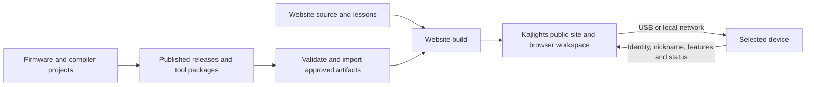

# Kajlights website implementation plan

Status: Implementation started

Date: 30 October 2026

## Purpose and implementation scope

Build a public Kajlights website where people can learn through light, sound and
connected objects, program without owning hardware, and install and maintain
supported devices without a local development environment or GitHub account.
The website owns the public experience; firmware projects provide independently
built implementations, reusable tools and verified release artifacts.

The existing editor, shared device services and
[OTA proposal](feature-proposal-firmware-ota.md) provide enough architectural
direction to start implementation. The remaining work includes formalising the
shared data contracts, producing releases, adding persistent device nicknames
and proving each installation method. These are explicit work packages below.
OTA remains future functionality and does not block a useful first website.

The first delivery includes public learning material, an offline lighting
preview, a device workspace for LightVM and kaj-fi, nicknames, feature reporting,
a release catalogue and local installation/recovery. Here, offline preview means
no device connection is required; installation of the website as an offline PWA
is a separate future choice.

LightVM remains at application version `0.1.0`. This plan does not authorise a
version change, release tag, release publication or production deployment.

## Product direction and public navigation

The public invitation is to make computing tangible through light, sound and
connected objects. Play, investigation and making are equally valid ways to
participate. A visitor can enjoy a pattern, change a rule, investigate a message
or build a connected object without following a compulsory course.

Organise material around three related subjects:

- Computing logic: values, choices, repetition, state, time, arrays and debugging.
- Hardware and signals: pins, colour encoding, timing, inputs and hardware buses.
- Connected systems: discovery, messages, subscriptions, identity, persistence,
  freshness and recovery from failure.

Use the audience and content separation established by Found in Space, with
Kajlights language and examples. Share useful design practices rather than
creating a dependency on its scientific-data applications or private coordination
material. Educational intentions and suggested timings must remain distinct from
evaluated learning outcomes.

| Route | Responsibility |
| --- | --- |
| `/` | Explain the purpose and offer play, learning, making and device setup. |
| `/play/` | Runnable browser activities, including activities requiring no board. |
| `/learn/` and `/learn/<lesson>/` | Guided activities, explanations and editable examples. |
| `/teach/` | Suggested activities, preparation, discussion prompts and adaptations. |
| `/build/` | Reusable materials, supported authoring tools and contributor routes. |
| `/hardware/` and `/hardware/<board>/` | Board identification, wiring, capabilities and recovery. |
| `/projects/<project>/` | Explain each implementation and its actual availability. |
| `/install/` | Help identify a board and open the installation workflow. |
| `/releases/` | Browse published product releases and their feature/capacity information. |
| `/studio/` | Persistent browser workspace for programming and device management. |
| `/about/` | Purpose, ownership, openness and relationship to sibling projects. |

The main navigation includes a clear **My devices** link to
`/studio/#/devices`. Repository names need not be understood before choosing an
activity. Show availability explicitly, including browser-only experiences,
hardware requirements and planned features.

## Repository ownership and website architecture

| Owner | Implementation responsibility |
| --- | --- |
| `KajLights.github.io` | Public pages, lessons and their source examples, design system, workspace UI, device inventory, nickname UI, release policy/catalogue importer, install/update UI and public guidance. |
| `lightvm` | Firmware, VM, compiler frontends, browser compiler/preview packages, lighting drivers, build/profile resolution, artifact production and runtime admission. |
| `kaj-fi` | Capture, analysis, publication, firmware, analysis library packages, product configuration adapter, artifact production and application health checks. |
| `shared/device-core` | Shared descriptor/metadata contracts, device metadata persistence, management transport, discovery and common maintenance services. |
| `pixelblaze-lightvm` | Its compiler implementation and frontend-specific runtime requirements; the website integrates it only after current-runtime admission is demonstrated. |
| Earlier CircuitPython work | Historical or separately described experiments, outside the native installation contract. |

Keep developer build instructions, API contracts, recovery implementation and
technical examples beside their code. User-facing lessons and maintenance
instructions have one canonical home on the website. A small device-local
provisioning/recovery page remains part of firmware so setup does not require
the public site to be reachable.

Use a static Astro content site and one React workspace at `/studio/`. Reuse the
current editor rather than rewriting the compiler, preview or device protocols.
Use hash routes inside the workspace, for example
`/studio/#/devices/<controller_id>/firmware`, so GitHub Pages can serve refreshed
deep links without server rewrites. Keep connections and unsaved drafts alive
when switching workspace views. Warn before navigation that would discard work.

The browser connects directly to boards over the existing transports. The
public hosting service does not connect to the user's LAN. The first delivery
needs no user accounts, cloud device database or general build service.



A proposed website layout is:

```text
src/pages/                    Public routes and the studio entry
src/content/lessons/          Explanations and editable lesson sources
src/data/                     Projects, product registration and public board guides
src/styles/                   Shared visual tokens and components
src/studio/                   Workspace shell, devices, editor and install UI
src/studio/adapters/          Product-specific UI adapters
scripts/import-releases.mjs   Catalogue acquisition and validation
release-policy/              Approved sources, recommendations and withdrawals
public/distribution/         Generated, verified assets, excluded from source Git
tests/                       Content, selection, UI and browser checks
```

Shared contracts are authored once with device-core and consumed by exact
revision. Product projects publish versioned compiler, preview and client
packages or immutable tool bundles. The live website uses pinned dependencies;
local path overrides are development-only. Do not leave vendored protocol copies
in each frontend. Extracting device-core into a neutral repository can follow
when cross-project pinning warrants it; it is not a launch prerequisite.

## Current implementation baseline

| Area | Current state | Required change |
| --- | --- | --- |
| Main website | Small Jekyll landing page for home-automation utilities. | Replace its content/build with the public site and workspace. |
| Lighting workspace | React editor, configuration, mixer, browser preview and audio playground. | Move ownership of the UI to the website and consume implementation packages. |
| Device discovery | Shared DNS-SD and board-provided HTTP peer lists; the editor filters for light-output devices. | Generalise inventory for both products and route controls by their descriptions. |
| Firmware description | Shared generated build/features/hardware members and machine-readable contracts are implemented in both products. | Complete release-producer/tool contracts and physical installation validation in their stages. |
| Nicknames | Shared metadata storage and guarded read/write operations are implemented, with browser/Python clients. | Carry these controls into the new website workspace and perform physical-device acceptance. |
| Installer | Images are bundled by the LightVM Pages workflow from `main`. | Consume selected published release artifacts through the catalogue. |
| Published releases | Both accessible release lists are empty at this planning baseline. | Prepare producer workflows and fixtures; publish only by explicit release decision. |
| Pattern compiler | Its manifest emits the superseded `1.3.0` runtime requirement. | Establish compatibility with the current runtime and test real admission. |
| OTA | Detailed proposal; no updater implemented. | Integrate only after platform boot, verification and recovery gates pass. |

The current Pages workflow couples firmware building and website publication.
Split these responsibilities: product CI builds/tests/packages implementations;
website CI assembles the public experience from explicit inputs. Ordinary
firmware commits must not silently replace the public installer catalogue.

## Shared contracts and device sessions

Implement the common descriptor specified by the
[OTA proposal](feature-proposal-firmware-ota.md#reading-the-installed-build-and-features).
It is required even when OTA, MQTT and audio are absent. Preserve the meaning of
`controller_id`, `boot_id` and the authoritative root `version`.

| Contract | Required information |
| --- | --- |
| Device description | Product, board/variant, chip/flash geometry, stable/boot IDs, nickname, build identity, features, effective limits, storage/layout/boot contracts and installation methods. |
| Device metadata | Optional nickname and an independent mutation revision. |
| Feature catalogue | Stable feature IDs, dependencies, conflicts, supported targets and public explanations. |
| Artifact manifest | Exact build inputs, target/profile, compiled features, capacities, compatible contracts, payloads, hashes and signatures. |
| Website catalogue | Imported artifacts plus recommendation, visibility, withdrawal and validation policy. |
| Tool bundle | Compiler/frontend provenance, preview/client assets, supported runtime contracts, package digests and licenses. |

Define machine-readable schemas, maximum sizes and fixtures before implementing
consumers. Do not introduce per-feature application-version floors. Encoding
and layout identifiers describe real compatibility boundaries; schema tooling
does not create another product release train. Update active clients together
when an experimental contract changes rather than adding legacy adapters.

A device session verifies identity directly before enabling controls. Deduplicate
USB and network paths by `controller_id`; require the same `boot_id` when joining
paths to one running session. A boot change invalidates capabilities, revisions,
preflight results and pending mutations. Never route a command by nickname,
list position, IP address alone or stale discovery data.

Initially support a remembered inventory with one active device workspace.
Switching the selected device must not send outstanding commands to the new
selection. Preserve drafts by their explicit target and keep a clear selected
device banner. Devices continue operating independently while another is selected.

Browser discovery uses a known board's peer list, a direct address or USB; it
does not assume a browser mDNS scanning API. Capability masks are discovery hints.
Read the complete description before opening product controls or admitting an
installation. A compiled feature, its configuration and its current availability
are separate facts: a disconnected MQTT broker does not mean MQTT is absent.

Unknown optional features can be displayed generically or ignored. Unknown
required contracts, invalid identity and unsupported required capabilities stop
the relevant operation with a reason. A device cannot supply arbitrary scripts,
package URLs or firmware URLs for the website to execute or install.

## Persistent device nicknames

Store the nickname in a small shared device-metadata object on the board. This
makes the same name visible through USB, network connections and another browser.
Keep it independent of output names, presets, network credentials and product
configuration. A rename must not alter `controller_id`, hostname, hardware
identity, program references or Home Assistant unique IDs.

The implemented management operations use the existing LVM1 transport:

```json
{"op":"device_metadata_get"}
```

```json
{
  "op": "device_metadata_set",
  "nickname": "Kitchen shelf",
  "expected_revision": 4,
  "expected_boot_id": "current-boot-id"
}
```

The read and successful write return the canonical saved value and its revision:

```json
{
  "schema": "kajlights.device_metadata",
  "nickname": "Kitchen shelf",
  "revision": 5
}
```

Implementation rules:

- Accept `null` to clear the name. Trim leading/trailing ASCII spaces and turn
  the resulting empty string into `null`. Preserve valid UTF-8 up to 63 bytes;
  reject malformed UTF-8 and ASCII control characters. Validate on the device
  as well as in the UI, and render the name as text.
- Save atomically through shared persistence on an explicit **Save name** action.
  Do not write flash on each keystroke. Reject stale revisions/boot IDs, storage
  failure and read-only storage without claiming a successful rename.
- An unset record reads as `nickname: null`; it does not require a migration or
  a write at boot. Allocate an unused shared store type and update the storage
  policy hooks in both products; existing LightVM types already occupy 1–7.
- Keep metadata concurrency separate from network and application settings.
  Refresh any changed catalogue revision after a metadata write. Coordinate
  flash work with the existing management/render/audio owners and report any
  audio capture gap rather than implying continuous capture during saving.
- Add `nickname` and `metadata_revision` to the direct description. Discovery
  may carry a bounded optional name; it must still expose unnamed devices, and
  the direct read is authoritative. Account for DNS-SD packet/cache limits.
- Use `Kitchen shelf · Pico W · …42a1` in device lists and consequential actions.
  Names need not be unique. An unnamed device uses its product/board and short ID.
- Cache the last observed label in the browser only as an offline inventory hint.
  Mark it as last seen, refresh it on connection and never use the cache as proof
  that a device is present or that a rename was saved.
- Retain metadata through compatible firmware changes. Include it in explicit
  configuration exports and clean-install guidance. A factory wipe removes it;
  changing products/layouts does not promise automatic identity/name transfer.

Use the existing management write policy for initial local naming. When scoped
pairing/authorization is introduced for network maintenance, integrate metadata
writes with that policy. A management session ID is not authentication.

## Firmware profiles and resource presentation

The default LightVM image includes the lighting runtime, normal input bindings,
presets/storage, USB and recovery. Wireless boards also include provisioning,
discovery and browser management. MQTT/Home Assistant and audio subscriptions are
independent optional native features. Audio must not require MQTT. The default
Pico W image excludes OTA, as the OTA proposal requires.

Start with a small approved build matrix per supported board:

| Feature selection | Meaning |
| --- | --- |
| Standard | The ordinary lighting/programming experience. |
| MQTT and Home Assistant | Standard plus broker-based control and HA discovery. |
| Audio | Standard plus supported audio subscriptions/gateway handling. |
| MQTT and audio | Both integrations when the board's measured budget permits. |

Only list combinations actually built, tested and published for that target.
Future OTA variants add a separately validated layout/boot strategy. They are not
automatically available for every row or board. Defaults on other OTA-capable
boards remain a measured profile decision; current firmware has no OTA option.
The first website selects prebuilt artifacts rather than offering arbitrary
checkbox combinations that trigger an on-demand cloud compiler.

In the installer, show **Standard firmware** first. **Additional features**
exposes available choices and their dependencies. Selecting a missing feature
means installing another native image; it is not a runtime plugin download.
Keep browser-only audio exploration available independently of connected-board
support and load its analysis assets when opened.

Report capacity from artifact measurements and the device's effective limits:
firmware bytes and slot headroom, saved-content capacity, VM budget, module
limit and relevant pixel/layer limits. Separate nominal storage from free space
and staging/fragmentation requirements. Smaller firmware does not automatically
enlarge the animation store. Keep store boundaries stable within a layout family;
a deliberate new layout can allocate more content space through local install.

The [Pico W measurements](../validation/ota-picow-size-2026-10-30.json) establish
specific current-build costs, not a universal saving for every board. Audit that
excluded services remove their dedicated implementations, buffers and unused
dependencies; the current core still lists audio sources unconditionally.

## Build identity and release artifacts

Generate firmware descriptions and packaging metadata from the same resolved
build inputs. Each product retains its own authoritative application version.
The current LightVM application and compatibility baseline remain `0.1.0`.

Use three distinct identifiers:

- Product version: the explicitly agreed application release milestone.
- Build ID: a digest of canonical source/dependency revisions, target, resolved
  features/drivers, resource settings, layout and relevant SDK/toolchain inputs.
- Artifact digest: the SHA-256 of the actual distributed payload bytes.

This avoids treating source SHA as a complete build identity and avoids a
circular requirement to embed a binary's own complete digest inside that binary.
Record the payload digest in the signed manifest and verification transaction.
Two profiles with the same application version remain different selectable builds.

Each release manifest must include:

1. Product/repository identity, release tag, resolved source commit and build ID.
2. Exact target/variant, supported hardware revisions, chip and flash geometry.
3. Resolved profile/features, their digest, dependency revisions and build tools.
4. Boot/layout contract, allowed update strategy, image regions and size limits.
5. Storage/configuration formats and runtime program/binding requirements.
6. Full local-install payloads separately from application-only OTA payloads;
   offsets where appropriate, byte sizes, SHA-256 and signing key/signature data.
7. Measured capacity report, matching tool bundle and third-party notices.
8. Recovery, clean-install and content-preservation requirements.

For ESP32, hash every bootloader, partition and application part. For Pico,
retain UF2 family/layout validation and distinguish transport-file size from
actual firmware flash consumption. Derive these values from linked output and
native flasher descriptions rather than repeating the current installer's fixed
2 MiB application assumption.

A producer workflow validates a deliberate release tag against the version file,
builds/tests the approved matrix from exact inputs, and attaches all complete
assets to a draft release. Publication is a deliberate release action. Use
immutable releases and provenance where available, without confusing GitHub's
release attestation with the device's signed-manifest verification contract.
CI on ordinary commits produces development evidence, not public stable releases.

## Catalogue acquisition and public distribution

The website imports releases in CI from allowlisted product/distribution
repositories. It does not query GitHub separately for every visiting browser.
Firmware needs no GitHub credentials or internet access to describe itself.

The catalogue importer performs the following steps:

1. Enumerate all release pages from registered sources; handle API pagination,
   rate limits, not-found/authentication errors and incomplete responses.
2. Exclude drafts explicitly even if the CI credential can see them. Import
   prereleases into a separate opt-in channel. A tag without a complete published
   release and required manifest is not an installable candidate.
3. Resolve source tags to commits and validate product, schemas, signatures,
   targets, features, capacities and asset inventory. Reject conflicting build
   identities and malformed manifests rather than inventing missing values.
4. Download approved payloads/tool assets in CI, verify exact bytes and mirror
   them under immutable paths on the hosted origin. Do not unpack archives with
   unsafe paths. Record provenance and retain a reproducible import lock.
5. Apply website policy for recommended builds, supported tool contracts,
   visibility and withdrawals. Recommendations may differ by board/profile and
   are independent of GitHub's repository-wide latest flag.
6. Generate the public catalogue with an ID, generation time, source release
   identity and verified asset paths. Check all references before deployment.

A source failure must not silently publish an empty catalogue or remove working
downloads. Retain the previous successful deployed site while a failed import is
resolved. Show the catalogue's verification time; a browser refresh fetches the
current published catalogue, not an unimplemented live GitHub scan.

Refresh on a release-to-website dispatch, explicit manual workflow dispatch and
a proposed daily CI reconciliation. Configure cross-repository permissions deliberately;
events generated using `GITHUB_TOKEN` do not generally start another workflow.

Private product source and public firmware distribution are distinct decisions.
Before advertising kaj-fi installs, explicitly enable an approved public binary
distribution route. That can be a public release/distribution repository fed by
its private build, or an authorised CI export to the public host. Do not expose
private source archives, internal release notes, private links, credentials or
signing keys while mirroring approved binaries.

Use GitHub Releases as the artifact source of record, not expiring Actions
artifacts. Cache assets by verified content and share common tool files so old
milestones do not each duplicate a Python/WASM runtime. Apply a deployment-size
budget. GitHub Pages currently limits a published site to 1 GB; if approved
history outgrows it, use a controlled CORS-enabled distribution origin with the
same digest/signature checks. Do not silently prune published supported releases
or rely on untested cross-origin browser downloads.

## Finding releases for a specific device

Make release selection a pure, independently tested function over the current
device description, artifact catalogue, desired features, saved-content summary
and selected installation method. It returns candidate assessments with machine
reason codes and user-facing explanations.

Use the following order:

1. Validate the direct device/boot identity and catalogue snapshot. Identify the
   installed build by build ID, even when two candidates share `0.1.0`.
2. Match the product and exact hardware target, variant, flash geometry and
   hardware revision constraints. Matching the processor or USB vendor ID alone
   is insufficient. Missing identity requires inspection/identification first.
3. Resolve the user's desired feature set against candidate capabilities and
   hardware dependencies. Features may be added even when absent from the current
   firmware. Reject unpublished combinations; never silently substitute one.
4. Assess the selected method: an OTA image must match the installed layout,
   boot/confirmation contract, allowed strategy, image limits and authorization.
   A layout or loader transition becomes a local-install candidate, not a remote
   repartition attempt. Unsupported hardware/product remains incompatible.
5. Assess configured peripherals, saved programs/presets and metadata against
   the candidate's features and content contracts. Unknown content compatibility
   prevents a preserve-data claim and routes to a defined export/clean install.
   Check trial/fallback state compatibility before permitting OTA preservation.
6. Check the website's available compiler/preview/product adapter support. An
   image can be locally installable while requiring a matching older tool bundle.
   Distinguish that state from normal support in the current workspace.
7. Apply withdrawal and recommendation policy. Sort published milestone releases
   using the product's version policy, with explicitly selected profiles/builds
   at equal versions. Build metadata is not a semantic-version ordering rule.

Return at least these assessment states:

| State | Website behaviour |
| --- | --- |
| Installed build | Show its identity; offer deliberate reinstall where supported. |
| Compatible OTA | Offer the reviewed OTA operation when that board/method is enabled. |
| Compatible local install | Offer the validated USB/UF2 procedure. |
| Clean local install required | Explain content export, wipe/reprovision and recovery first. |
| Matching tools required | Offer an approved historical tool bundle or an explicit limited-use explanation. |
| Cannot yet assess | Request missing board/content information; keep writing disabled. |
| Incompatible or withdrawn | Explain the reason; do not offer an ordinary install action. |

Do not automatically downgrade a device, remove features or switch its product.
A product switch uses a separately identified local installation journey and
device enrollment rather than being labelled an ordinary firmware update.

## Device workspace and installation journeys

The device overview shows nickname/short ID, product and board, connection paths,
installed version/build/profile, compiled features, effective capacities and
runtime availability. **Firmware** shows compatible release choices and changes
to features, tools, content and recovery. Keep implementation-only identifiers in
expandable details while preserving enough identity to recognise the target.

For a new or unbootable board:

1. Identify the physical model and intended product. Use board photographs and
   labels; require explicit model selection where the bootloader cannot
   distinguish variants such as Pico and Pico W.
2. Select a published standard profile and supported local method. Probe chip and
   flash information where available, then validate against the selected bundle.
3. Show the exact target, erase/content consequences and recovery procedure.
   Download and verify the selected assets before writing.
4. Install using the existing supported ESP serial, RP2040 browser or UF2 route.
   Verify writes where the transport allows; a downloaded/copied UF2 is not yet
   proof of the running application's identity.
5. Reconnect, read the actual description and compare it with the chosen build.
   Provision networking if desired, save a nickname and open the appropriate tools.

For an existing device, read identity/content first, compute the assessment and
present a preflight summary. One explicit **Install selected firmware** action
starts the reviewed operation. A changed boot, candidate or feature selection
invalidates the summary and requires a new assessment before writing.

Preflight must distinguish compatible preservation from a clean install. Export
configuration, nickname and useful stored objects where available; explain that
editable source is currently external to the board and cannot be reconstructed
from saved bytecode. Restore only validated current formats. Unsupported
experimental state uses wipe/reprovision instructions, not format migrations.

Keep the existing local methods initially: ESP browser serial, direct RP2040
browser installation where verified, and UF2 download/copy for Pico 2 W. Add other
methods only after native and hosted-browser validation. Do not imply every
browser supports every method; capability detection offers appropriate guidance.

## Future OTA integration

The OTA proposal remains authoritative for update transactions, signatures,
authorization, layouts and boot recovery. The website supplies the transaction
UI and product adapters; firmware implements admission and safe writing.

Present the update states receiving, verifying, ready, pending boot, confirmed,
rolled back, cancelled and failed. Progress reflects acknowledged offsets and
actual device state. Handle an ambiguous response by querying the transaction;
do not automatically repeat commit or other uncertain mutations. On reconnect,
expect the same `controller_id`, a new `boot_id` and the selected build/profile.
Success requires device confirmation, not merely a successful upload response.

Boot confirmation is a local application health check. It cannot depend on the
browser staying open, a broker/audio source, GitHub or internet access. Show when
outputs or audio may pause during maintenance. An interrupted transfer may be
restarted or resumed only according to the advertised, tested native contract.

Enable the hosted OTA button separately for each verified board/product/layout.
Pico W requires its additional loader and power-loss/trial-boot proof; its
candidate layout is not an implemented guarantee. ESP32 and RP2350 also need
their application integration and measured budgets. Adding or changing a loader
or layout first uses local installation. Removing the OTA service leaves the
existing slot reservation in place until a deliberate local layout change.

Before enabling network firmware writes, settle and implement scoped device
authorization, signed-manifest verification and signing-key rotation/recovery.
Current session identifiers, open CORS and browser local-network permissions do
not supply that authorization. The website checks authenticity/integrity and the
device independently enforces it before erasing or selecting a firmware image.

## Learning material and reusable tools

Move the twelve beginner lessons, their catalogue, starter/solution/extension/bug
sources and teacher guidance to the website as one content authority. Preserve
the Python, JavaScript and Blocks choices, local preview, tracing and discussion
prompts. Keep the bounded language behaviour explicit; do not describe these as
general-purpose Python or arbitrary browser JavaScript execution.

Each lesson record includes a stable ID, title, concept, prerequisites, expected
hardware or browser-only route, required features/runtime contract, editable
sources, expected observations and suggested extensions. Use **Open in studio**
to pass a trusted lesson ID/language/example selection; do not replace an unsaved
draft silently. Unsupported connected firmware should not prevent browser play.

Separate technical compiler/frontend code from lesson content generation. Package
the current lowering/compiler APIs so website lessons can use them without
importing private paths from a sibling checkout. Product CI validates an exact
website lesson corpus artifact; website CI runs lessons against pinned released
tools. Record the corpus/tool pairing to avoid an unpinned cross-repository cycle.

Integrate the sibling pattern frontend only after current-runtime compilation,
admission and representative rendering pass. Remove its stale runtime labels and
vendored client copies as part of that integration; relabelling manifests alone
does not demonstrate compatibility.

## Browser behaviour and deployment

Lazy-load compiler workers, Python/WASM runtimes, block editor, audio analysis,
product adapters and flashers only when their views are opened. The homepage,
lesson explanations and device inventory must not download audio or compiler
assets unnecessarily. Pin each tool bundle and its dependent assets together;
avoid stale caches combining one release's compiler with another runtime.

Serve production over HTTPS. Test actual hosted-origin Web Serial/WebUSB,
local-network permission prompts, HTTP CORS and WebSocket behaviour. Localhost
development alone does not establish these paths. Ask for browser permissions
from the relevant user action; show useful denied/unavailable states. Connecting
to a setup AP without internet should retain the small device-local setup route.

Keep names, device addresses, credentials and project source in the user's
browser/device unless the user explicitly exports them. Do not send them to site
analytics or GitHub. Remembered inventory is convenience data, not cloud backup.
Unreachable GitHub/catalogue services must not stop editing or local preview once
their required tools are available; never claim a stale device is up to date.

Use a shared accessible design system, keyboard navigation, readable error states
and small-screen content pages. Keep long-running operations visible and disable
conflicting actions. Public content and catalogue descriptions should remain
readable without loading the workspace.

Website pull requests run content/schema checks, selection tests, UI/browser
tests and a production build. Exercise a non-root base path and refresh workspace
deep links. Deploy one complete tested output with its import lock and retain
the preceding known-good deployment for website rollback. Rollback of the website
does not alter device firmware or undo an already committed device transaction.

## Implementation work packages

These are delivery stages, not application-version milestones. Content/UI work
can use contract fixtures while firmware producers are being implemented.

| Stage | Owners and concrete work | Prerequisites and acceptance gate |
| --- | --- | --- |
| 1. Contract fixtures | Device-core and website: define descriptor, metadata, feature, release and tool schemas; board/product registration; candidate-assessment results; deterministic build inputs. | Fixtures cover both products, absent features, same-version different builds, malformed metadata and local-only methods. Resolve proposed field names before consumers diverge. |
| 2. Device descriptions and names | LightVM/device-core and kaj-fi: generate build/features/limits, implement shared metadata get/set/persistence, extend discovery safely and update both product clients/pins. Target `src/app.c`, `src/device_host.c`, shared `host.h`/discovery/store policies and kaj-fi `main/management.c`. | USB/network descriptions agree; names survive reboot and compatible firmware replacement; duplicate names and stale writes are handled; no dependency on MQTT/audio/OTA. |
| 3. Product packaging | Both firmware projects: generate approved board/profile builds, capacity reports, complete local payloads, manifests/signatures, tool bundles and draft-release workflows. Refactor `tools/package_web_firmware.py` and `.github/workflows/pages.yml` responsibilities. | Runtime descriptors match manifests; all payloads validate; excluded features' cost is audited; wrong targets/layouts and oversized outputs fail packaging. No publication occurs merely by landing workflows. |
| 4. Website and workspace | Website with implementation packages: replace Jekyll, add route/design/content models, move React shell and lesson ownership, generalise `web/discovery.mjs`/controller service into shared client plus product UI adapters, implement nicknames and remembered inventory. | Both products open the correct tools; offline light programming works; lesson drafts survive navigation; heavy assets load on demand; a static production build supports deep links. |
| 5. Catalogue and local installation | Website plus product maintainers: importer, locked public distribution, policy/recommendations, candidate selector, reviewed preflight, ESP/Pico local adapters, recovery and post-install verification. | Empty catalogue works honestly; fixtures prove all selection reasons; an explicitly approved real release completes a hosted local-install journey on each advertised target. This is the first production-site launch gate. |
| 6. OTA by validated target | Firmware projects/device-core and website: native loaders/slots, authorization/signatures, transaction client and per-product health checks, then hosted OTA UI. | Each advertised board/product passes its complete power-loss, rollback and authorization matrix. Add support per target; a pending Pico W implementation does not block the rest of the site. |

Keep site assembly independent of full firmware toolchains. Firmware workflow
changes retain the current native/host checks. Compiler and shared-core changes
must coordinate pinned consumers rather than silently compiling a different
sibling checkout. Track each delivery and its evidence in the owning repository,
with cross-project dependencies pinned explicitly.

## Verification matrix

| Area | Required verification |
| --- | --- |
| Identity and routing | Same board through USB/network, device switches, boot changes, duplicate names, changed IP, stale discovery and unexpected device identity before writing. |
| Nicknames | Unset/clear, valid Unicode, byte limit and escaping, invalid/control input, concurrent saves, lost reply, power interruption, read-only/full storage, reboot and clean reset. |
| Compiled features | MQTT/audio absent and each approved combination, runtime integrations disconnected, unsupported peripheral/preset requirements and attempts to add a feature. |
| Release acquisition | Pagination, zero releases, drafts visible to CI, prereleases, tag-only refs, missing assets, private-source failures, invalid signatures/digests, withdrawn builds and partial imports. |
| Candidate matching | Wrong product/variant/geometry, identical versions with different builds, layout/boot limits, missing content information, unavailable tooling and hardware anti-rollback restrictions when present. |
| Local installation | Each advertised physical target, blank/working/unbootable devices, explicit board identification, checksum failure before writing, interrupted install, recovery and running-build verification. |
| Content preservation | Compatible reflash retains metadata/configuration; incompatible state routes to export/clean install; no automatic restore of unsupported formats; editable source remains external. |
| OTA | All OTA proposal tests, including transaction reconciliation, authorization, power cuts, trial failure, rollback, browser closure and removal of OTA service. |
| Teaching and tools | Twelve lessons in their supported languages/variants, trusted lesson handoff, unsaved-draft protection, compiler/runtime admission and representative rendering for every integrated frontend. |
| Browser and hosting | Real HTTPS origin, allowed/denied permissions, supported/unsupported APIs, CORS/WebSocket, AP setup without internet, keyboard/mobile views, deep-link refresh and non-root base path. |
| Capacity and performance | Linked firmware/slot fit, storage boundaries, effective RAM budgets, excluded-service costs, no full firmware image retained on the device and measured web asset/deployment sizes. |

Use existing meaningful host, transport, compiler and browser suites, then add
the contract/selection and failure cases above. Native simulations cover protocol
state machines; they do not replace physical flashing or power-loss validation.

## Decisions required at implementation gates

The architecture is sufficient to begin stages 1 and 4. Finalise these details
at their relevant gate rather than delaying all website work:

- Before stage 2: final shared schema fields, metadata operation encodings and
  storage type allocation. The nickname behaviour above is the proposed default.
- Before stage 3: approved hardware/profile matrix, actual storage/image budgets,
  canonical build-ID inputs, signed-manifest encoding and trust roots, release
  signing-key custody and supported runtime/tool pairings.
- Before public binary distribution: the explicit kaj-fi distribution decision
  and first release publication decisions. Empty release lists must not be filled
  with arbitrary development builds disguised as releases.
- Before stage 5 launch: supported methods/browsers/physical-board evidence,
  recommended artifacts, older supported milestones/tool retention and domain
  deployment details.
- Before stage 6 on each target: layout/loader strategy, authorization and signing
  implementation, key handling, health checks and demonstrated recovery.

The first complete demonstration is a visitor opening a browser activity,
connecting a LightVM board and a kaj-fi device in turn, naming them, seeing their
different capabilities, selecting a board-compatible published profile, reviewing
its consequences, installing it locally and verifying the running build. The
demonstration includes a deliberate supported downgrade and an honest unavailable
state when a requested integration or release does not exist.

## References

- [Current application version policy](../versioning.md).
- [Shared device services](../../shared/device-core/README.md).
- [Build profiles proposal](feature-proposal-build-profiles.md).
- [OTA firmware updates and build discovery](feature-proposal-firmware-ota.md).
- [Storage contracts and layout](../storage.md).
- [Current browser workspace](../web-editor.md).
- [Current lesson catalogue](../../examples/lessons/README.md).
- [Current website/firmware packaging workflow](../../.github/workflows/pages.yml).
- [Found in Space public website architecture](https://github.com/Found-in-Space/found-in-space.github.io/blob/main/docs/site-structure.md).
- [Astro React integration](https://docs.astro.build/en/guides/integrations-guide/react/).
- [React Router hash routing](https://reactrouter.com/api/declarative-routers/HashRouter).
- [GitHub release API and pagination](https://docs.github.com/en/rest/releases/releases#list-releases).
- [GitHub immutable releases](https://docs.github.com/en/code-security/concepts/supply-chain-security/immutable-releases).
- [GitHub workflow trigger behaviour](https://docs.github.com/en/actions/how-tos/write-workflows/choose-when-workflows-run/trigger-a-workflow).
- [GitHub Pages limits](https://docs.github.com/en/pages/getting-started-with-github-pages/github-pages-limits).
- [Browser local network access](https://developer.chrome.com/docs/modern-web-guidance/guides/security/local-network-access).
