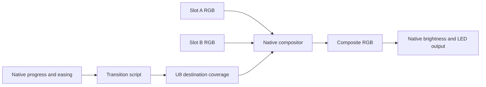

# LightVM A/B Slots and Scripted Transitions Feature Proposal

Status: Proposed

Date: 12 October 2026

LightVM should provide two explicit animation slots, A and B, and an independently
uploaded transition program that controls how their live outputs are blended.
Users should be able to prepare the next animation, preview it, then crossfade,
wipe or dissolve into it while both animations continue running.

The native engine owns packed frame buffers, scheduling, compositing and physical
output. Colour programs produce RGB; transition programs produce one blend byte
per pixel. This makes transitions programmable while keeping their storage and
execution costs bounded. A simple uniform crossfade is the first example of the
same mechanism used for a custom spatial reveal.

This develops the A/B and one-byte transition-channel design discussed on
10 October 2026 in the archived picolights chat, **Review animation effects and**.
It complements the [web editor](feature-proposal-web-editor.md),
[device support](feature-proposal-device-support.md) and
[native port architecture](../docs/architecture.md). All new interfaces below
are proposed; the current engine executes one animation at a time.

## User experience

An operator loads a rainbow into A and puts it on the lights. They load a sparkle
into B, adjust its parameters and inspect a preview without changing the output.
They choose a two-second soft wipe and press **Go**. Rainbow and sparkle both
keep moving while the wipe reveals B. When the transition completes, B becomes
the program source and A is available for the next animation.

The editor shows A, B, the transition mask and the final output. A transition
slider can move the reveal forward or backward, or hold it partway through while
the source animations keep playing. **Auto** advances that same transition over
a selected duration. **Cut** switches immediately. A button, potentiometer or
transport command can drive the same native controls when the relevant input
capability is available.

The device continues playback and an automatic transition after the browser or
USB client disconnects. Saving a show for reboot is a separate persistence
feature. Preparing and taking a new effect should also work from the desktop
client, without requiring the editor.

## Prior art and design implications

The following systems supply useful precedents. The LightVM choices in the last
column are adaptations for an embedded RGB animation engine.

| Precedent | Documented behaviour | Proposed LightVM adaptation |
|---|---|---|
| [ETC Express two-scene mode](https://support.etcconnect.com/ETC/Consoles/Express_Expression_and_Insight/Express_Support/A_%2F%2F_B_Faders_and_Buttons_Not_Controlling_Cues_on_an_Express) | Two banks describe scenes for the same channels; A/B controls crossfade between them | Keep two explicit sources ready and expose one transition control |
| [ETC Express cue playback](https://support.etcconnect.com/ETC/Consoles/Express_Expression_and_Insight/Express_User_Manual/Playing_cues_on_Express_consoles) | Selecting a cue does not start it; Go starts playback, with timed fades or manual control of fade completion | Separate preparation from taking an animation; keep duration and manual progress in native controller state |
| [Blackmagic ATEM vision mixing](https://www.blackmagicdesign.com/uk/products/atemtelevisionstudio/gettingstarted) | Preview selects the next source; a T-bar or Auto performs mix and wipe transitions, including soft edges | Show program and preview roles, support Cut and Auto, and permit manual control of the same transition |
| [Resolume A/B crossfader](https://resolume.com/support/en/composition) | Content is assigned to A/B buses, each bus is composited, and a slider blends their outputs; mixer curves are configurable | Keep slot identity separate from its current output role and expose easing independently of mask shape |
| [After Effects Gradient Wipe](https://helpx.adobe.com/after-effects/desktop/apply-effects-and-animation-presets/list-of-effects/transition-effects.html) | A separate grayscale layer controls reveal order; transition completion and softness determine transparency | Treat the transition as a scalar field over pixels, with scripts defining ordering and intermediate weights |

These precedents suggest three independent concepts: the two sources, the shape
of the transition, and its progress. LightVM should give each an explicit API.
Native master brightness and power apply after compositing. The initial feature
uses a normalized RGB blend; additional lighting-console merge rules, video
overlays and arbitrary layer stacks would be separate capabilities.

Picolights already provides forward, backward, inward and outward wipes with
duration and easing in
[`transition.py`](../../picolights/picolights/effects/transition.py). Its transition
wraps the incoming animation's pixel object and selectively replaces pixels in
the existing output. LightVM should retain those familiar shapes while giving
both source animations their own live frames and state.

## Goals and initial scope

- Run two independently loaded colour programs and one transition program.
- Keep both animations moving during a transition, including at a held progress.
- Support uniform crossfades, directional wipes, centre wipes, soft wipes and
  seeded dissolves through a common one-byte mask contract.
- Give manual control, timed playback and external controllers the same state
  and lifecycle rules.
- Declare and enforce the total memory budget before admitting a combination.
- Keep effect bytecode portable across native ports within advertised limits.
- Preserve existing animation API v1 modules through a slot adapter.

The first release targets one logical RGB output and a one-dimensional pixel
index. RGBW, mapped 2D/3D transitions, playlists, beat synchronization, multiple
outputs and larger scene graphs can follow. A/B slots are virtual sources for
the same output, not two physical LED strips.

## Slot identity and output roles

A and B are stable slot names. Each owns its program identity, generation,
parameters, interpreter instance, animation state and RGB frame. Loading the
same module into both slots creates two independent instances. Programs render
into the slot supplied by the engine; they do not select a global destination.

**Program** identifies the committed source on the output when no transition is
active. **Preview** identifies the other slot. Taking B changes these roles; it
does not rename A/B, copy their frames or restart the destination animation.
Parameter updates always identify a slot and its generation so stale requests
cannot affect its replacement.

A prepared preview is initialized and has produced a valid frame, but its time
is held by default. An operator can run it for live preview. Starting a take
resumes a held preview from its prepared state; a running preview continues from
its current state. Restarting it from the beginning is an explicit action before
the take. After completion the outgoing slot is held and retained for reuse;
unloading it explicitly releases its resources.

At transition start, bind the source and destination slot generations and freeze
the transition program, its parameters and seed. Colour parameters may still
change between frames through generation-checked updates. Reject replacement of
either source or the transition while the take is active. A second Go returns
`transition_busy`.
The operator must finish, cut or return to the source before preparing a third
animation. This avoids needing a hidden third colour slot or an unbounded queue.

## Transition progress and mask semantics

Native controller state owns duration, progress, playback mode and completion.
Use a progress value `p` in 0..65535, representing 0..100 percent from the chosen
source to the chosen destination. A transition script produces destination
coverage `w[i]` in 0..255 for each pixel:

- `0` selects the source colour.
- `255` selects the destination colour.
- Intermediate values blend their RGB components in the same proportion.

For every component, use widened integer arithmetic and rounded division:

```text
output[i] = (source[i] * (255 - w[i]) + destination[i] * w[i] + 127) / 255
```

The compositor guarantees the exact source frame at `p = 0` and exact destination
frame at `p = 65535`, overriding the script's mask at those endpoints. This makes
completion independent of whether a custom mask happens to write every pixel.
During intermediate frames the mask starts at zero; unwritten pixels select the
source and out-of-range writes are errors.

The mask is destination coverage for the current take. In a B-to-A transition,
255 therefore selects A. A UI displaying a fixed A/B blend position converts
that orientation explicitly; the script does not need different endpoint rules
for each direction. Spatial direction, such as forward versus backward wipe, is
a separate transition parameter.

Timed playback computes progress from monotonic elapsed time and duration.
Manual playback supplies progress directly. Pause holds transition progress
while A/B continue running; pausing all playback freezes both source animations
as well. Returning progress to an earlier point changes the reveal, without
rewinding either animation. Auto can resume from the current progress, taking
the corresponding remaining fraction of the configured full duration.

An automatic take requires distinct ready source/destination slots, a prepared
transition and a positive duration within the device's advertised range. Use Cut
for an immediate switch. Starting a take or moving its slider applies at the
next frame boundary.

Easing maps native progress into the progress seen by the mask program. It must
be monotonic with exact endpoints. Apply it once; softness and spatial ordering
belong to the script. The controller reports both raw and eased progress.

## Script contract and examples

Introduce a versioned `transition-v1` execution profile using the existing
once-per-frame and per-pixel callback structure:

| Interface | Proposed contract |
|---|---|
| Export `render(index: i32) -> void` | Required; emit coverage for the current pixel |
| Export `beforeRender(delta_ms: i32) -> void` | Optional; precompute values once per transition frame |
| Import `lightvm.transition.v1.pixel_count() -> i32` | Logical output length |
| Import `lightvm.transition.v1.progress() -> i32` | Eased destination progress, 0..65535, stable throughout the frame |
| Import `lightvm.transition.v1.seed() -> i32` | Stable seed for this take |
| Import `lightvm.transition.v1.weight(value: i32) -> void` | Write 0..255 coverage during `render`; last write wins |

The initial profile requires a seekable mask: for the same index, progress, seed
and parameters it produces the same weight, regardless of the previous progress
values. It may cache calculations in bounded state. Its visible output must not
depend on accumulating elapsed time or consuming a random sequence on every
frame. This contract enables manual scrubbing, reversal and predictable preview.
A later timed profile could support transitions whose own animation evolves
independently of progress, with its available controls advertised explicitly.

These programs remain one-byte animations executed by the same interpreter and
scheduler machinery as colour programs. They have scalar output and additional
transition context. They receive no physical-output access and no writable
access to A/B frames. Native range fills can follow as an optimization without
changing the meaning of per-pixel coverage.

Illustrative frontend pseudocode, with normalized progress `t` in 0..1:

```text
# Crossfade: every pixel gets the same destination coverage.
render(index):
    weight(round(255 * t))

# Hard forward wipe: each pixel has a fixed reveal threshold.
render(index):
    threshold = (index + 0.5) / pixelCount
    weight(255 if t >= threshold else 0)

# Dissolve: hash returns the same threshold for this pixel and seed.
render(index):
    threshold = normalizedHash(index, seed)
    weight(255 if t >= threshold else 0)
```

For a soft wipe, replace the hard threshold with a smooth ramp around it. Expand
the travelling boundary beyond both ends of the strip so endpoint coverage is
complete even with a wide soft edge. Inward/outward wipes derive thresholds from
distance to the centre. A dissolve derives thresholds from pixel index and seed,
avoiding another stored random array and preventing flicker while progress is
held. Example libraries should expose direction, softness and seed through the
web editor's shared parameter schema.

## Frame pipeline and native ownership



One engine owner processes commands between frames, captures the frame's time
and controller state, renders the running slots, renders the mask, composites
and submits one output frame. Both running colour instances receive the same
elapsed-time sample. A held instance receives no accumulated catch-up time when
resumed. Preserve the existing fractional-millisecond carry and gap cap for
colour callbacks; automatic transition progress uses its own monotonic clock so
an overdue transition can finish at the next successful frame.

Allocate output storage before playback. Preserve current API v1 behaviour:
each colour frame starts black, `beforeRender` runs once, and `render` runs in
index order. Legacy `led.rgb` and `led.hsv` resolve to the executing slot's buffer
through its instance context. Any future effect that retains its previous frame
needs a separate, explicitly budgeted profile; the composite must never become
either slot's animation history.

Only submit output after all required guest callbacks succeed. Guest state may
already have advanced when a later callback fails; holding the last output does
not imply rollback of interpreter state. Physical brightness and wire ordering
remain in the native port and apply once to the composite.

Snapshots carry frame IDs and validity. A failed render invalidates each source
or mask buffer it partially overwrote; a read reports that state instead of
returning it as a complete frame. The separate output buffer retains the last
successful composite. Retaining older A/B/mask snapshots after a failure would
require additional storage beyond the baseline below.

Pixel-slot programs initially have permission to produce colour only. General
device programs from the device-support proposal need a separate owner for
actuator writes; two animation slots must not independently command the same
servo or buzzer. Read-only input snapshots can be added to the mixer profile
through the shared device API.

## Memory and execution budgets

For `N` RGB pixels, the baseline engine storage is:

| Buffer | Bytes |
|---|---:|
| Slot A RGB | 3N |
| Slot B RGB | 3N |
| Transition coverage | N |
| Composite RGB | 3N |
| Total frame storage | 10N |

This is 1,000 bytes for the current 100-pixel profiles and 40,960 bytes for
4,096 pixels. RGBW would require 13N bytes when that output format is supported.
These are frame-storage calculations, not total device memory requirements.

Admission must also count retained module bytes, compiled interpreter code,
instance state, linear memories, execution stacks, allocator overhead, upload
storage, native stacks and driver buffers. Include the peak during preparation
and replacement, not just steady playback. Identical modules may initially have
duplicated code storage; sharing immutable code is a later optimization.

The current default limits are 32 KiB per uploaded module, a 128 KiB interpreter
heap budget and an 8 KiB execution stack. One guest linear memory can be 64 KiB.
Three instances each using a full page would consume 192 KiB in linear memories
alone, exceeding that heap budget. The first examples should therefore use
memoryless WASM modules, engine-owned output buffers and small instance state.
Do not multiply the current heap limit by three without checking native RAM.

Use one aggregate engine budget with per-instance caps. Declare resource needs
in program manifests, then validate actual WASM declarations and measured loader
allocations. Reject a combination with an explanation of required and available
bytes before taking it. Frame buffers and runtime execution storage are reserved
at preparation; rendering must perform no dynamic allocation or `memory.grow`.
Instrument the prototype to establish that guarantee across guest call paths.

A scalar crossfade or procedural mask could eventually avoid the N-byte stored
mask, provided its externally visible semantics remain identical. The first
implementation should retain the full mask for simple verification and preview.

Budget the whole frame: A, B, mask generation, mixing and output. Report each
stage, missed frame deadlines and peak memory. The current 500 ms guest deadline
is a recovery bound, not a usable rendering target; three guests must not each
receive a separate full frame budget. Use a shared deadline and bounded guest
work. Supported pixel counts and frame rates require measurements on each port,
including physical transmission time and the native services actually enabled.

## Preparation and management API

Split upload, preparation and taking a slot. Receipt and checksum validation do
not establish that a module initializes, renders or fits alongside the other
instances. A slot becomes ready only after linking, compilation, initialization
and a successful first frame within its resource and execution limits.

The existing BEGIN command destroys the current application. Add slot-aware
operations rather than making a new client use that path to prepare B while A
is visible. An initial implementation may replace a held preview destructively:
if preparation fails, program playback survives but the old preview may be lost.
Report this guarantee explicitly. Retaining an old preview while validating its
replacement requires additional candidate storage and is optional.

Keep incoming bytes and initialization output separate from physical output.
Process transfer work in bounded chunks between frames. Compilation and start
functions also need scheduling limits: if a port must hold the last frame during
preparation, expose that behaviour. Two frame buffers alone do not establish
uninterrupted playback during loading. Reject replacement of a visible slot or
any instance locked by a transition.

Suggested logical operations, independent of USB, HTTP or MQTT framing:

| Operation | Meaning |
|---|---|
| `upload(target, ...)` | Transfer a colour module to A/B or a transition module to T |
| `prepare(target, parameters)` | Validate and initialize the target; produce its first frame |
| `play(slot)` | Start a ready slot as program when no take is active |
| `preview_play(slot)` / `preview_pause(slot)` | Run or hold the hidden slot |
| `take(to, transition, duration_ms, easing, seed, mode)` | Bind a ready destination and transition; start at source-only coverage |
| `set_progress(take_id, value)` | Enter manual mode and set raw progress within 0..65535 |
| `hold(take_id)` / `auto(take_id)` | Enter manual mode at the current progress or resume timed movement towards the destination |
| `finish(take_id)` | Commit a manually controlled take at the destination endpoint |
| `return_to_source(take_id)` | Cut back to the original source and end the take |
| `cut(slot)` | Submit that ready slot directly and commit its program role |
| `pause_all()` / `resume_all()` | Freeze or resume source animation time and transition progress |
| `stop()` | Blank output, end the take and hold loaded instances |
| `unload(target)` | Release an unlocked, hidden target |
| `snapshot(A or B or mask or output)` | Read a completed logical buffer with its frame ID, or report invalid contents, without stepping playback |
| `status()` | Read roles, generations, preparation state, progress, errors and budgets |

Automatic takes commit at the destination endpoint after successful frame
submission. Manual endpoint selection remains reversible until Finish or Cut;
reaching 100 percent alone does not unload or rename anything. Finish is valid
only at that endpoint. Return to source is an immediate cut; a smooth manual
return uses Set progress back to zero before that command.

Mutations carry expected generations and a controller revision. Take requests
also carry a retry token so a retransmitted Go cannot start a second transition.
Return a take ID for subsequent controls; an old take ID cannot affect a newer
one. Coalesce queued slider updates and use bounded transfer/snapshot queues.
Transport callbacks enqueue work for the sole engine owner.

Discovery advertises the mixer/profile versions, slot count, mask format,
supported controls, transition scripts, snapshots, preparation guarantees and
resource limits. The editor shows unsupported operations before deployment.
Keep mixer ABI, colour ABI and transport versions separate. Legacy one-program
commands retain their documented semantics; mixing requires explicit opt-in to
the new management API.

## Completion and failure behaviour

| Event | Required result |
|---|---|
| Successful automatic completion or manual Finish | Destination becomes program; source becomes held preview; retain destination state and release the take context |
| Cut during a take | Submit the selected ready slot, commit it as program and end the take |
| Invalid or oversized preview/transition preparation | Leave program identity and state intact; report which target failed and whether its previous preview was retained |
| Guest trap, invalid weight or execution timeout | Submit no partial composite; hold the last successful output, stop all mixer playback and report the failing instance and take |
| Browser or transport disconnect | Continue the selected native playback mode; a held manual take remains held |
| Pause all playback | Retain frames, guest state and progress; exclude paused time on resume |
| Stop | Blank physical output, end the take and hold loaded instances; a new Play selects a program source explicitly |
| Native output failure | Report and stop if the port exposes recoverable failure; otherwise retain the port's documented fatal behaviour |

A fault does not silently choose the incoming effect or promote a partially
rendered destination. Recovery is an explicit Cut to a healthy prepared slot,
repreparation of the failed instance, or Stop. The present native output contract
returns no failure status, so recoverable driver errors require that contract to
be extended before the corresponding guarantee is advertised.

## Editor integration and delivery sequence

Extend the web-editor project format with colour artifacts for A/B, a transition
artifact, their parameter schemas and default take settings. Each artifact keeps
its own language and ABI requirements, allowing colour and transition programs
to use different frontends. Compile and deploy a transition independently of
the colour programs. A blocks frontend can expose a transition template with
progress, pixel position and a 0..255 coverage output.

The editor should show readiness, program/preview labels, live preview state,
transition controls and the resource total for the selected combination. Read
A/B/mask/output snapshots passively. Device snapshots use bounded rates; local
preview runs the same logical scheduler, endpoint and compositing rules without
requiring device streaming at full frame rate. Runtime diagnostics identify the
slot or transition and its artifact generation.

Deliver the feature in three increments:

1. Refactor the core into colour instances and fixed buffers; preserve legacy
   single-program playback. Add slot preparation, Cut, native crossfade and
   passive snapshots on the host and Pico.
2. Add the transition profile and independently uploaded crossfade, four wipe
   directions, soft wipe and seeded dissolve. Add manual progress, Hold, Auto,
   completion, failure handling and aggregate admission accounting.
3. Add editor controls and project packaging. Run the same modules on host, Pico
   and available ESP32 ports; measure real hardware memory and frame timing.

## Acceptance criteria

- Upload and prepare B and a transition while A remains the committed program;
  preparation obeys the advertised continuity guarantee and never displays B.
- Run stateful A/B examples and show both advancing through a held and moving
  transition. Completion preserves the destination's state.
- Verify exact endpoints, rounded intermediate colours and A-to-B/B-to-A takes
  using identical mask bytecode. Include one-pixel and odd-length wipe cases.
- Holding or revisiting a progress value reproduces the same mask for the same
  parameters and seed. Dissolve thresholds remain stable without an N-byte
  threshold array.
- Reject busy takes, stale generations, invalid weights, unsupported imports and
  excessive resources with useful errors. Retried requests have one effect.
- A failing guest produces no partial output or accidental promotion. Cut and
  Stop remain usable after a fault; disconnect does not stop autonomous playback.
- Confirm zero allocations during rendering and stable memory across repeated
  loading, taking, unloading and failed preparation. Report loading peaks too.
- Browser preview and host produce identical logical frames for the same test
  inputs. Existing API v1 rainbow modules keep their colour and timing semantics.
- Publish measured per-stage timing and total RAM for supported board profiles.
  A build or desktop preview alone does not establish hardware throughput.

The first prototype should settle aggregate allocator accounting, preparation
scheduling and the smallest useful resource profile for three instances. Stable
slot identity, destination-mask semantics and completion rules should be fixed
before implementing editor or transport adapters, since those rules define the
portable behaviour of the feature.
