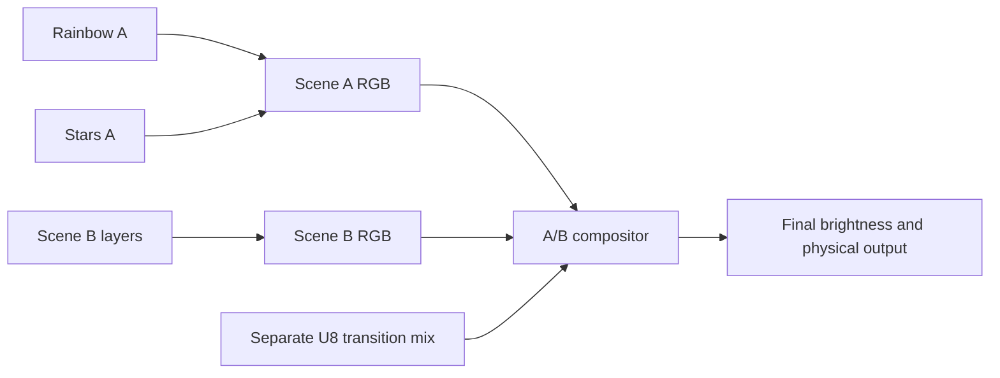

# LightVM Animation Composition and Reusable Backgrounds Feature Proposal

Status: Proposed

Date: 12 October 2026

LightVM should run independently configured animations in a bounded, ordered
scene. A moving rainbow can supply the background while stars, a scanner or a
location marker draw over it. A solid background is another reusable source;
foreground effects should not each implement their own background painting.

The basic composition operation is RGB overwrite: a foreground writes the pixels
it covers and leaves other pixels to lower layers. This requires no alpha
component in the colour value. Pixel presence, optional interpolation weights,
RGBW's white emitter and the separate A/B transition mix have distinct meanings.

This feature uses the [control API and execution model](feature-proposal-control-api.md),
complements [A/B transitions](feature-proposal-ab-transitions.md), and supplies
contracts for the [web editor](feature-proposal-web-editor.md) and
[build profiles](feature-proposal-build-profiles.md). All behaviour below is
proposed. The implemented LightVM runtime has one resident animation and RGB
target; it does not provide animation layers or a scene compositor.
The implemented [single-program control profile](../docs/control-api.md) now
supplies fresh/retained contribution colour and explicit presence/erase, but no
scene management or lower-layer readback. Those primitives prepare this separate
composition increment without advertising it as available.

## User experience and initial scope

A user creates a scene with Rainbow underneath Twinkle. Both have their own
parameters, state and program time. Stars appear over the current rainbow and
reveal that live background when they disappear. The user can replace Rainbow
with Color or Pattern without rewriting or restarting the star animation.

Start with one logical RGB8 output and a flat scene supporting two independently
loaded colour instances. Advertise the supported layer count and aggregate
resource limits; larger scenes require admission within those limits. Different
layers may use different supported language frontends over the same control ABI.
Guest execution remains serialized through the engine owner.

The initial composition mode is ordered overwrite. Retained painting and lower
layer readback extend that mode under explicit capabilities. Channelwise maximum
and weighted interpolation are optional modes with separately advertised
semantics. RGBW, additional outputs, coordinate mapping and nested scene graphs
can follow. A/B playback remains useful with single-animation sources and does
not require every build to include this capability.

## Picolights motivation

The current picolights sources expose several different behaviours that the
shared contract must preserve:

| Source | Existing behaviour | Proposed composition role |
|---|---|---|
| [Rainbow](../../picolights/picolights/effects/animations/rainbow.py), [Color](../../picolights/picolights/effects/animations/color.py), [Colors](../../picolights/picolights/effects/animations/colors.py), [Pattern](../../picolights/picolights/effects/animations/pattern.py) | Paint the complete pixel range | Reusable full-coverage background sources |
| [Twinkle](../../picolights/picolights/effects/animations/twinkle.py) | Track star lifetimes, fill a dim solid background, then draw stars with a background-dependent channel minimum | Fresh foreground contributions over a separately configured background; choose overwrite, maximum or interpolation explicitly |
| [Locator](../../picolights/picolights/effects/animations/locator.py) | Fill a background and draw one marker, with introductory full-strip flashes | Sparse marker foreground; introductory flashes intentionally cover the whole scene |
| [Cylon](../../picolights/picolights/effects/animations/cylon.py) | Combine eyes in a black temporary buffer, then copy the entire buffer | Publish eye presence as well as colour; surrounding black must not implicitly cover lower layers |
| [Candle](../../picolights/picolights/effects/animations/candle.py), [Matrix](../../picolights/picolights/effects/animations/matrix.py), [Ident](../../picolights/picolights/effects/animations/ident.py) | Clear black before drawing selected content | Separate the full-strip clear from foreground drawing; painted black remains intentional coverage |
| [Flame](../../picolights/picolights/effects/animations/flame.py) | Retain some flame pixels and paint a background above the current height | Retained foreground with explicit release when its occupied region shrinks |
| [Starlight](../../picolights/picolights/effects/animations/starlight.py) | Read and randomly modify existing colours | Filter using a declared lower-layer input or its own retained history |
| [Patchy](../../picolights/picolights/effects/animations/patchy.py), [Wipe](../../picolights/picolights/effects/animations/wipe.py), [ColorWipe](../../picolights/picolights/effects/animations/color_wipe.py) | Update selected regions and depend on earlier paint remaining | Retained colour and presence, independent of background refresh |
| [Fade](../../picolights/picolights/effects/animations/fade.py) | Change pixel-object brightness | Explicitly choose layer colour scaling or final controller brightness; an ordinary layer cannot implicitly dim unrelated layers |

[PicoAnimation](../../picolights/picolights/effects/helpers.py) can draw without
immediately showing its output. [PixelBufferController](../../picolights/picolights/devices/pixelstrip.py)
owns one active animation; subset controllers and grouped effects supply some
concurrent drawing, but do not establish a general overlapping-layer contract.
[BlendStrip](../../picolights/picolights/colors/_blend.py) already tracks writes
and merges overlapping colours with channelwise maximum. These are conceptual
predecessors, not claims that a complete scene compositor is implemented.

This review records design lineage rather than prescribing direct source reuse.
Implementation must follow the [provenance and licensing rules](feature-proposal-control-api.md#prior-art-and-provenance).

## Scene, layer and presence contracts

A **scene** owns an ordered list of layer bindings, one logical output topology
and a completed composite. A **layer** binds an independent colour program,
its generation and parameters to an owned contribution. The same module loaded
twice has independent animation state. The engine supplies the destination;
programs do not obtain arbitrary write access to other layers or physical output.

Composition runs from the bottom layer to the top. At a covered pixel, the later
layer replaces the earlier RGB value. Uncovered pixels retain the value already
produced beneath them. A scene starts composition from black each frame, so a
pixel covered by no layer has a defined black result. A full-coverage background
can overwrite that initial value with a solid or animated source.

Specify these operations independently of final WASM names and binary layouts:

| Operation | Meaning |
|---|---|
| Write colour | Set the layer's colour and mark that pixel present |
| Fill colour range | Paint every pixel in the range, including presence |
| Clear colour range | Paint black and mark the range present, preserving the common pixel clear meaning |
| Erase contribution range | Remove presence so lower layers show through; retained colour storage in that range is no longer a visible contribution |
| Read own contribution | Read the layer's colour and presence, identifying working or committed state |
| Read lower input | Read the current frame's completed lower-layer composite under a read-only, stable input contract |
| Publish contribution | Admit a successful complete layer step to composition at the declared boundary |

Black is ordinary paint. Neither `(0, 0, 0)` nor a zero white-emitter value means
"uncovered". Legacy full-frame effects remain full-coverage sources even when
some pixels are black; an adapter must not guess presence from colour values.

Ordered direct drawing can express presence by omitting writes. Independently
retained layer buffers need explicit presence, such as a packed bitset or a
bounded sparse representation. Both implementations must expose the same rules.
The ABI should specify presence semantics without requiring an RGBA format or
mandating one native storage representation.

## Fresh foregrounds and retained painting

Declare each contribution's retention policy. Keep effect simulation state
separate from both the contribution and the final scene output.
Fresh foregrounds are scratch contributions whose presence resets to empty;
that reset differs from painting a raw pixel buffer black.

- A fresh foreground begins each frame build with no pixels present, then draws
  its current visible objects. An expired star issues no write, so the current
  background reappears without restoring a saved colour.
- A retained foreground keeps its committed colour and presence across updates.
  Unwritten pixels keep that layer's previous paint. Patchy and incremental wipes
  need this policy to accumulate their work while a background continues moving.
- Erasing retained presence reveals the current lower input. Clearing to black
  intentionally covers it. A shrinking flame or moving retained marker must
  release pixels that should no longer belong to its contribution.

A fresh contribution must be rebuilt for every scene frame in which it plays.
If simulation updates more slowly, redraw from persistent effect state; do not
advance simulation once per draw just to keep the foreground visible. A retained
layer with no due update contributes its latest valid published state. Holding
one layer freezes its program time and retains its latest completed contribution
while other layers continue; it does not erase that contribution.
Scene pause gates the whole scene clock without changing individual layers'
running/held selections. Resume restores those selections, so a deliberately
held layer does not begin advancing merely because the scene resumes.

Illustrative scene behaviour, not frozen frontend syntax:

```text
scene layers, bottom to top:
    rainbow: full-coverage RGB source
    stars: fresh RGB foreground

on each scene frame:
    draw rainbow at the frame's time
    start stars with no presence
    for every currently live star:
        paint its position with its current colour
    compose bottom to top
    submit one completed output
```

Removing a completed foreground from a scene releases its contribution. Holding
its final paint is a separate declared completion policy. A foreground's completion
event must not implicitly stop or replace the background.

## Filters, readback and optional mixing

Own-layer history and the lower composite are different readback resources.
The former preserves cumulative behaviour; the latter is the current background
and all earlier layers for this frame. Starlight over Rainbow can sample and
modify the moving rainbow, but that differs from repeatedly modifying its own
previous colours. An effect or compatibility adapter must declare its input.
The final physical output never silently becomes a layer's retained history.

Lower input is captured after earlier layers have completed and remains stable
throughout the dependent frame step. The effect stages its own writes separately,
so its writes cannot change the input it is sampling. Lower-input reads are valid
only in that ordered frame context; arbitrary event handlers use explicit own
state or a separately advertised committed snapshot. Forward references, reading
the unfinished final scene and dependency cycles are rejected. Initial filters
use the scene order rather than an arbitrary dependency graph.

Frame drawing and lower-input filter steps are bounded and cannot suspend on a
wait. Other event/control tasks may suspend under the common task model and
publish state for subsequent frames. A library can separate simulation and
drawing without making language-specific callback names mandatory core exports.

Direct overwrite of a dimming star fades its colour towards black, then reveals
the background when presence ends. Smoothly fading the star into the current
background instead requires interpolation. An optional layer mix weight can
produce that result; a channelwise-maximum mode can preserve the background's
channel minima as Twinkle currently does. Weights and merge modes must have
defined endpoints, ranges, rounding and colour-space semantics. They are
separate from RGB/RGBW storage and do not imply alpha-channel requirements.

## Scheduling, ownership and lifecycle

One engine owner applies queued changes, captures the frame's input/time context,
services due work and visits layers from bottom to top. At each layer it presents
the completed lower composite, builds or adopts the layer's contribution, then
applies that contribution before visiting the next layer. This order lets filters
sample this frame's lower colours. Submit exactly one physical frame only after
the scene and any A/B composition are complete. All participating layers see
the same frame-time sample and their own declared program clocks. Native
brightness, calibration and wire ordering apply to the final output, once.

Each layer owns its colour contribution. The scene compositor owns the logical
scene output; the output controller owns physical publication. Concurrent
programs do not become competing unrestricted writers to the physical strip.
Sensor snapshots may be shared read-only; servos, GPIO and tone retain the
[device proposal's ownership rules](feature-proposal-device-support.md).

Scene pause holds its layers' program time and complete output. Layer hold keeps
other layers running. Scene stop blanks its output and holds reusable loaded
layers; task/job cancellation follows the common stop policy. Unloading a layer
cancels its owned tasks, jobs, timers and subscriptions and releases its storage.
Removing a layer or changing order applies between complete frames, with
generation/revision checks. Transport disconnect leaves autonomous playback
running. Initial admission or preparation produces no physical output.

A failed layer step or composition submits no partial scene. Hold the last
successful final output, stop the affected scene's playback and report the layer
identity and generation. Successful earlier guest state changes are not rolled
back. Working buffers and readback carry frame IDs and validity; any promised
retention of older complete snapshots needs reserved storage. Recovery must
explicitly remove, reprepare or replace a failing layer, or stop the scene.
During an A/B take, a layer fault propagates to the mixer failure policy: retain
the last successful final output and stop mixer playback without promoting a
partially rendered destination.

## Relationship to A/B transitions

Persistent animation composition and timed scene changes have separate
lifecycles. A rainbow and its stars remain active together for as long as their
scene runs; no transition progress needs to reach an endpoint or promote a
foreground to replace the background.

When both capabilities are supported, each A/B slot supplies a completed scene
frame to the existing transition mixer. A single colour animation is a
single-layer scene. The engine first composes A and B independently, then applies
the separate U8 transition mix to their completed RGB frames, and finally
publishes the output. Transition completion preserves every destination layer's
state and holds the outgoing scene according to the A/B lifecycle.



The initial seekable transition program cannot stand in for a star-presence
generator driven by evolving lifetimes. Layer presence follows animation state;
transition coverage follows the declared progress/seed contract. A future
stateful transition profile does not remove the need for ordinary scene layers.

## Resource admission and discovery

Advertise composition version, formats, maximum layers per scene, total resident
colour instances, retention modes, readback modes, merge operations and aggregate
memory/frame limits. Supporting two layers in one scene does not establish that
two such scenes plus a transition will fit simultaneously.

Account for every program/interpreter instance, retained colour and presence,
working/staging storage, stable lower-input views, completed scene/output frames,
snapshot guarantees and native driver buffers. A packed presence bitset costs
`ceil(N / 8)` bytes for N pixels in addition to colour storage. Full-coverage
sources can omit it internally without changing semantics. Other representations
need equivalent bounded accounting; no per-frame allocation is permitted.

The A/B proposal's `10N` frame-storage figure covers its minimal two RGB8 sources,
U8 mix and final RGB output. Layered scenes add storage and interpreter state;
that figure is not a budget for arbitrary scenes. Budget preparation/replacement
peaks and the whole frame, including all layers, filters, both scene composites,
the transition and physical transmission when combined. Reject unsupported or
oversized combinations before activation without changing the active scene.

## Management, editor and delivery

Keep scene identity, layer identity, loaded artifact generation and A/B slot
role distinct. Management operations prepare/activate a scene, inspect its layer
order, update a layer's parameters, hold/resume or remove a layer, and inspect
completed contribution/presence/scene snapshots. Requests apply through the engine
owner at frame boundaries with explicit revision, retry and replacement rules.
Changing a background leaves the foreground state intact when the advertised
replacement guarantee permits it; destructive preparation must be disclosed.

The editor represents a scene as reusable source artifacts plus an ordered layer
configuration. A preset such as "stars on a dim solid colour" uses the same star
artifact as "stars on a rainbow". Show layer order, parameters, retention/merge
choices, readiness, diagnostics and total resource use. Preview uses the same
presence, readback, timing and publication rules as hardware. Scene packaging
does not require a new language or an alpha-enabled colour API.

Deliver the feature in bounded increments:

1. Two-layer RGB8 overwrite on host and Pico: independent Rainbow and fresh
   Twinkle state, explicit presence, one physical publication, admission and
   failure handling. Preserve legacy full-frame playback through its adapter.
2. Retained painting, erase operations and stable lower-input filters: exercise
   Patchy, a shrinking foreground and Starlight with declared readback. Add
   independent layer hold/resume and background replacement guarantees.
3. Editor/project packaging and A/B scene integration on supported profiles;
   measure total resource use and frame timing on each native port. Add maximum
   and weighted interpolation only as advertised extensions.

Acceptance must demonstrate:

- The same star artifact over Color, Rainbow and Pattern without background code
  inside the foreground; Rainbow continues advancing under visible stars.
- Star expiry reveals the current background without trails or saved-colour
  restoration; intentional black foreground paint still obscures it.
- Deterministic overwrite at overlapping pixels according to configured order.
- Patchy accumulates its own paint across background refreshes; erasing it reveals
  the current background, while black clear stays covered.
- Lower-input filters see a stable current lower composite; own-history reads
  remain distinct and no composition introduces feedback or dependency cycles.
- Slower simulation updates and layer hold/resume do not make contributions
  disappear or advance another layer's state unexpectedly.
- Completion/removal releases or retains contributions according to the declared
  policy without implicitly stopping another layer.
- One complete physical publication per frame; traps/timeouts never display a
  partial scene, and diagnostics identify the failing instance.
- Unsupported modes, stale generations and excessive scene/A/B combinations are
  rejected before activation; rendering performs no dynamic allocation.
- A/B transitions between layered scenes preserve every destination layer's
  state and apply native output brightness once.
- Host/editor replay agrees for fixed timestamps, initial state and seeds,
  followed by measured memory/frame timing on supported hardware profiles.

Before implementation, fix the presence and erase encodings, declared retention
and completion policies, lower-input context, scene/layer management identities
and aggregate budget. Keep storage choices and frontend helpers behind those
portable contracts.
