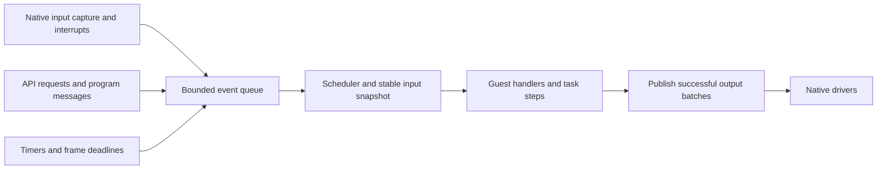

# LightVM Control API and Execution Model Proposal

Status: Proposed general model; single-program animation profile implemented

Date: 12 October 2026

LightVM should provide one language-neutral WASM control API for lighting,
digital and analogue IO, PWM, servos and future devices. Addressable RGB pixels
are one capability within a shared model of resources, properties, actions, events,
tasks and time. Python, C, a blocks editor and compatibility frontends should
bind to the same contracts.

The core API is designed independently, with documented roots in picolights.
Pixelblaze compatibility belongs in an independently implemented frontend or
adapter above this API. Pixelblaze callback names, numeric rules and available
devices do not define or constrain the core contract.

The first [control ABI 1 animation profile](../docs/control-api.md) now defines
start/frame steps, deployment-injected pixel contributions, program time, typed live parameters,
fresh/retained RGB8 colour/presence and successful-step publication. An original
restricted Python compiler and six examples target it. Schema-2 artifacts have
no destination binding: slot selection is native deployment metadata. Production
still exposes one slot A; offscreen instances and physical publication have
separate ownership, preparing the later A/B mixer. General event/task/device
and multi-layer contracts below remain proposed.

This proposal defines the remaining common semantics before freezing additional
import signatures and binary layouts. It governs the proposed [device support](feature-proposal-device-support.md),
[web editor](feature-proposal-web-editor.md) and
[animation composition](feature-proposal-animation-composition.md), alongside
[A/B transitions](feature-proposal-ab-transitions.md). The implemented runtime
also preserves legacy animation API v1, runtime hardware configuration and named
procedure storage. General events, resumable tasks, scene layers, GPIO, ADC, PWM
and servo capabilities below remain proposed.

## Common concepts

| Concept | Contract | Example |
|---|---|---|
| Resource | A named physical or virtual instance with identity and lifetime | Button, pixel strip, colour buffer, timer |
| Capability | A versioned set of operations implemented by a resource | Digital input, PWM output, indexed pixel buffer |
| Property | Typed state that can be read and, where allowed, written | Logical button state, commanded duty, output brightness |
| Sample | A measurement with capture time, validity and declared units | Dial reading, temperature, pulse count |
| Action | A request to perform work, with defined acceptance and retry semantics | Fill a pixel buffer, pulse an output, begin a fade |
| Job | An action that continues over time and has an identity | Timed pulse or transition, with completion and cancellation |
| Event | A typed record that something happened | Press, release, message, deadline, completion |
| Trigger | A subscription or condition selecting when work becomes runnable | On press, every interval, on threshold crossing |
| Task | One invocation of a script, including its suspended state | Set red, wait, then set black |
| Clock | A declared time domain used for timestamps and deadlines | Native monotonic time, pausable program time |
| Snapshot | Stable input state for one guest execution step | The same dial sample throughout a calculation |
| Batch | Staged output changes published at a defined boundary | Update several pixels and an indicator together |
| Ownership | Authority to write or compose a resource | One servo controller, an owned foreground contribution |
| Layer | An independently owned colour contribution with presence and a place in scene order | Stars drawing over a live background |
| Scene | A bounded ordered composition producing a complete logical frame | Rainbow plus stars, supplied to an output or A/B slot |

A device type defines its configuration and capabilities. An instance binds
that type to configured hardware or a virtual resource. Program bindings resolve
logical names to opaque handles; pin names, bus addresses and timer allocation
remain in native configuration. Capability discovery reports both compiled
support and the instances actually available.

Properties, actions and events also describe external management operations,
but the guest ABI remains typed and bounded. A shared definition can generate
WASM bindings, editor controls and transport metadata without requiring a
string-based property interpreter inside each guest call.

## State and occurrences

"The button is held" is a property. "The button was pressed" is an event.
Reading a property must not consume an event, and observing an event must not
depend on polling at the lighting frame rate. Convenience flags such as
`rose` and `fell` may summarize an input snapshot; they cannot preserve the
number or order of several transitions between steps.

Distinguish requested output, the last committed output, and measured feedback.
A servo target is a command, not proof of physical position. A timed movement
job can complete its command timeline without claiming measured arrival.
Advertise a reached-position event only when the device supplies feedback.

An action returning success may mean that it was accepted. A job subsequently
reports completion, cancellation or failure. Writing a property to the same
value should not restart a timed action; explicitly starting an action may do
so according to its replacement policy. External action requests need retry
tokens where repeating them would create another job or pulse.

## Trigger families

| Family | Examples | Required semantics |
|---|---|---|
| Lifecycle | Start, pause, resume, stop, fault | Define order, permitted operations and cleanup |
| Periodic | Every 20 ms, control update | Declare interval, clock and missed-deadline policy |
| Frame | Lighting output opportunity | Supply a frame context; do not imply a universal device tick |
| Deadline | After a delay, at a program time | One occurrence, cancellable registration, defined lateness |
| Input | Pressed, released, changed, sample available | Declare filtering, debounce and event payload |
| Condition | Threshold crossed, became true, held for a duration | Declare edge or level behaviour and rearming |
| Message or invocation | Named signal, parameter update, API action | Typed payload, source and request semantics |
| Completion | Job finished, failed or cancelled | Identify the job and terminal outcome |

Condition triggers are derived from properties or samples. A threshold crossing
normally fires once and rearms after crossing back; hysteresis prevents noisy
samples from repeatedly firing it. "While true" means periodic work while a
condition holds and must declare its cadence. Define whether a condition already
true at startup fires immediately or only after a subsequent transition.

A script can emit a named message without making a network request. Broadcast
and broadcast-and-wait are language conveniences over message delivery and task
completion. Waiting refers to the invocations started by that broadcast, not
every future invocation of the same handler.

## Time and scheduling

Keep three timing domains independent:

1. Native waveform generation, including PWM, servo pulses and tone.
2. Native input sampling, debounce and peripheral servicing.
3. Guest control steps, event handlers and lighting frames.

They can share a clock without sharing a refresh rate. Input events should be
serviceable when no lighting animation is running. Native waveforms and output
expiry must continue while a guest task is waiting. Guest code must not generate
servo pulses by sleeping or toggling a pin in a frame callback.

Use native monotonic time for capture timestamps, hardware deadlines and latency.
Use program time for animations and script waits that freeze when the program is
paused. A job declares its clock and pause policy. Optional wall-clock scheduling
is a separate capability with timezone and clock-adjustment semantics; it does
not replace monotonic timing.

Contexts identify the scheduled time, dispatch time and elapsed program time.
All work participating in one lighting frame uses the same frame-time sample.
Event capture time remains distinct from dispatch time. Delayed dispatch must
not change an event's timestamp or conceal its age.

Periodic scheduling should preserve its intended phase and report missed
intervals. The initial policy performs one due update with actual elapsed time,
rather than creating an unbounded catch-up queue. Any fixed-step simulation or
limited catch-up mode is an explicitly advertised extension. A frontend may
bound its integration step without rewriting the actual clock or deadlines.

## Event delivery and execution ownership

Only the engine owner enters WASM or changes guest lifecycle state. Interrupts,
network callbacks and native samplers capture data or enqueue work; they never
invoke a guest handler directly. Delivery is serialized, with a documented
sequence for simultaneously due work.



An event record contains its kind, source instance and generation, sequence,
capture timestamp and bounded typed payload. Samples additionally describe
validity and quality. A record's payload is valid for a documented lifetime;
bindings copy data needed after the current step into reserved guest storage.

Preserve accepted edge and message order. State updates may coalesce to the
latest sample under a declared policy; occurrence events cannot silently become
one boolean flag. Report overflow and dropped counts, preserve a recoverable
current input state, and bound dispatch work so event floods cannot starve
frames or native servicing. The precise queue allocation and overflow policy
must be fixed per event class before implementation.

API validation failures return to the caller without starting guest work.
Accepted invocations enter the same scheduler as local triggers. Correlation
IDs identify requests; they do not by themselves provide retry deduplication.
Management event streams are observers with their own buffering and must not
consume events intended for guest handlers.

## Resumable tasks and jobs

Triggers make tasks runnable. Each task executes a bounded step, then completes
or yields with a wake condition. Several tasks may be active, but they execute
serially through the engine owner. Native WASM threads or suspension of a native
interpreter stack are not prerequisites: frontends can compile waits into state
machines with continuation state in guest memory.

The runtime exposes task identity, wake conditions and cancellation semantics;
the frontend owns the representation of source-language locals and control flow.
Handlers that run to completion need no continuation state. The exact guest
step export and context layout remain to be specified independently of language
syntax.

For each trigger, declare what happens if it fires while its handler is active:

| Policy | Behaviour |
|---|---|
| Queue | Retain another invocation within a fixed bound |
| Restart | Cancel the current invocation and start a replacement |
| Ignore while active | Do not start another invocation; expose the policy |
| Multiple instances | Admit another task up to the declared limit |

Choose a documented beginner default, while allowing a compatibility frontend
to request the policies its language requires. Bounds apply to tasks, timers,
subscriptions, queued invocations, jobs and continuation memory. Reserve their
capacity before execution; task creation cannot imply unbounded heap allocation.

Job cancellation and task cancellation are distinct. A job's ownership and
replacement rules determine whether it survives its initiating task. Unloading
the owning program cancels its subscriptions, timers, tasks and owned jobs;
stale generations cannot wake a replacement program.

## Input snapshots and output publication

A guest step sees stable sampled inputs. An event handler can therefore see a
historical edge payload alongside a newer current-state snapshot; both carry
their own time. Drivers service inputs independently and publish their next
snapshot at a scheduling boundary. An unavailable measurement is not zero.

Stage output changes during a step or explicit batch. Publish after successful
completion of that step, including a successful suspension. Publication makes
committed state available to the resource's driver or mixer; physical refresh
follows its declared schedule. Never defer publication until an entire
multi-step script finishes:

```text
when button pressed
    fill lights with red
    wait 1 second       # Publish red, then suspend this task.
    fill lights with black
```

Other tasks continue while this task waits. An explicit output batch cannot
span a wait. A guest trap discards unpublished changes from the failing batch;
previously committed batches are not rolled back. Guest state is not generally
transactional. Native commit failure may occur after another device has already
changed, so software batching does not promise electrically simultaneous output
or physical rollback.

Within one writer's batch, the last property assignment wins. Across writers,
resource ownership governs acceptance. Retained buffers keep their committed
contents until explicitly replaced or cleared; scratch buffers have a declared
reset rule. Frame ID and validity distinguish complete output from a partially
written working buffer. Readback identifies whether it returns committed state,
working state or measured feedback.

## Addressable RGB pixel control

Use **addressable RGB** in documentation and **pixels** for the capability/API
namespace. ARGB is used for addressable lighting, but also names alpha-first
colour packing in graphics; spelling out the lighting capability avoids that
ambiguity. [Addressable lighting example](https://dlcdnets.asus.com/pub/ASUS/ODD/DC/TUF_Gaming_TF120/Q19275_TUF_Gaming_TF120_ARGB_Fan_3-pack_QSG_PRINT.pdf),
[graphics ARGB definition](https://learn.microsoft.com/en-us/dotnet/api/system.drawing.color).

A logical pixel buffer is an indexed colour resource, separate from its physical
driver. Its capabilities include count/topology discovery, retained reads and
writes, RGB/HSV colour helpers, fill or range updates, explicit clear and
publication. Mapping the buffer to an addressable strip is configuration.
Per-pixel procedural sampling is a binding/library convenience over these
operations, not a mandatory core execution model.

The standard colour value is RGB. An optional RGBW capability exposes independent
red, green, blue and white emitter values, preserving picolights' explicit white
control. There are no alpha-channel requirements. Ordered foreground overwrite
uses pixel presence independently of colour. Optional layer interpolation weights
and a transition's separate destination-coverage mix have their own contracts.

Each versioned pixel contract specifies channel ranges, RGB or RGBW format,
storage precision, colour conversion, rounding and the treatment of unwritten
pixels. Clear fills black; retained buffers keep other pixels until explicitly
changed. A scratch buffer may reset to black under its declared policy.
Separate colour scaling from native output brightness. Define the order of
logical mixing, calibration, output brightness and physical wire ordering.
Exact encodings and any higher-precision format remain implementation decisions.

Source buffers can contribute through an explicitly configured scene or mixer.
The [composition proposal](feature-proposal-animation-composition.md) defines
bounded ordered layers and reusable backgrounds. The first A/B format uses RGB8
source frames and a separate U8 mix channel; new formats cannot silently change
its blend endpoints or rounding. When both features are supported, each source
frame is a completed scene, composed before the A/B mix.

Blending colours does not define how to merge two servo targets, GPIO writes or
bus transactions. Ordinary actuators have an exclusive owner initially;
additional arbitration policies require their own advertised contract.

## Ordered animation composition

Give each layer its own program identity, parameters, state and colour/presence
contribution. Compose bottom to top with overwrite as the basic operation: a
covered pixel replaces the lower colour, and an uncovered pixel leaves it alone.
Black is a valid covered colour. Clear paints black; an explicit erase operation
removes presence and reveals the current lower composite. Dense RGB buffers
alone cannot distinguish those operations.

Declare fresh or retained contribution policy. Fresh foregrounds redraw their
currently visible objects each scene frame; expired stars cease contributing.
Retained foregrounds preserve their own colour and presence across updates,
allowing Patchy and incremental wipes to accumulate paint independently of a
moving background. Effect simulation state and final scene output are separate;
the final composite must never silently become a layer's animation history.

Own-layer readback and current lower-layer input are distinct. Lower-input reads
occur only in an ordered frame context, after lower layers have completed, and
remain stable throughout the step. Writes stage into the effect's own contribution.
This supports filters such as Starlight while rejecting forward dependencies and
feedback cycles. Frame draw/filter steps cannot suspend; other control tasks use
the ordinary resumable-task model.

One engine owner captures shared frame time, services independent layer updates,
builds contributions, composes and publishes one physical frame. Holding one
layer retains its completed contribution while other layers run; completion and
removal have explicit release/retain policies. Native output brightness applies
once after scene composition and any A/B mixing. Scene/layer discovery reports
supported modes, layer/instance limits and aggregate memory/execution budgets.

Optional maximum and interpolation modes do not require an alpha component in
RGB/RGBW. Dimming a directly overwritten star towards black and interpolating it
into a live background have different visible results and must be explicit.
Persistent scene layers run under their animation clocks; seekable A/B transition
coverage follows progress and seed. One does not replace the other's lifecycle.

## Device capability conventions

| Capability | Properties and operations | Events or jobs |
|---|---|---|
| Digital input | Logical state, active polarity in configuration | Debounced transitions; press/release presets |
| Digital output | Committed logical state, write | Bounded pulse job, with expiry |
| Analogue input | Timestamped normalized sample; optional calibrated units | Sample-ready, significant change, threshold crossing |
| Analogue output | DAC level or calibrated voltage where supported | Declared update/completion behaviour |
| PWM output | Duty, enabled state, configured or advertised variable period | Optional capture measurements and timed jobs |
| Positional servo | Calibrated target angle, enabled state, release | Command timeline; feedback events only when available |
| Continuous rotation servo | Signed rotation command, neutral, release | Distinct from positional angle semantics |
| Tone | Frequency, silence, duration | Native expiry and completion |
| Sensor, display or stream | Typed measurements, buffers or transfers | Data-ready, transfer-complete, bounded stream availability |

PWM and true analogue output remain separate capabilities. A servo is a semantic
device over pulse generation, not an alias for an arbitrary duty fraction.
Several capabilities may share a native timer, pin or bus, so resource planning
must validate their combined requirements.

Use booleans for logical state, a consistent normalized range for fractions, and
explicit physical units for measurements and commands. A normalized wire value
does not imply that much hardware resolution or calibrated accuracy. Fixed-width
WASM encodings, signed values and units are declared in capability metadata.
Bindings may offer natural floats, enums or colour objects without changing the
wire meaning.

Return status separately from data for new operations, including reads. This
allows negative temperatures and signed commands without overloading them as
error codes. Structured results use validated guest buffers with versioned
layouts. Specify range rejection, permitted rounding and actual achieved values
where hardware cannot exactly produce the request.

## Lifecycle and compatibility

Activation validates bindings and reserves resources before outputs become
available to guest execution. Initialization resolves handles and prepares state;
the start trigger runs after successful activation. Pause freezes program time
and pausable tasks; native safety deadlines and input servicing continue. Resume
uses a fresh snapshot and a declared policy for events captured during pause.

Stop, fault and unload apply per-capability output policies, cancel the relevant
work and release ownership. A stop handler may have bounded notification work,
but native cleanup must not depend on it successfully running. Transport
disconnect leaves autonomous execution running. Resource reconfiguration
invalidates handles and requires rebinding.

Legacy animation API v1 retains its existing signatures, integer millisecond
deltas, gap cap, black-at-frame-start and ordered per-pixel callbacks. An adapter
binds it to its assigned RGB output. It is an implemented prototype contract,
not the definition of the new control API. Pixelblaze source compatibility is
a separate frontend with a published support matrix and independent implementation.

Version the runtime execution contract, device capabilities, buffer formats and
management/configuration schemas separately. Program manifests declare their
imports, bindings, triggers, continuation/resource bounds and compatibility
requirements. Validate the actual WASM as well as the manifest.

## Prior art and provenance

| Source | Relevant precedent | LightVM use |
|---|---|---|
| [W3C Web of Things](https://www.w3.org/TR/wot-thing-description11/) | Properties, actions, events and typed descriptions | Common vocabulary and generated metadata; compact local bindings |
| [Scratch event implementation](https://github.com/scratchfoundation/scratch-vm/blob/develop/src/blocks/scratch3_event.js) | Hats, condition edges, broadcasts, restart policies and waiting | Explicit trigger/task semantics for a blocks frontend |
| [MakeCode reactive model](https://makecode.microbit.org/device/reactive) | Cooperative event handlers and suspended scripts | Bounded steps and resumable continuations |
| [CircuitPython keypad](https://docs.circuitpython.org/en/latest/shared-bindings/keypad/index.html) | Timestamped input events, debounce and bounded queues | Native capture separated from guest dispatch |
| [CircuitPython analogue IO](https://docs.circuitpython.org/en/latest/shared-bindings/analogio/index.html) and [PWM](https://docs.circuitpython.org/en/latest/shared-bindings/pwmio/index.html) | Normalized values, physical capabilities and hardware resolution | Explicit units and independent ADC, DAC and PWM contracts |
| [CircuitPython servos](https://docs.circuitpython.org/projects/motor/en/latest/api.html#module-adafruit_motor.servo) | Calibrated pulse limits; positional and continuous rotation interfaces | Separate semantic capabilities |
| [Zephyr workqueues](https://docs.zephyrproject.org/latest/kernel/services/threads/workqueue.html) and [PWM](https://docs.zephyrproject.org/latest/hardware/peripherals/pwm.html) | Deferred interrupt processing and native waveform parameters | One guest owner with native timing services |
| [Browser animation callbacks](https://developer.mozilla.org/en-US/docs/Web/API/Window/requestAnimationFrame) | Frame cadence and a shared time sample | Consistent frame contexts without a universal hardware tick |
| [CircuitPython NeoPixel](https://docs.circuitpython.org/projects/neopixel/en/latest/api.html) | Indexed colours, fills, explicit publication and RGB/RGBW formats | Addressable pixel control separated from physical wire order |

Picolights is the direct project predecessor. Its Git history records:

- `e3befb5`, 21 September 2023: named device/controller structures.
- `e4349a1`, 8 October 2023: animation helpers extending Adafruit's `Animation`.
- `7848d8e`, 15 October 2023: general pixel-buffer transitions.
- `2203220`, 5 November 2023: a standalone `PicoAnimation` lifecycle.
- `f4eca72`, 11 December 2025: candle rendering with explicit RGBW control.

The relevant sources are [device configuration](../../picolights/picolights/devices/config.py),
[properties](../../picolights/picolights/devices/controller.py),
[animation lifecycle](../../picolights/picolights/effects/helpers.py),
[transitions](../../picolights/picolights/effects/transition.py) and
[RGBW candle output](../../picolights/picolights/effects/animations/candle.py).
The [composition proposal](feature-proposal-animation-composition.md#picolights-motivation)
also records repeated background painting, retained effects and readback filters
in the existing animation catalogue.
Record inheritance at the concept and copied-source level; a new LightVM name
does not erase upstream provenance.

Adafruit [LED Animation](https://github.com/adafruit/Adafruit_CircuitPython_LED_Animation/blob/main/LICENSE),
[NeoPixel](https://github.com/adafruit/Adafruit_CircuitPython_NeoPixel/blob/main/LICENSE)
and the [Pixelbuf implementation](https://docs.circuitpython.org/projects/neopixel/en/6.2.1/_modules/adafruit_pixelbuf.html)
use MIT licensing. Reused code needs its applicable copyright/license notices,
source revision and modifications recorded in LightVM's third-party notices.
CircuitPython runtime source needs per-file review.

Picolights' [easing.py](../../picolights/picolights/easing.py) explicitly credits
semitable/easing-functions and declares [GPLv3](https://github.com/semitable/easing-functions/blob/master/LICENCE.md).
It entered in `a41572e` on 18 April 2023 and is imported by animation helpers and
transitions. For an MIT-only LightVM implementation, use independently implemented
mathematics, verified permissive code or additional permission; do not copy or
mechanically translate this implementation. The package's MIT metadata does not
replace that file's upstream terms. Other files need individual assessment.

The vendored picolights `.mpy` bundles have no accompanying root license/notice
files in the reviewed checkout. Embedded LED Animation 2.7.2 and Pixelbuf 2.0.2
versions differ from lockfile versions 2.9.3 and 2.0.6. Establish exact source
revisions and required notices before redistributing those bundles. Existing
picolights distributions containing GPL code need separate compliance assessment;
this targeted provenance review does not classify every device dependency.

## Implementation decisions and acceptance

Before freezing the first control ABI, specify the guest step/context layout,
event schemas and ordering, clock encodings, default retrigger policy, pause
delivery, task/job ownership and aggregate budgets. Fix the baseline pixel
formats, colour conversion and readback/publication rules, with legacy RGB8
preserved through its adapter. Specify layer presence/erase, fresh versus retained
contributions, lower-input readback, completion policies and scene admission
before exposing composition to frontends. Generate descriptors and bindings
from those decisions.

Start with lifecycle, timer and digital-input events plus bounded handlers and
digital output on the host and Pico. Add suspended waits and a blocks sequence;
then add retained pixel buffers, ADC/PWM/servo/tone and native jobs. Keep legacy
animation playback through its adapter throughout that work. Deliver bounded
animation composition through its own increments; its source frames can feed
A/B transitions when both capabilities and their combined budgets are available.

Acceptance must demonstrate:

- The same event/task and device semantics across language bindings and ports.
- Press/release ordering and repeated presses between lighting frames, with
  debounce, overflow diagnostics and recoverable current state.
- A red/wait/black script publishing before suspension while another script runs.
- Retrigger, cancellation, pause/resume and stale-generation behaviour within
  configured task, queue and continuation bounds.
- Native PWM/servo/tone timing continuing independently of guest frame cadence.
- Stable snapshots, sample age/validity and signed readings without error ambiguity.
- Explicit pixel retention, black clear, RGB/RGBW channels and blend endpoints.
- Independent Rainbow/Twinkle layers, explicit presence/erase, retained Patchy
  paint and stable lower-input filters, with one completed output per frame.
- Scene/layer pause, completion and failure behaviour; A/B composition preserves
  destination layer state and rejects combinations beyond aggregate limits.
- Actuator ownership rejection, no unpublished output after a trap, and honest
  reporting of partial native commit failure.
- Deterministic host/editor replay from input events, timestamps and initial
  state, followed by physical timing and resource measurements on each board.
- Recorded provenance and notices for every implementation actually reused.
