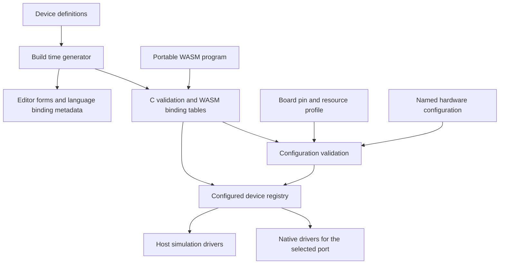

# LightVM Beginner Device Support Feature Proposal

Status: Proposed

Date: 12 October 2026

LightVM should support a small set of inputs and outputs that make programming
and logic tangible: press a button, compare a sensor value, change a light, play
a note or move a servo. This should be a core feature alongside the
[web editor](feature-proposal-web-editor.md) and
[portable native ports](../docs/architecture.md).

Use a bounded device registry, named device instances and versioned, typed WASM
imports. Define each device type's configuration and API in one declarative
definition, then generate the shared validation and binding metadata from it.
Native drivers implement the hardware behaviour. This gives new devices a clear
extension path while keeping the Pico firmware small.

All interfaces and examples below are proposed. The implemented baseline remains
the single WS2812B output and animation API v1.

## Starter devices and learning goals

Build the first increment around digital input and output. Complete the starter
release with analogue input, PWM, tone and positional servo support. Buttons,
switches, potentiometers and light sensors can be editor presets over these
basic types, rather than separate drivers for every component.

| Device type | Examples and lessons | Required configuration | Defaults and optional configuration |
|---|---|---|---|
| WS2812B pixels | Existing strips and rings; colour, loops and position | Output pin and pixel count | GRB order, output brightness limit, primary animation output |
| Digital input | Button, toggle switch or digital sensor; conditions and state changes | Input pin | Pull, active level and debounce interval; a button preset supplies suitable defaults |
| Digital output | LED or active buzzer; booleans and timed sequences | Output pin | Active level and logical safe value, initially off |
| Analogue input | Potentiometer or LDR divider; thresholds and mapping | ADC-capable pin | Sampling interval, smoothing and configured input endpoints |
| PWM output | LED dimming; proportional values | Output pin | Frequency and safe duty cycle, initially zero |
| Tone output | Passive piezo; notes and timing | Output pin | Supported frequency range and maximum note duration; silence on stop |
| Positional servo | Pointer or simple mechanism; angles and state machines | Output pin and a selected servo calibration preset or explicit pulse limits | Period, permitted angle range and release on stop |

These are software capabilities, not promises that every connected component can
be driven directly from a GPIO. Wiring templates should specify the resistor,
driver, power supply and common ground required by the selected component.
Distinguish active buzzers from passive piezos, and positional servos from
continuous rotation servos in the editor.

After the starter release, add one named I2C temperature/humidity driver and a
small monochrome display. These exercise bus sharing, measurement units and
buffer operations. Rotary encoders and distance sensors can follow. General
motor control, arbitrary bus transactions, cameras, radar and picolights' wider
automation catalogue are outside this initial feature.

Useful starter projects are a button-controlled light, a knob-controlled dimmer,
a light threshold alarm, a timed traffic light, a reaction game and a servo
pointer. Each should run in preview and on configured hardware without changing
its program's pin assumptions.

## Current platform and required changes

The shared engine already delegates clock, allocation and RGB transmission to
native ports. GPIO, PIO and SDK dependencies stay outside `src/`. Preserve that
boundary and the single owner of engine execution.

| Current code | Consequence for this feature |
|---|---|
| [`src/config.h`](../src/config.h) requires `PIXEL_COUNT >= 1` | General programs need profiles with no pixel output |
| [`src/pixels.c`](../src/pixels.c) has one static RGB buffer | Pixel capacity and output identity must become explicit registry resources |
| [`src/app.c`](../src/app.c) links each `led` import directly in `load` | Move device bindings into registration tables, retaining the legacy imports |
| `prepare_animation` requires `render(index)` | Add a general periodic execution profile for programs with no renderer |
| `app_tick` only services active playback or the native demo | Native input sampling and timed output expiry need service while guest execution is idle |
| [`src/platform.h`](../src/platform.h) describes one output and a void RGB callback | Add driver contracts with instance identity, bounded operations and failure reporting |
| STATUS describes one pin, brightness and pixel count | Structured discovery must report types, instances, state and resource limits |
| Pico wiring lives in [`board_config.h`](../platforms/pico/board_config.h) | Separate board capabilities and budgets from editable peripheral configuration |

Picolights provides a useful precedent: its
[`device_factory`](../../picolights/picolights/devices/config.py) registers named
types, `DeviceList` instantiates configured devices, and
[`PropertyManager`](../../picolights/picolights/devices/controller.py) exposes
properties. Reuse those concepts. LightVM should use explicit field types,
operation signatures and validation instead of dynamic Python imports and
untyped property messages. Devices need no MQTT connection to work.

## Device definitions and native drivers

Keep three concepts distinct:

- A **type** defines configuration, capabilities and operations, such as
  `digital-input`.
- An **instance** is configured hardware, such as `button` on Pico GP14.
- A **capability** is a portable contract, such as reading a logical input.
  Several device types can implement the same capability.

Firmware advertises both the types compiled into its build and the instances
actually configured. Compiling in a sensor driver does not establish that a
sensor is connected. Initial discovery relies on configuration; automatic
component identification is not required.



A device definition should contain its stable type ID and version, required
fields, defaults, ranges, units, editor labels, capability versions, import
names/signatures, valid execution contexts and result/error semantics. It should
also identify resource requirements, driver state bounds, stop behaviour and
preview support. Cross-field and hardware constraints remain explicit validation
hooks where declarative rules are insufficient.

For example, a shortened definition could be:

```yaml
type: digital-output
version: 1
config:
  pin: {kind: pin, required: true, capabilities: [gpio.output]}
  active_low: {kind: boolean, default: false}
  safe_value: {kind: boolean, default: false}
capabilities: [digital-output/1]
imports:
  - module: lightvm.digital_output.v1
    name: write
    params:
      - {name: device, type: i32, kind: device_handle}
      - {name: value, type: i32, minimum: 0, maximum: 1}
    result: {type: i32, convention: status}
    contexts: [tick, beforeRender]
```

The generator should emit compact C descriptors, field validation, import
registration, SDK declarations and editor metadata. Firmware should not need a
general JSON Schema interpreter. The editor can use richer generated schemas;
the firmware validates the same rules using bounded structures. Match schema
IDs, versions and content hashes when loading an editor's cached definitions.

Each native driver implements configuration validation/resource planning,
initialization, native servicing, input snapshots, staged output commit, safe
state and teardown. The registry connects a type to the selected port's driver
implementation. Hardware-specific code can be shared within a port, for example
PWM allocation used by dimming, tone and servo drivers.

Adding a device should require its definition, shared operation handlers where
needed, native and simulation drivers, and one build registration entry. It
should not require device-specific branches in the scheduler, command handler
or loader. Definitions cannot generate sensor protocols or useful simulations
automatically; those remain driver work. New drivers arrive through firmware
builds and firmware updates; uploading a guest program does not install drivers.

## Hardware configuration and resource validation

Board profiles define pin identities and aliases, available functions, reserved
pins, peripheral resources and memory budgets. Hardware configuration selects
instances. Programs select logical names and required capabilities. Keep these
three layers separate so the same compiled program can run on different boards.

An illustrative Pico configuration is:

```json
{
  "schema": "lightvm.hardware/1",
  "devices": [
    {"id": "lights", "type": "ws2812b", "config": {"pin": "GP16", "count": 100, "primary": true, "brightness_limit": 32}},
    {"id": "button", "type": "digital-input", "config": {"pin": "GP14", "pull": "up", "active_low": true, "debounce_ms": 20}},
    {"id": "dial", "type": "analog-input", "config": {"pin": "GP26"}},
    {"id": "indicator", "type": "digital-output", "config": {"pin": "GP15"}}
  ]
}
```

An ESP32 configuration would use that board's advertised pin aliases while
retaining `lights`, `button`, `dial` and `indicator`. The program manifest declares
the logical devices and capabilities it needs. Activation checks those bindings
and the actual WASM imports; a manifest alone does not prove compatibility.

Reject duplicate IDs, unknown types/fields, missing required values, unsuitable
or reserved pins, conflicting pin aliases, unavailable capabilities, incompatible
PWM periods, exhausted peripheral resources and excessive buffers. Report the
field path and conflicting instance, for example
`devices[2].config.pin: GP16 is already used by lights`.

Resource planning must include resources shared across different device types.
The RP2040's paired PWM outputs share a slice counter; the S3 associates PWM
channels with timers and has frequency/resolution constraints. A dimmer, tone
output and servo therefore need a common allocator rather than independent pin
checks. [Pico PWM documentation](https://www.raspberrypi.com/documentation/pico-sdk/hardware.html#hardware_pwm),
[S3 LEDC documentation](https://docs.espressif.com/projects/esp-idf/en/v5.5/esp32s3/api-reference/peripherals/ledc.html).

For analogue input, normalize a configured signal range to 0..65535. This does
not imply 16-bit measurement accuracy or calibrated voltage. Calibrated units
must be a separate advertised operation. ESP32 ADC drivers can report sampling
failures, and the S3's ADC2 shares use with Wi-Fi, so expose validity and age
instead of silently treating a failed sample as zero.
[S3 ADC documentation](https://docs.espressif.com/projects/esp-idf/en/v5.5/esp32s3/api-reference/peripherals/adc_oneshot.html),
[C6 ADC documentation](https://docs.espressif.com/projects/esp-idf/en/v5.5/esp32c6/api-reference/peripherals/adc_oneshot.html).

The first implementation should use fixed upper bounds for instance count,
aggregate pixel bytes, driver state, input events and native driver buffers.
Allocate or reserve device storage when applying configuration, never during a
guest callback. Account for it separately from the existing wasm3 heap budget.
The initial pixel driver may advertise a maximum of one strip while the registry
and new imports still use instance handles. Additional strips then need no ABI
redesign.

Validate a complete configuration without changing hardware. Apply only while
guest execution is stopped, with an expected configuration revision to reject
stale editor writes. A successful apply invalidates old handles and requires
program rebinding. Validation failure leaves the current configuration intact.
Driver initialization can still fail during apply; leave outputs safe and report
the resulting active configuration. Advertise restoration guarantees explicitly
if a port can restore its previous drivers after that failure.

Start with a compiled default configuration equivalent to the current Pico demo,
plus optional RAM configuration through management commands. Explicit persistent
saving can follow the editor's storage work. Replacing a program should retain
the hardware configuration, and temporary editing should not write flash on
every change.

## Portable WASM device API

Use typed, versioned imports for guest calls, with schema-driven discovery and
management outside the guest. A generic string-based property interface would
make units, signatures and compiler checks harder to maintain.

All signatures below use `i32`; `h` is an opaque device handle. Resolve a name
once during initialization and cache its handle. Names are UTF-8 strings in
guest linear memory; the core validates pointer and length bounds. Generated
language bindings hide pointers, handle checks and error decoding.

| Import namespace | Proposed operations | Meaning |
|---|---|---|
| `lightvm.devices.v1` | `find(name_ptr, name_len) -> h` | Find a configured instance by logical name |
| `lightvm.digital_input.v1` | `read(h) -> value`, `rose(h) -> flag`, `fell(h) -> flag` | Logical 0/1 state and debounced transition flags for this tick |
| `lightvm.digital_output.v1` | `write(h, value) -> status` | Stage a logical 0/1 output |
| `lightvm.analog_input.v1` | `read(h) -> value`, `age_ms(h) -> value` | Cached normalized value and sample age |
| `lightvm.pwm_output.v1` | `duty(h, value) -> status` | Stage duty in 0..65535; frequency belongs to configuration |
| `lightvm.tone_output.v1` | `play(h, hz, duration_ms) -> status`, `stop(h) -> status` | Stage one bounded note or silence |
| `lightvm.servo.v1` | `angle(h, millidegrees) -> status`, `release(h) -> status` | Stage a calibrated position or disable pulses |
| `lightvm.pixels.v1` | `count(h) -> value`, `rgb(h, index, r, g, b) -> status`, `hsv(h, index, hue, s, v) -> status` | Explicit pixel output using the existing RGB and HSV ranges |

Handles are positive; successful status calls return zero. These scalar reads
return nonnegative values and all failures return defined negative error codes. Check
handle generation, capability, arguments and execution context at every call.
Errors include `invalid_handle`, `wrong_capability`, `out_of_range`,
`sample_unavailable` and `invalid_context`. Generated beginner bindings turn
unexpected errors into useful runtime diagnostics; advanced bindings may inspect
them. Native commit failures are reported separately after staged writes.

Future signed or structured sensor results should use a status return plus a
validated output buffer, with its layout defined by the capability. Negative
temperatures must remain valid measurements rather than becoming error codes.

Reads use a stable snapshot within each tick. Output writes are valid in `tick`
or legacy `beforeRender`; explicit pixel writes can also run during `render`.
Pixel buffers start black each iteration. Scalar outputs retain the last
committed value until changed or stopped. A second write to the same output in
an iteration replaces the first. A new note replaces the current note; playing
the same note each tick intentionally restarts its duration.

Keep `led.pixel_count`, `led.rgb`, `led.hsv`, `render` and `beforeRender` unchanged
for animation API v1. Its imports target the configured primary strip. Reject a
legacy animation when that output is unavailable. The old rainbow should retain
its current colours, callback order and lack of guest linear memory.

Device capability/import versions and the general execution profile are separate
from animation API, management API, configuration schema and framing versions.
Additive discovery fields need no ABI break. Changed units or semantics require
a new capability/import version. A device links only the APIs implemented by
its firmware; missing required APIs or configured instances produce explicit
compatibility errors before execution.

## Execution and output lifecycle

Add a `device-v1` execution profile requiring `tick(delta_ms: i32) -> void` and
optionally accepting `render(index: i32) -> void` for the primary strip. In this
profile, `tick` runs before the optional renderer. `beforeRender` belongs to the
legacy profile; reject an ambiguous combination rather than advancing program
state twice. The compiler manifest selects the profile and the runtime validates
its exports.

Each scheduled iteration services due native work, freezes input state, invokes
the guest, and commits staged outputs only after all guest callbacks succeed.
Use the existing elapsed-time carry and 1000 ms gap cap. Missed iterations should
not create an unbounded catch-up queue. Advertise scheduling and callback budgets;
the present 500 ms deadline is a recovery bound, not a suitable interactive target.

Native servicing must also run when the guest is stopped or paused. Debounce and
input sampling operate at their configured native cadence, independently of
pixel count. Latch observed transitions until the next snapshot; repeated reads
of `rose` and `fell` see the same flags. Bound pending events and expose overflow.
This supports human interaction, not arbitrary high-speed pulse counting. Clear
old transition flags and seed current state when starting or resuming a program.

Tone expiry uses monotonic native time and never depends on another guest callback.
Servo pulses and tone waveforms come from native peripherals; guest code never
sleeps or bit-bangs them. Bus-based sensors introduced later must use bounded
native servicing and cached results rather than blocking guest imports on a
conversion or absent peripheral.

Do not execute physical outputs from guest start functions during candidate
validation. Initialization may resolve bindings; output writes are confined to
the execution contexts above. Check required bindings before allowing playback.

| Event | Required behaviour |
|---|---|
| Successful iteration | Commit staged outputs; there is no promise of electrically simultaneous updates across devices |
| Guest trap or timeout | Discard pending writes and stop playback; pixels retain their last submitted frame, digital/PWM outputs use their safe values, tone is silenced and servos release pulses |
| Native output failure | Stop playback, report the failing instance and attempt the configured safe states; earlier native writes may already have happened |
| Stop, unload or hardware reconfiguration | Clear pixel output, set digital/PWM safe values, silence tone and release servo pulses |
| Pause | Retain pixels and ordinary scalar outputs; silence tone and release servos; resuming permits new commands |
| Browser or USB disconnect | Continue autonomous playback, consistent with the web editor proposal |

Servo release means no control pulses; it cannot guarantee a mechanism's physical
position. Keep firmware brightness limits on pixel instances separate from shared
controller brightness/power. Matter and other adapters use that controller state
for lighting. Lighting power-off should not implicitly rewrite every unrelated
device; a general stop action applies the lifecycle rules above.

Only one task owns the registry, interpreter and commits. Native interrupts and
network callbacks can publish samples or enqueue commands, but cannot call WASM.
If future A/B effects run together, pixel composition and ownership of actuator
writes need separate rules. Blending light frames does not define how two
programs should control one servo.

## Web editor and board integration

Extend the editor's structured descriptor with supported device types and schema
references, configured instances/capabilities, configuration revision, pin choices,
resource limits and simulation availability. Keep controller identity separate
from peripheral instance IDs such as `button`.

Add logical operations alongside the editor's existing proposed API:

| Operation | Proposed HTTP mapping | USB equivalent |
|---|---|---|
| List supported types and definitions | `GET /api/v1/device-types` | Bounded descriptor/schema query |
| Read hardware configuration and instances | `GET /api/v1/hardware` | Hardware query |
| Validate a candidate configuration | `POST /api/v1/hardware/config/validate` | Side-effect-free validation command |
| Apply configuration while stopped | `PUT /api/v1/hardware/config` | Apply with expected revision |
| Read peripheral state, validity and age | `GET /api/v1/devices/{id}/state` | Instance state query |

Use the same logical handlers, structured errors and access policy over both
transports. Large metadata needs bounded pagination or fragmentation because
current USB frames carry at most 512 payload bytes. Hardware forms should show
only choices valid for the connected board. Keep physical configuration distinct
from live program parameters such as speed or colour.

Generate language declarations and simple Blockly blocks from the shared
definitions. Semantic helpers such as `button.pressed`, `dial.value` and
`servo.angle` make the low-level imports approachable. A supported Python frontend
could expose this illustrative program:

```python
button = devices.input("button")
dial = devices.analog("dial")
indicator = devices.output("indicator")

def tick(delta_ms):
    indicator.write(button.read() and dial.read() > 32767)
```

Every frontend targets the same device semantics, with its own numeric/unit
conversion rules. Device definitions do not add arbitrary Python support or
Pixelblaze syntax automatically; capability availability and frontend support
both need checking. Simulation drivers should offer interactive buttons, analogue
sliders, light output, note events and servo position. Mark missing simulations
explicitly. Preview does not validate wiring, electrical behaviour or board timing.

Pico, XIAO ESP32-S3 and XIAO ESP32-C6 use the same shared definitions and imports.
Their ports supply different GPIO/ADC/PWM implementations and resource planners.
A port may initially support only a subset and advertise it accurately. Validate
each board's exposed pins, not just the underlying chip's peripheral catalogue.
Measure sampling latency, PWM/tone/servo behaviour and pixel throughput with
networking and Matter active on the ESP32 ports.

## Delivery sequence and acceptance

| Increment | Deliverable | Acceptance criteria |
|---|---|---|
| 1 | Definition format, generator, bounded registry, compiled default strip, digital input/output and general execution profile | Existing rainbow remains compatible; a button/LED program runs with zero pixels; invalid handles/configuration are diagnosed; adding the second type needs no scheduler/loader switch |
| 2 | Shared hardware discovery/configuration, USB support and editor integration | Required fields generate forms and bindings; bad pins/resource conflicts fail before apply; stale revisions are rejected; simulated and physical button/LED projects agree |
| 3 | Analogue, PWM, tone and positional servo drivers | Knob dimming, alarm and pointer examples run; readings expose validity/age; timer conflicts, note expiry and stop/trap policies are verified |
| 4 | ESP32 native implementations | Identical compatible WASM works on Pico, S3 and C6 with board configuration changes only; resource use and interaction timing are measured under native service load |
| 5 | One I2C sensor and optional display | Shared bus ownership, address conflicts, bounded servicing, disconnected hardware and missing preview support behave predictably |

The registry and descriptor shape should be agreed before the web editor freezes
its capability model. The first registry implementation can proceed on host and
Pico while ESP32 porting continues. HTTP, persistence, BLE and Matter do not need
to block basic devices over USB. Runtime hardware forms can follow the compiled
default configuration, avoiding a requirement to solve persistence first.

Acceptance tests should cover missing fields/devices/imports, signature mismatch,
stale handles, instance/buffer exhaustion, initialization failure, duplicate pin
aliases and PWM conflicts across types. Exercise stable input snapshots, debounce,
event overflow, bounded deadlines, failed frames, partial native commits, note
expiry, pause/stop/unload and browser disconnect. Compare logical outputs and
scripted input sequences in the host before hardware checks on each board.

Use an additional simulated device as an extension exercise: add its definition,
handler/driver and registration entry, generate its schema and language bindings,
and run it without changing generic engine or management dispatch. This is the
practical test of extensibility.

## Implementation decisions

The first prototype should settle the definition/generator format, handle and
error encoding, execution-profile selection, resource allocator hooks and the
smallest practical Pico storage bounds. It should establish which editor forms
and language bindings can be generated directly and which operations need
handwritten lowering.

Select concrete wiring/calibration presets for the starter examples before
claiming hardware support. Keep runtime configuration persistence and restoration
guarantees explicit per port. The resulting feature remains a compact teaching
device API with a repeatable driver extension path.
